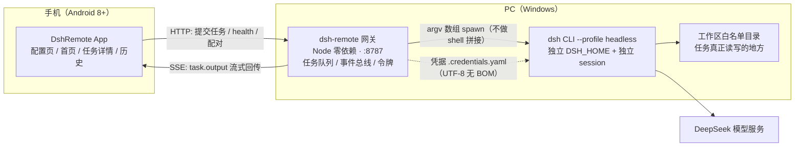

# DSH Remote —— 用手机远程指挥 PC 上的 DSH 干活

> 人在外面，也能把活儿交给家里那台开着 DSH 的 PC：手机发一句话，PC 上真实执行（读写文件、跑命令、改代码），
> 过程与结果通过 SSE 实时回到手机。**不需要公网 IP，不需要把桌面端暴露出去。**

| 项 | 值 |
|---|---|
| 组成 | PC 端零依赖 Node 网关（`tools/dsh-remote`）+ 原生 Android App（`android`，Kotlin + Compose）+ Windows 运维脚本（`scripts`） |
| 接口基线 | [API 契约 v1（冻结）](docs/01-设计/API契约.md)，`X-Api-Version: 1` |
| 默认端口 | 网关 `8787`（桌面端 Web GUI `127.0.0.1:19387` **不对外**，也不参与远程链路） |
| 实测环境 | Windows 11 + DSH 桌面端 `0.2.0-rc.2` + `dsh` CLI `0.1.0-rc.7`（`--profile headless`）+ Android 8.0+ |
| 运行目录 | `%USERPROFILE%\.dsh-remote`（凭据 / 配置 / 任务历史 / 日志，可用 `-Home` 覆盖） |

> **先读安全提示再看安装**：配对码只能在 PC 本机生成；外网访问必须走 Tailscale / frp+TLS / Cloudflare Tunnel 等 TLS 隧道；
> **禁止**把 `8787` 以裸端口映射到公网。详见[部署手册 §7](docs/05-运维/部署手册.md)。

---

## 1. 它是怎么跑的（一眼看懂）



- **网关**：零第三方依赖的 Node ESM 守护进程，负责任务队列（默认并发 2）、子进程执行、SSE 事件流、配对与令牌、白名单校验、日志滚动。
- **执行**：每个任务一个独立 `dsh` 子进程 + 独立 session，退出码 `0` = 成功，stdout 末段即结果。
- **手机**：OkHttp（SSE 长连接）+ `fromSeq` 断点续传 + 指数退避重连（1s→30s），终态落本地历史可离线查看。

---

## 2. 5 分钟快速开始

### 前置（PC）

| # | 要求 | 说明 |
|---|---|---|
| 1 | Windows 11 | Windows 10 21H2+ 未逐版本实测 |
| 2 | DSH 桌面端已安装并可正常使用 | 提供 `dsh` CLI 与 headless profile |
| 3 | PowerShell | Windows PowerShell 5.1（系统自带）或 PowerShell 7 均可；本仓库脚本两者都测过 |
| 4 | `DEEPSEEK_API_KEY` | 自行获取，**只写进运行目录，绝不入库** |

> 若提示「无法加载文件，因为在此系统上禁止运行脚本」，先临时放行（只影响当前窗口）：
> ```powershell
> Set-ExecutionPolicy -Scope Process -ExecutionPolicy Bypass
> ```
> 本机只装了系统自带的 Windows PowerShell 时，把下面所有 `pwsh` 换成 `powershell` 即可（脚本两种都支持）。

### PC 侧（3 步）

```powershell
# 1) 初始化：探测 DSH/node/CLI → 建运行目录 → 写凭据（UTF-8 无 BOM）→ 生成 config.json
#    不带参数时会交互式询问 API Key（不回显）；也可用 -ApiKey 或 -ApiKeyFile 导入
pwsh -File scripts/setup-pc.ps1

# 2) 后台启动网关（重复执行会提示「已在运行」，幂等）
pwsh -File scripts/start-gateway.ps1

# 3) 在 PC 本机生成 6 位配对码（5 分钟有效、一次性），并打印文本二维码
pwsh -File scripts/pair.ps1

# 可选：开机自启（登录时触发） + 放行专用网络入站端口
pwsh -File scripts/install-autostart.ps1 -AddFirewallRule
```

`setup-pc.ps1` 常用参数：

| 参数 | 作用 |
|---|---|
| `-Home <目录>` | 运行目录（默认 `%USERPROFILE%\.dsh-remote`）；测试时可用 `-Home .runtime\test-home` 避免污染 |
| `-ApiKeyFile <文件>` | 从已有凭据文件导入 Key（比 `-ApiKey` 更安全，不会进命令历史） |
| `-DshRoot <目录>` | DSH 安装目录（默认自动探测：环境变量 → 桌面端进程 → 常见路径 → 各固定磁盘） |
| `-Workspace <目录...>` | 工作区白名单（默认 `%USERPROFILE%\dsh-workspace`，会自动创建） |
| `-Port <端口>` | 网关端口（默认 `8787`） |
| `-Force` | 重写已存在的 `config.json` / 凭据（旧文件自动备份为 `<名字>.bak-<yyyyMMddHHmmss>`） |

### 手机侧（3 步）

| 步骤 | 操作 |
|---|---|
| 1 | 安装 APK：`android\app\build\outputs\apk\release\app-release.apk`（或 debug 变体）；需允许「安装未知来源应用」。产物大小与 `sha256` 用 `pwsh -File scripts/verify.ps1` 打印 |
| 2 | 打开 App → 配置页：服务器地址填 **PC 的内网地址**，如 `http://192.168.1.3:8787`（外网用隧道给的 `https://…`）；填 6 位配对码与设备名 → 点「配对」 |
| 3 | 首页输入任务（支持中文）→ 选工作区 → 提交；任务详情页可看实时输出、取消、复制全文 |

> 同网段连不上时：确认手机与 PC 在同一 Wi-Fi，并在**专用网络**放行端口：
> `New-NetFirewallRule -DisplayName "DSH Remote 8787" -Direction Inbound -Protocol TCP -LocalPort 8787 -Action Allow -Profile Private`
> （`install-autostart.ps1 -AddFirewallRule` 会自动做这一步，且幂等。）

### 装完自检（推荐）

```powershell
pwsh -File scripts/selftest.ps1        # 7 大类 9 项检查，PASS/FAIL 明细，失败退出码非 0
pwsh -File scripts/verify.ps1          # 交付验收报告表：APK 路径/大小/sha256 + 网关 + 配对 + 端到端任务
```

`selftest.ps1` 会**真的**提交一条任务（不是 mock）：让执行端在工作区写一个文件再回答 `DONE`，
并断言中文 `prompt` 往返逐字符一致、文件内容真实落盘。

---

## 3. 脚本清单（`scripts/`）

| 脚本 | 用途 | 关键参数 |
|---|---|---|
| `setup-pc.ps1` | PC 侧一键初始化（幂等，改动前自动备份） | `-Home` `-ApiKey` `-ApiKeyFile` `-DshRoot` `-Workspace` `-Port` `-Force` |
| `start-gateway.ps1` | 后台启动网关（WMI 分离启动，写 PID 文件，重复启动检测，等 health 就绪） | `-Home` `-Port` `-Node` `-ConfigPath` `-Foreground` `-WaitSeconds` |
| `stop-gateway.ps1` | 停止网关（结束进程树、校验端口释放；未运行时幂等） | `-Home` `-Port` `-Force` |
| `pair.ps1` | 本机生成配对码 + 文本二维码（自校验通过才打印） | `-Home` `-Port` `-HostAddress` `-NoQr` `-AsciiQr` `-Json` |
| `install-autostart.ps1` | 注册「登录时触发」计划任务实现开机自启（幂等可更新；**注册需要管理员权限**，未提权会明确报错并提示） | `-Home` `-TaskName` `-Port` `-PowerShellPath` `-StartNow` `-AddFirewallRule` `-DryRun` |
| `uninstall-autostart.ps1` | 卸载自启（不删任务历史与凭据） | `-TaskName` `-RemoveFirewallRule` `-StopGateway` |
| `selftest.ps1` | 一键自检：路径/凭据/健康/配对/真实任务，逐项 PASS/FAIL | `-Home` `-Port` `-BaseUrl` `-Workspace` `-SkipTask` `-Cleanup` `-ReportFile` |
| `verify.ps1` | 交付验收：APK sha256 + 网关 + 配对 + 端到端任务报告表 | `-ApkPath` `-Home` `-Port` `-SkipTask` `-ReportFile` |
| `_common.ps1` | 公共函数库（被点源加载，不单独运行） | 输出/探测/JSON/HTTP/配对/任务/进程助手 |
| `_qrcode.ps1` | 纯 PowerShell 二维码编码器（字节模式/纠错 L/版本 1~5） | `New-QrMatrix` `Format-QrText` `Test-QrSelfCheck` |
| `tests\qr-selftest.ps1` | 二维码回归自检：与 python-qrcode 金标准逐模块比对 | — |

所有脚本：`Set-StrictMode -Version Latest` + `$ErrorActionPreference='Stop'`；
路径一律 `Join-Path`，不硬编码用户名与盘符（默认值全部靠探测，参数可覆盖）；
同时兼容 Windows PowerShell 5.1 与 PowerShell 7。

> **`-Home` 的小坑（脚本已处理）**：PowerShell 里 `$HOME` 是只读自动变量，参数不能直接叫 `Home`。
> 脚本内部用 `[Alias('Home')]` 实现，命令行仍按文档写 `-Home` 即可。

---

## 4. 目录结构

```
dsh_android/
├─ README.md                 ← 本文件：项目入口
├─ scripts/                  ← Windows 安装/运维脚本（setup / start / stop / pair / autostart / selftest / verify）
│  ├─ _common.ps1            ← 公共函数库
│  ├─ _qrcode.ps1            ← 纯 PowerShell 二维码实现
│  └─ tests/                 ← 二维码回归自检 + 金标准矩阵（python-qrcode 生成）
├─ tools/dsh-remote/         ← PC 网关源码（Node ESM，零第三方依赖）
│  ├─ gateway.mjs            ← 入口：serve / pair / devices / workspaces
│  ├─ lib/                   ← config / http / tasks / runner / events / tokens / ratelimit / workspace
│  ├─ test/                  ← node:test 单元 + 集成测试
│  ├─ config.example.json    ← 配置模板（**键名以此为准**）
│  └─ README.md              ← 网关安装、配置、排障
├─ android/                  ← 手机客户端（Kotlin + Compose，Gradle 工程）
│  ├─ app/                   ← 源码与资源；产物 app/build/outputs/apk/{debug,release}/*.apk
│  └─ BUILD.md               ← 构建说明（工具链、命令、产物路径）
├─ docs/                     ← 需求 / 设计 / 开发规范 / 测试 / 验收 / 运维 / 变更记录（见 §7 索引）
├─ .toolchain/               ← 本机构建工具链（JDK17 / Android SDK / Gradle，不入库）
└─ .runtime/                 ← 本机运行数据：网关 home、任务、日志、验收证据（不入库）
```

运行目录（PC 侧数据，**不入库**）：

```
%USERPROFILE%\.dsh-remote\
├─ .credentials.yaml   ← 单行 DEEPSEEK_API_KEY: <key>，UTF-8 **无 BOM**（带 BOM 会导致 headless 启动失败）
├─ config.json         ← 端口 / 并发 / 超时 / 工作区白名单 / node 与 dsh 路径
├─ devices.json        ← 已配对设备（只存 sha256(令牌)，不存明文）
├─ tasks\*.json        ← 每个任务一份快照（原子写，重启后历史仍在）
├─ logs\gateway-YYYYMMDD.log   ← 按日滚动日志（含 sessionId 与耗时）
└─ gateway.pid.json    ← 网关 PID 记录（stop-gateway.ps1 用）
```

---

## 5. 配置要点

`config.json` **键名以 [config.example.json](tools/dsh-remote/config.example.json) 为准**，`setup-pc.ps1` 生成的文件与它同构：

| 键 | 默认 | 说明 |
|---|---|---|
| `host` / `port` | `0.0.0.0` / `8787` | 监听地址与端口（仅本机用可改 `127.0.0.1`） |
| `dshHome` | `%USERPROFILE%\.dsh-remote` | 凭据 + 任务 + 日志的根，同时作为子进程 `DSH_HOME` |
| `maxConcurrent` / `maxQueue` | `2` / `100` | 并发上限（超出排队）；队列满才返回 `429 busy` |
| `defaultTimeoutSec` / `maxTimeoutSec` | `3600` / `86400` | 单任务默认/最大超时 |
| `workspaceAllowlist` / `defaultWorkspace` | 由 `setup-pc.ps1` 写入 | 工作区白名单（含子目录）；**空数组 = 拒绝所有任务** |
| `dsh.node` / `dsh.binPath` / `dsh.profile` | 探测值 | node.exe 与 `bin.js` 绝对路径、headless profile |
| `limits.*` | 见模板 | 请求体/输出上限、配对码 TTL、限速阈值 |

安全红线：**API Key 只放 `.credentials.yaml`**（不写进 `config.json`、日志、脚本、README）；
日志与响应里令牌一律脱敏；网关侧只保存 `sha256(令牌)`。

---

## 6. 网络与依赖说明（本机实测约束）

| 项 | 说明 |
|---|---|
| `services.gradle.org` | **本机不可达**。Android 构建不要用它，改走可达镜像/已安装的 Gradle 发行版 |
| 可达源 | `dl.google.com`、`repo.huaweicloud.com`、`mirrors.cloud.tencent.com` |
| Node 依赖 | 网关零第三方依赖（只用 Node 内置模块），不需要 `npm install` |
| 手机与 PC 连通 | 同局域网直连（`http://<PC-IP>:8787`）；外网走 Tailscale / frp+TLS / Cloudflare Tunnel（详见部署手册 §7） |

---

## 7. 文档索引

| 文档 | 内容 |
|---|---|
| [docs/README.md](docs/README.md) | 文档总索引与阅读路径（用户 / 开发者 / 运维） |
| [需求规格说明书](docs/00-需求/需求规格说明书.md) | 干系人、用户故事、FR/NFR 编号、验收标准矩阵 |
| [API 契约 v1（冻结）](docs/01-设计/API契约.md) | 端点、字段、状态机、错误码、安全要求（**接口唯一依据**） |
| [概要设计](docs/01-设计/概要设计.md) | 上下文图、部署拓扑、时序图、数据模型、技术选型 |
| [开发规范](docs/02-开发/开发规范.md) | 分支/提交规范、代码风格、评审清单、安全编码红线 |
| [测试计划](docs/03-测试/测试计划.md) | 测试分层、环境矩阵、用例表、准出标准 |
| [验收报告](docs/04-验收/验收报告.md) | 验收结论与现场证据 |
| [部署手册](docs/05-运维/部署手册.md) | 安装、配置、自启、配对、内网/外网接入、故障排查表 |
| [变更记录](docs/06-项目管理/变更记录.md) | 版本 / 日期 / 变更内容 / 影响面 |
| [网关 README](tools/dsh-remote/README.md) | 网关安装、配置、CLI 子命令与排障 |
| [Android 构建说明](android/BUILD.md) | 工具链、构建命令、产物路径 |

---

## 8. 本次交付的实测证据

以下均为**真实执行**（Windows PowerShell 5.1；非模拟、非伪造）：

| 验证 | 命令 | 结果 |
|---|---|---|
| 一键自检 | `pwsh -File scripts/selftest.ps1` | **PASS=9 FAIL=0**：node/dsh 路径、凭据无 BOM、网关 health、配对链路、中文 prompt 往返（POST 响应 + 持久化两次逐字符相等）、端到端真实任务（`succeeded`/`exitCode=0`/文件内容 `OK-中文` 落盘），任务耗时约 3 秒 |
| 交付验收 | `pwsh -File scripts/verify.ps1` | **PASS=4 FAIL=0**：自动探测到 `android\app\build\outputs\apk\release\app-release.apk`（11.06 MiB，`sha256` 随每次构建变化，**以脚本实时输出为准**），网关 health、配对、端到端任务全通过 |
| 二维码回归 | `pwsh -File scripts/tests/qr-selftest.ps1` | **PASS=20 FAIL=0**：4 组用例（v2/v3/v4/v5 × 不同掩码）与 python-qrcode 金标准逐模块一致；固定掩码 v2~v5 × mask0~7 共 32 组差异 0；掩码惩罚值与参考实现完全相同 |

> 二维码说明：`pair.ps1` 打印的二维码是**辅助信息**，当前 App 按契约只支持手动输入 6 位配对码。
> 编码器已用独立参考实现（python-qrcode）逐模块验证，但**未做真机扫码实测**。

> 运行环境说明：上表实测均在 **Windows PowerShell 5.1.26100** 完成。本机未安装 PowerShell 7（GitHub 下载受限、
> 国内镜像不带该文件），因此 `pwsh` 侧未做真机执行；脚本刻意不使用任何 PS7-only 语法
> （无 `??`/`?.`/三元/`-AdditionalChildPath`/`ForEach-Object -Parallel`），且全部文件通过 5.1 解析器校验，
> 如你有 pwsh 7 环境，建议复跑 `scripts/tests/qr-selftest.ps1` 与 `scripts/selftest.ps1` 复核。

重新生成二维码金标准（需要 Python + `qrcode`）：

```powershell
pip install qrcode
# 按 scripts/tests/golden/cases.json 里的 payload/version/mask，用
# qrcode.QRCode(version=..., error_correction=ERROR_CORRECT_L, border=0, mask_pattern=...)
# + QRData(payload, mode=MODE_8BIT_BYTE) 生成同名文件即可
```

---

## 9. 常见问题速查

| 现象 | 处理 |
|---|---|
| 脚本无法运行（执行策略） | `Set-ExecutionPolicy -Scope Process -ExecutionPolicy Bypass` |
| 网关起不来，日志报 `the value for "version" … must be a string` | 凭据文件格式不对：必须是**单行旧格式 UTF-8 无 BOM** 的 `DEEPSEEK_API_KEY: sk-xxx`；重新跑 `setup-pc.ps1 -ApiKeyFile <好文件>` |
| 手机连不上 | 手机浏览器直接开 `http://<PC-IP>:8787/api/v1/health`；不通则查防火墙（仅放行专用网络）、IP 是否变化、网关是否在跑 |
| 配对报 `pairing_bad_code` / `pairing_closed` | 配对码 5 分钟一次性；先在 PC 重新 `pair.ps1` |
| 任务一直 `queued` | 并发已满（默认 2）；看 `health` 的 `activeTasks`/`queuedTasks`，等前序结束或调大 `maxConcurrent` |
| 提交返回 `400 bad_request` | `workspace` 不在白名单（含子目录）或不存在；或 `prompt` 为空 |
| 中文乱码 | 凭据与 `config.json` 用 UTF-8；**`.ps1` 脚本必须保存为 UTF-8 带 BOM**（Windows PowerShell 5.1 否则按 ANSI 解析）；脚本内所有 JSON 请求体都走 UTF-8 字节 |
| 提示找不到网关源码 | `tools/dsh-remote/gateway.mjs` 不存在时脚本会明确报错：先完成网关实现，或用 `-GatewayDir` 指向网关目录 |

更完整的排障表见[部署手册 §9](docs/05-运维/部署手册.md)。

---

## 10. 安全提示与免责声明

**安全提示**

1. 配对码**只在 PC 本机**生成（`pair/open` 仅接受 `127.0.0.1`/`::1`），不要截图外发。
2. 外网访问**必须**叠加 TLS（Tailscale / frp+TLS / Cloudflare Tunnel），**禁止**裸端口映射到公网。
3. 内网 `http://` 明文在**同一网络内可被嗅探**，仅限可信内网使用；App 仅信任系统默认证书链，不支持应用内安装自签 CA。
4. `workspaceAllowlist` 是**安全边界**：只放行你确实允许执行端读写的目录；空数组表示拒绝所有任务。
5. 令牌只以 `sha256` 形式存于 `devices.json`；丢手机请立刻用 `DELETE /api/v1/devices/{tokenId}` 吊销（或网关 CLI `devices revoke`）。
6. 不要把 `.credentials.yaml`、`devices.json` 放进共享目录或网盘；提交日志前脱敏（`sk-****`、`dshr_****`）。

**免责声明**

- 本项目是**单机自用**的远程执行工具：手机下发的任务会在你的 PC 上以你的账户权限真实执行（含文件写入与命令运行）。
  请自行确认下发内容，并为工作区配置最小权限目录。
- 交付的 APK 使用 **debug 签名**（自用安装包），**不可**公开发布或上架。
- 未经你自己环境实测的外部接入方式（Tailscale / frp / Cloudflare Tunnel 等）只提供思路，配置后果自负。
- 请遵守你所用模型服务的条款与当地法律法规。

---

## 11. 给维护者：几个已踩过的坑

| 坑 | 现象 | 结论 |
|---|---|---|
| `.ps1` 无 BOM | Windows PowerShell 5.1 按 ANSI/GBK 解析，中文注释直接变成语法错误 | **所有 `scripts/**/*.ps1` 必须保存为 UTF-8 with BOM**；改完用 `Parser::ParseFile` 复核 |
| `$HOME` 只读 | 参数或变量命名为 `Home` 会报「无法覆盖变量 Home」 | 用 `[Alias('Home')][string]$DshRemoteHome`，命令行仍可 `-Home` |
| `Invoke-RestMethod -Body <字符串>` | PowerShell 5.1 在中文区域按 ANSI/GBK 编码请求体，网关按 UTF-8 解码 → `???` | 统一用 `HttpWebRequest` + `[System.Text.Encoding]::UTF8.GetBytes()` 发送（`scripts/_common.ps1` 的 `Invoke-DshApi`） |
| `ConvertTo-Json` | 5.1 会把中文转义成 `\uXXXX`，生成的 `config.json` 不可读 | `_common.ps1` 内置了自己的 JSON 序列化器，两种 PowerShell 输出一致且中文可读 |
| `Start-Process` 启后台 | 子进程继承宿主句柄/作业对象，CI 或 Agent 里会一直等到网关退出才返回 | 改用 WMI `Win32_Process.Create` 分离启动（cmd 负责重定向日志），失败时回退 `Start-Process` |
| 中文对齐 | 中文占 2 列，`PadRight` 会错位 | `Write-Kv` 按显示宽度对齐（`Get-DisplayWidth`） |
| 二维码自校验 | 只看「余式为 0」会自洽却错（生成多项式表示法反了也能过） | 必须与独立参考实现逐模块比对（`scripts/tests/qr-selftest.ps1`） |

自测命令（改完脚本请都跑一遍）：

```powershell
pwsh -File scripts/tests/qr-selftest.ps1                     # 二维码回归
pwsh -File scripts/setup-pc.ps1 -Home .runtime\test-home -ApiKeyFile <凭据文件> -Workspace .runtime\test-home\ws
pwsh -File scripts/start-gateway.ps1 -Home .runtime\test-home -Port 18787
pwsh -File scripts/selftest.ps1      -Home .runtime\test-home -Port 18787
pwsh -File scripts/verify.ps1        -Home .runtime\test-home -Port 18787
pwsh -File scripts/stop-gateway.ps1  -Home .runtime\test-home
```
