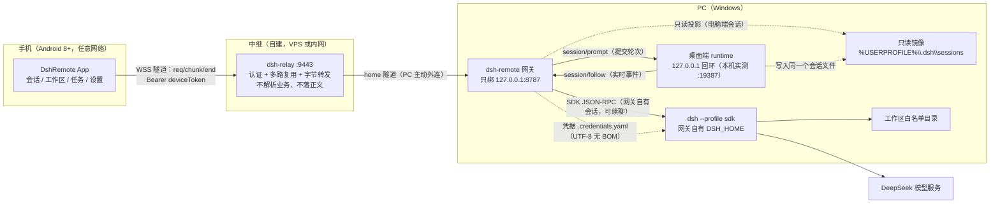

# DSH Remote —— 用手机远程指挥 PC 上的 DSH 干活

> 人在外面，也能看住家里那台开着 DSH 的 PC：手机浏览电脑端会话、翻工作区文件、新建任务并**接着聊**，
> PC 上真实执行（读写文件、跑命令、改代码），过程与结果实时回到手机。
> **v2 起手机在任意网络都可用**：手机与 PC 都只主动连你自建的**中继**，PC **不开任何入站端口、手机不直连 PC**。

| 项 | 值 |
|---|---|
| 组成 | 中继 `tools/dsh-relay`（零依赖，默认 `0.0.0.0:9443`）+ PC 网关 `tools/dsh-remote`（零依赖，**只绑 `127.0.0.1:8787`**）+ 原生 Android App（`android`，Kotlin + Compose）+ Windows 运维脚本（`scripts`） |
| 接口基线 | [协议契约 v2](docs/01-设计/协议契约-v2.md)（`X-Api-Version: 2`）；[API 契约 v1（冻结）](docs/01-设计/API契约.md) 的端点**全部保留**，网关 `supportedApiVersions:[1,2]` |
| 默认端口 | 中继 `9443`；网关 `8787`（**只监听回环**，绝不对外）；桌面端 runtime **0.2.0 起由系统分配随机回环端口**（旧版为 `19387`；v2.11.0 起网关自动发现并用 `~/.dsh` 的 browser-session 凭据探测，见[契约 §7.4](docs/01-设计/协议契约-v2.md)），**不对外开放** |
| 执行引擎 | 网关自有会话：`DSH_HOME` 下的 `dsh --profile sdk`（长驻 JSON-RPC 子进程，支持同会话续聊）；**电脑端会话：桌面端 runtime 通道（`127.0.0.1` 回环，提交 `session/prompt` 由电脑端真实执行）**；**手机新建的任务自 v2.5.0 起默认也落电脑端**（`POST /api/v2/tasks` 的可选字段 `host`，传 `"gateway"` 可显式落回网关自有 home）；镜像只读 `%USERPROFILE%\.dsh` |
| 实测环境 | Windows 11 + DSH 桌面端 `0.2.0-rc.2` + Android 8.0+（各组件当前版本见[协议契约 v2](docs/01-设计/协议契约-v2.md) 与 `tools/*/lib/config.mjs`，本文不再转抄） |
| 运行目录 | 网关 `%USERPROFILE%\.dsh-remote`；中继默认 `.runtime\relay-home`（均可用 `-Home` 覆盖） |

> **先读安全提示再看安装**：网关只绑 `127.0.0.1`；**禁止**把 `8787` 以裸端口映射到公网；
> 公网中继必须 `wss://` + TLS，并设置非空 `relaySecret`。详见[中继部署手册](docs/05-运维/中继部署手册.md)与[部署手册 §13](docs/05-运维/部署手册.md)。

---

## 1. 它是怎么跑的（一眼看懂）



- **中继**：唯一有公网入站口的角色；只做「认证 + 多路复用 + 字节转发」，不解析会话内容、不落盘消息正文。
- **网关**：零第三方依赖 Node ESM，负责 v2 路由（会话镜像/工作区/续聊/SSE）、relay 出站长连接、白名单与令牌；**只监听回环**。
- **执行**：网关自有会话由 `DSH_HOME` 下的 `dsh --profile sdk` 长驻子进程服务（同会话可续聊）；
  **电脑端会话由电脑端自己执行**——网关经回环通道提交轮次（`session/prompt`）并订阅事件（`session/follow`），
  手机与电脑看到同一条时间线。该通道不可用时（桌面端未运行 / DSH 升级改了未公开协议）**自动回退**：
  电脑端会话退回只读镜像，`writable:false`，网关自有会话能力不受影响。详见[协议契约 v2 §7.4](docs/01-设计/协议契约-v2.md)
  与[网关 README §6.7](tools/dsh-remote/README.md)。
- **手机**：WS 隧道 + 多路复用 + SSE 增量 + 指数退避重连（1s→30s）+ 离线缓存。
- **对话内图片（v2.9.0）**：电脑端会话里出现的图片（用户贴的图、`read_image` 这类工具的产物、截图）
  在手机上**内联渲染**成缩略图带（1 张铺满、2~4 张方格），点开是全屏查看器（左右滑动切换、显示
  `1400×1000 · 32 KB · png`）。网关侧新增 `GET /api/v2/attachments/{id}`（内容哈希寻址、魔数嗅探
  `Content-Type`、8 MiB 上限、Bearer 保护）+ 转录投影 `images[]`；**base64 绝不进转录/SSE**——
  只传引用，字节按需拉取并做内存 + 磁盘两级缓存（`filesDir/attachments/`）。
- **轮次导航（v2.9.0）**：对话页顶栏的「轮次导航」（桌面端是 hover 浮层，手机换成底部面板）列出每一轮
  的用户话 + 助手回复预览与读数（`16:25:07 · 2 步 · 1 次工具 · 3 条`）；点一轮就滚到那里并**整轮高亮**，
  窗口里没有的轮次才走一次 `GET /transcript?cursor=<toIndex>`（**已在窗口内就不重新取页**，免得把用户
  翻出来的历史丢掉）。轮号以服务端 `turn` 为准：**同一会话里轮号可以有空洞**（实测 1/3/4/5），
  所以"当前"标的是最大轮号而不是轮数。
- **新建任务即对话（v2.10.0）**：点「新建任务」不再弹对话框，而是进一整屏**草稿对话**——工作区、
  「在哪执行 · 权限」、模型三段都在这一屏里选，底下就是和对话页同一个输入胶囊（`ComposerCapsule`）；
  第一句话按发送才建任务，建好**直接进那个会话**。两处刻意的不装样子：① 权限档当初只在「仅在手机上执行」
  时可选（**v2.11.0 已改**：电脑端执行也能在创建时选，见下一条）；② 模型来自
  `GET /api/v2/models`（桌面端模型目录直通；拿不到就降级成 `source:"config"` + 一条 `failures`
  说明原因，**绝不 5xx**，手机端也就整块不画选择器）。选了模型就经 `session/selectModel` 在**首轮投递前**
  落到电脑端那一轮，没生效不判任务失败，而是横幅告知原因并让你决定是否仍然进入。
- **v2.11.0：工作区同步 + 对话内改权限（用户报的两件事）**：
  **① 电脑端新建的工作区手机看不到** —— 有两个根因，都修了：
  **(a)** 网关的 `GET /api/v2/workspaces` 过去只回 `config.workspaceAllowlist`，电脑端实际登记在
  `<desktopHome>/storages/workspace.json`。现在网关定时（`desktopWorkspaces.pollMs`，默认 5s）读这份
  **权威持久化**，把电脑端工作区合并进有效白名单并随列表下发 `title`/`source:"desktop"`/`sessionCount`；
  电脑上删除后手机端下一次列表/文件请求立即失去访问权。不扫描磁盘、不依赖桌面端 RPC，桌面端离线也能同步。
  **(b)** 真正的"连不上"根因：桌面端 0.2.0 起用 `--port 0` **随机端口**，而网关写死 19387，
  于是审批桥、电脑端会话、工作区标题全部静默。现在 `lib/desktop-discovery.mjs` + `DesktopApi.ensurePort()`
  会从「命令行含 `dsh-desktop-host/lib/index.js` 的进程」的监听表里发现候选端口，再用 `~/.dsh` 的
  browser-session 自签 cookie 逐端口探测；配置的 `desktop.port` 只作第一顺位提示，`autoDiscover` 默认开。
  **② 想要「全部权限」只能开「仅在手机上执行」** —— 现在两条路都通：
  - **新建任务**：两种 host 都能选「全部权限」；电脑端执行时网关在**首轮投递前**让桌面端执行
    `/permission danger-full-access`（顺序有单测钉住），失败是软失败（`permissionApplied:false` +
    `permissionWarning`，任务照跑但横幅要求确认，绝不把没生效说成生效）；
  - **对话里**：输入区上方那行权限说明变成「改权限」入口（也可从「…」菜单进），底部面板列
    `只读 / 仅工作区 / 全部权限`，改完经 `POST /api/v2/sessions/{id}/permission` → 桌面端
    `/permission <preset>` → 回读 `permissions` 投影确认；**全部权限带二次风险确认**（与桌面端同款）。
    权限是会话级事实（写进该会话日志），电脑端同一会话立即看到；网关自有 SDK 会话明确显示"创建时固定、
    不可运行中改"（没有 setter，不画假开关）。契约 §7.9，能力位 `session.permission` / `workspaces.desktopSync`。
  **证据**：网关 node 套件 **321 / 321 通过**（新增权限 6 例、工作区同步 3 例、端口发现 5 例）；
  Android JVM 单测 **694 / 0 失败 / 1 跳过**；临时真实 DSH Web runtime 端到端验证
  `danger-full-access → read-only → danger-full-access` 返回 `verified:true`；真实桌面端（随机端口 55941）
  只读探针确认 5 个电脑端工作区（含 `D:\Workspace\养一只哦鲸鲸`）与各会话当前权限档都正确下发。
- **Markdown 渲染（v2.2.0）**：助手回复按 Markdown 渲染（标题 / 列表与任务项 / 表格 / 引用 / 代码块可复制 / 链接可点），
  工作区里的 `.md` 文件**默认预览、一键切回源码**；解析器是**自研纯 Kotlin**（零第三方依赖），无语法文本逐字符不变。
- **对话 / 轨迹分页（v2.3.0）**：长会话不再一次性塞进单页 —— 首屏只取**最新一页 60 条**，上拉到顶自动取**更早一页**
  （契约 §4.2.1 的 `limit` + `cursor`），本地只保留**有界窗口**（上限 600 条）；标题栏显示「已加载 X/Y 条」，
  到最早时显示「已到最早」。顶部新增**「轨迹」视图**：把同一条会话摊平成"一步一行"（工具调用 / 结果 / 交付物 / 待办各自一行），
  与「对话」视图**同源同窗口、切换不重新拉取**；离开底部后右下角出现「回到最新」，上拉取更早时**不会**被自动贴底拽回。
- **掉线可见**：PC 掉线立刻推 `notice{home_offline}`，请求返回 503（不是无限转圈）；中继重启后自动重连。
- **双向同步（电脑端会话可续聊）**：手机在**电脑端会话**里发的消息由**电脑端 runtime 真实执行**
  （回环 `session/prompt` + `session/follow`，本机实测端口 `19387`），电脑端 UI 与手机**看到同一条时间线**；
  列表/详情新增 `driver`（`desktop`/`gateway`）与放宽后的 `writable` 语义。
  > **落地状态（2026-10-14 复核 + 端到端实测）**：契约与实测证据见[协议契约 v2 §7.4/§7.5](docs/01-设计/协议契约-v2.md)；
  > 网关侧适配层 `tools/dsh-remote/lib/desktop-api.mjs` 与接线**已交付**（`desktop.enabled` 可关闭），
  > `driver` 取值与下发已按契约对齐（四处同一套取值），端到端实测一轮跑通，见[网关 README §6.7](tools/dsh-remote/README.md)
  > 与契约 §7.5 的「实现侧对齐状态」表。
- **手机新建任务默认落电脑端（v2.5.0）**：手机上新建的活**原生**建在电脑端 DSH 的工作区里 ——
  电脑端打开就是**同一个会话**，不是接力、不是复制历史。`POST /api/v2/tasks` 新增可选字段 `host`
  （`"desktop"`/`"gateway"`，缺省＝桌面端通道可用时落电脑端），列表/详情新增 `createdBy` 回答「谁发起的」
  （与 `source`「数据长在谁家」、`driver`「现在谁在驱动」各说各的事）。契约与逐字错误码见
  [协议契约 v2 §7.6](docs/01-设计/协议契约-v2.md)，排障见[网关 README §6.8](tools/dsh-remote/README.md)。
  两条如实限制：`host:"desktop"` 时 `access` 档位**不生效**（权限是电脑端 DSH 进程自己的，全局而非每会话）；
  电脑端会话触发**审批**时手机端原为**无法应答**（U16，该轮会挂住直到有人在电脑端批准）——
  **v2.6.0 起已可直接应答，见下一条**。
- **手机可直接应答电脑端审批与提问（v2.6.0）**：电脑端那一轮**卡在审批上**时，手机可以直接放行或拒绝，
  不用回电脑前。审批/提问是"向所有监听者提问"的可应答 waterfall（不是新增 RPC 方法）：网关保持一条
  **常驻订阅**，把未决项摊成 `GET /api/v2/approvals`，答案走 `POST /api/v2/approvals/{eventId}`，
  并广播 `approval.asked` / `approval.decided` / `approval.expired` 三个事件。审批四档
  （`allowed-once` / `rejected` / `cancelled` / `unavailable`）；提问答案支持多选与自由文本
  （字段名是 `custom`，`selected` **必须是数组**）。契约与逐字错误码见
  [协议契约 v2 §7.7](docs/01-设计/协议契约-v2.md)、网关排障见[网关 README](tools/dsh-remote/README.md)。
  **四条如实限制**：①**没有重放**——订阅必须先于提问，错过的（已决定的）不补；
  ②**没有超时**——TTL 15 分钟到期只是网关侧记账，电脑端那一轮**仍然挂着**，手机端不得显示"已自动拒绝"；
  ③**先到先得**——电脑端 UI 自己也是应答者，第一个答案生效，后到的既无错误也改不了结果，也没有"总是允许"；
  ④**只管电脑端 runtime 里的会话**（`source:"computer"`），网关自己用 `dsh --profile sdk` 起的会话
  **不在**这条流上。
- **v2.7.0：把上面这些能力在真机上"真正能用"**（用户报的五件事，**没有新功能**）：
  **① 工具调用不再刷屏** —— 折叠态每张工具卡只剩 1 行（删掉结果预览行），一条助手消息里**连续成功**的调用
  合并成一行汇总（`6 次工具调用 · edit×4 · pwsh×2 · 全部成功 · 5.0s`），点开才铺各卡；
  `isError` 的调用**不进组、始终单独成卡**（错误永不因折叠而看不见）。
  **② 工作区"路径越界"误拒修掉** —— 手机端 5 个工作区端点以前**只发绝对 `path`、从不发 `workspace=`**，
  网关于是按 `defaultWorkspace` 解释，导致选中的其它白名单工作区一律 `403 路径越界（不在工作区内）`；
  现在客户端显式带 `?workspace=`（白名单**最长匹配**），网关也在缺 `workspace` 时按绝对 `path` **反推**
  （**旧客户端不升级也能用**，见[契约 §4.3](docs/01-设计/协议契约-v2.md)）。顺带修掉 Windows **目录联接（junction）**
  点一下报「不是文件：…\node_modules」（原来 junction 被当成符号链接文件）与面包屑「工作区根」被判越界。
  **③ 崩溃可观测** —— 全局兜底 `data/CrashReporter.kt`（**先落盘再调用旧 handler**，落 `filesDir/crashes/`，
  ≤10 份轮转、整份过脱敏）、应用级 `CoroutineExceptionHandler`、设置页「崩溃记录」、`scripts/collect-crash.ps1` 一键取证；
  另修 8 处代码级隐患（中继畸形地址崩进程、LazyColumn key 撞车、UTF-8 分片解码、`callbackFlow` 缓冲 64 **静默丢帧**等）。
  **④ 手机能看见并回答 ask/审批** —— 根因**不是代码而是真机网关进程里跑着旧代码**（`/api/v2/health` 的 capabilities
  没有 `approvals`、`/api/v2/approvals` 404），部署新代码后真机可用。
  **⑤ 子智能体会话不再平铺** —— 真机 145 条里 **109 条**是子代理/派生，服务端默认只回顶层
  （`origin` 缺失时**绝不**默认成 `user`），chip「含子代理」可展开并标注父会话。
  证据：Android JVM 单测 **489 / 0 失败 / 1 跳过（44 个测试类）**、网关 node 套件全绿，
  真机端到端截图 16 张（`android/evidence/v2.7.0/shots/`）；详见[验收报告 §15](docs/04-验收/验收报告.md)
  与[变更记录 §15](docs/06-项目管理/变更记录.md)。
- **网关 2.2.0（APK 2.7.2，手机端零改动）：电脑端发起的轮次现在会实时同步到手机**（用户报的
  「答完 ask 之后这条对话就再也不往下更新」）。两个**互相独立**的根因，都是网关侧：
  **① 电脑端自己发起的轮次从未进过会话总线** —— 网关的总线过去只覆盖"手机经 `POST /turns` 投递的轮次"，
  用户在电脑端 DSH 里直接发起的轮次（`source:"computer"`）一个事件都不广播，手机端只能靠进页面时的
  整份转录（所以"能看见旧内容、再也不会长"）。现在新增常驻中继 `lib/desktop-watch.mjs`：每 `desktopWatch.pollMs`
  轮询桌面端运行态，发现 `running` 的会话就 `session/follow` 订阅并按 `translateDesktopEvent` 把帧发进总线
  （`turn.started` → `message.delta`/`tool.call`/`tool.result` → `turn.ended`，带 `source:"computer"`+`relayed:true`），
  与手机端直连桌面端那条流**互斥**（`http.mjs` 的 `desktopSse` 探针在场时中继让位，避免同一条会话两份帧）。
  开关与体检口径：`config.desktopWatch`（`enabled`/`pollMs`/`streamTimeoutMs`/`attachTimeoutMs`），
  健康检查新增能力位 `session.desktopRelay`，`/api/v2/health` 的 `sessionRunner` 里有 `relays`/`attaches`/`attachesFailed`。
  配置模板 `tools/dsh-remote/config.example.json` 已补 `desktopWatch` 块（含各项合法区间）；本轮的版本号也一并收口——
  生产 `C:\Users\Administrator\.dsh-remote\config.json`、`scripts/start-live-env.ps1`、`config.example.json` 里的
  `gatewayVersion` 全部由 `2.1.0` 改为 `2.2.0`（与 `lib/config.mjs` 的 `GATEWAY_VERSION` 一致；改前备份
  `config.json.bak-20261015-gwv220`）。⚠️ 版本号改动只在**下次重启**后才反映到 `/api/v2/health`。
  **② 网关重启后客户端会带着"上一个进程的游标"重连，被永久静音** —— 总线 `seq` 是**进程内**计数器，
  重启即从 1 重开；而客户端把游标持久化在本地（Android `ConsoleRepository.busCursor` → `PrefsStore`），
  重连时照发旧值。旧实现把订阅的 `afterSeq` 直接设成这个来自未来的值，`publish()` 的 `ev.seq <= sub.afterSeq`
  于是**吞掉之后所有事件**：连接在线、心跳正常、界面一个字都不动（生产网关实测复现，且真机 0.35 秒就带着
  `fromSeq=283` 重连上来）。现在 `lib/events.mjs` 的 `subscribe()` 识别 `fromSeq > this.seq` 为跨进程游标，
  收敛到当前最大 `seq` 并置 `epochReset`（不假装能补齐——那些事件在别的进程里），HTTP 层落一条 warn 留痕。
  **证据**：网关 node 套件 **251 / 251 通过**（含新增单测「来自未来的游标不静默饿死」）；
  `.probe/relay-live-e2e.mjs`（进程内总线，真桌面端跑满一轮 `turn=4 … text=23813 字 工具调用=18 次`，98 帧、verdict PASS）、
  `.probe/relay-sse-e2e.mjs`（**手机端那条 HTTP/SSE 地址** `/api/v2/sessions/stream`，一条流覆盖两端会话）；
  真机（PGT-AN00）用户确认「已经在实时更新」。网关待办见变更记录 §17。

- **v2.9.0：手机端"看得见图、回得到轮"**（用户报的三件事）：
  **① 对话里的图片以前只有一个 `[图片] alt url` 占位** —— 根因是网关**根本不知道附件对象库存在**
  （`lib/` 里 `attachment` 一度零命中）。现在 `lib/attachments.mjs` 按内容哈希在
  `<home>/attachments/<ver>/objects/<前 2 位>/<64 位>` 里解析对象、用**魔数**嗅探类型（对象文件无扩展名），
  `GET /api/v2/attachments/{id}` 回原始字节（`Cache-Control: private, max-age=31536000, immutable`、
  超 8 MiB 走 `413 attachment_too_large`、不在 `PUBLIC_ROUTES`）；转录投影新增 `images[]`
  （`user/message`、`assistant/message`、`toolCalls[].images` 三处，无图时**整个字段不出现**）。
  手机端用 OkHttp 拉字节 + `BitmapFactory(inSampleSize)` 解码，失败可重试（负结果不缓存）。
  **② 没有"跳到某一轮"的入口** —— 新增 `GET /api/v2/sessions/{id}/turn-index`（能力位 `session.turnIndex`），
  客户端据此画底部面板；`[fromIndex,toIndex)` 与 `/transcript` **同一套投影**，`cursor=<toIndex>` 正好取到
  "以该轮结尾"的一页（这条不变量有交叉验证用例钉住）。`user/message` 同时补上 `turn` 戳。
  **③ 会话列表的状态语言重做** —— 删掉恒真的「可续聊」胶囊（对多数行都成立 ⇒ 徽标通货膨胀，
  用户最后会全部忽略），改成**只在值得说时出现**：`运行中`（绿点，且离线快照时**不显示**，
  免得把缓存里的旧状态说成现在）、`只读`（灰锁，点一下说明原因；原因优先转述服务端
  `writableReason` / `lastTurn` 的原话，服务端没给才按 `source` 兜底）、
  手机发起的会话一个极轻的「手机」标记；普通可写会话**什么都不画**。行版式改为
  `标题 / 最后: … / 工作区 · N 轮 · N 个文件 / 时间` 四层 84dp。
  **证据**：网关 node 套件 **296 / 296 通过**（新增 `attachments.test.mjs` 22 例、`turn-index.test.mjs` 9 例）；
  Android JVM 单测 **664 / 0 失败 / 1 跳过**（57 个测试类）；真机（模拟器 1080×2340）截图见
  `android/evidence/v290/`（列表新状态、单图/多图内联、全屏查看器 1/2 与 2/2、轮次面板、跳转高亮）；
  夹具 UI 回归 `android/evidence/v2/run-ui-check.ps1` 从 **42 / 82 修到 76 / 76 全绿**（脚本本身的老化断言同步校正，见变更记录 §19.7）。
  真机上还改掉两个只有跑起来才看得见的问题：面板的「当前」原本拿**轮数**当轮号
  （真会话的轮号有空洞，1/3/4/5 ⇒ 把第 4 轮标成了当前），以及预览直接露原始 Markdown
  （`- **头部**：…`、`|---|---|`）——现在走 `turnPreviewText()` 做纯文本投影并吃掉表格残留。
  另外顺手修掉一个 v2.8.0 遗留的闪退：进 `工作区 → 改动` 会让**整个进程**消失——预览卡把 `DiffView`
  （本身就是 LazyColumn）塞进外层 LazyColumn 的 `item {}` 里，内层量到无界高度直接抛
  `IllegalStateException: Vertically scrollable component was measured with an infinity maximum
  height constraints`（设备上留了 3 份 `files/crashes/crash-*.txt`）。现在预览卡是普通 `Column` +
  `DiffLineText`，回归守卫钉在 `android/evidence/v2/run-ui-check.ps1`（改动页断言 `@@`）。
  ⚠️ 两个如实提醒：网关版本号改动**只在重启后**才反映到 `/api/v2/health`；
  离线打开旧缓存会看不到图片链——本地缓存序列化已在 v2.9.0 一并修好（此前 `messagesToJson`
  漏写 `images`/`turn`，只有离线才复现）。
- **多合一控制台：桌面一个入口跑完全部运维动作（2026-10-16）**：双击桌面上的 `启动DSH远程.cmd`
  就出菜单——8 项（启动 / 停止 / 重启 / 状态 / 生成配对码 / 看门狗 / 开机自启 / 看日志）
  背后是 `scripts/dsh-remote-desktop.ps1`，把过去要记住的 8 个脚本名收成一个入口；
  引导层刻意写成 **ASCII-only**（cmd.exe 按 OEM 代码页读批处理，写中文会乱码），并探测 `pwsh`、
  取不到就回退系统自带的 PowerShell 5.1。本轮自测暴露并修掉四个真实缺陷：
  **D-23** 调用方一捕获输出，`$LASTEXITCODE` 就变成字符串 ⇒ 幂等启动被误判成失败（改 `Start-Process -PassThru` 读 `ExitCode` 属性）；
  **D-24** 脚本写成无 BOM 的 UTF-8 ⇒ PowerShell 5.1 按 ANSI 解码中文，一行都跑不了；
  **D-25** 看门狗是孙进程且继承调用方 stdout 句柄 ⇒ 输出被重定向时 `-Start` 永不返回；
  **D-26**（用户真机反馈）`Start-Process` 默认给子脚本**新开一个控制台窗口** ⇒ 菜单 5「生成配对码」
  只回来父脚本那句提示，6 位码与二维码全在那个随即消失的窗口里（改默认 `-NoNewWindow`，
  只给常驻看门狗留 `-SeparateConsole`）。契约 / 网关 / 中继 / APK **零改动**，详见
  [变更记录 §21](docs/06-项目管理/变更记录.md)与[部署手册 §4.0](docs/05-运维/部署手册.md)。

---

## 2. 5 分钟快速开始

### 前置（PC）

| # | 要求 | 说明 |
|---|---|---|
| 1 | Windows 11 | Windows 10 21H2+ 未逐版本实测 |
| 2 | DSH 桌面端已安装并**正在运行** | 手机任务的默认执行者是**桌面端 DSH runtime**（回环 `127.0.0.1:19387`）；同时提供 `dsh` CLI（`--profile sdk`，仅「仅在手机上执行」时用）。桌面端没运行时手机任务自动回落为网关自有会话（`source:"phone"`） |
| 3 | PowerShell | Windows PowerShell 5.1（系统自带）或 PowerShell 7 均可；本仓库脚本两者都测过 |
| 4 | `DEEPSEEK_API_KEY` | 自行获取，**只写进运行目录，绝不入库** |

> 若提示「无法加载文件，因为在此系统上禁止运行脚本」，先临时放行（只影响当前窗口）：
> ```powershell
> Set-ExecutionPolicy -Scope Process -ExecutionPolicy Bypass
> ```
> 本机只装了系统自带的 Windows PowerShell 时，把下面所有 `pwsh` 换成 `powershell` 即可（脚本两种都支持）。

### 桌面单入口（推荐；不想记脚本名就用这个）

双击桌面上的 `启动DSH远程.cmd` 即出菜单（引导层只负责探测 `pwsh` / 回退 5.1 并把参数转发给本体）。
也可以直接跑本体，`-NoPause` 供脚本与自动化调用：

```powershell
pwsh -File scripts/dsh-remote-desktop.ps1                  # 交互菜单（8 项）
pwsh -File scripts/dsh-remote-desktop.ps1 -Status -NoPause # 只读体检：网关 / 中继隧道 / 看门狗
pwsh -File scripts/dsh-remote-desktop.ps1 -Start  -NoPause # 幂等启动（含看门狗）
pwsh -File scripts/dsh-remote-desktop.ps1 -Pair   -NoPause # 生成 6 位配对码 + 二维码
pwsh -File scripts/dsh-remote-desktop.ps1 -Stop   -NoPause # 停网关与看门狗
```

> 已知取舍（不改代码、只记用法）：拉起常驻看门狗时保留了 `-WindowStyle Hidden`（不弹黑窗），
> 代价是看门狗继承调用方的 stdout 句柄——**把 `-Start` 的输出接管道/重定向会一直不返回**
> （子进程还活着，管道就不 EOF）。机器可读的配对码请直接调 `relay-pair.ps1 -Json`。

### PC 侧（4 步）

```powershell
# 1) 初始化：探测 DSH/node/CLI（含 v2 的 dsh.launcher）→ 建运行目录 → 写凭据 → 生成 config.json
#    不带参数时会交互式询问 API Key（不回显）；也可用 -ApiKey 或 -ApiKeyFile 导入
pwsh -File scripts/setup-pc.ps1

# 2) 起一个中继（本机验证用；公网 VPS 见 docs/05-运维/中继部署手册.md §4）
pwsh -File scripts/setup-relay.ps1 -Home ".runtime\relay-home" -Port 9443 -TlsMode off -PublicUrl "ws://127.0.0.1:9443"
pwsh -File scripts/start-relay.ps1 -Home ".runtime\relay-home"

# 3) 后台启动网关（重复执行会提示「已在运行」，幂等）
pwsh -File scripts/start-gateway.ps1

# 4) 在 PC 本机生成 6 位配对码（同时在中继上打开配对窗口），并打印中继隧道地址 + 文本二维码
pwsh -File scripts/relay-pair.ps1

# 可选：开机自启（登录时触发） + 放行专用网络入站端口
pwsh -File scripts/install-autostart.ps1 -AddFirewallRule          # 需管理员
pwsh -File scripts/install-autostart.ps1 -StartupFolder            # 免管理员（Startup 启动器，附带看门狗）

# 可选：网关看门狗（进程中途死掉也能自愈；常驻，默认 60 秒体检一次）
pwsh -File scripts/watchdog-gateway.ps1 -IntervalSeconds 120 -Quiet
pwsh -File scripts/watchdog-gateway.ps1 -Stop                      # 停看门狗（不动网关）
```

> v1 兼容：如果只想同局域网使用，第 2 步可以跳过，用 `scripts/pair.ps1` 生成配对码、手机直连 `http://<PC内网IP>:8787`。

`setup-pc.ps1` 常用参数：

| 参数 | 作用 |
|---|---|
| `-Home <目录>` | 运行目录（默认 `%USERPROFILE%\.dsh-remote`）；测试时可用 `-Home .runtime\test-home` 避免污染 |
| `-ApiKeyFile <文件>` | 从已有凭据文件导入 Key（比 `-ApiKey` 更安全，不会进命令历史） |
| `-DshRoot <目录>` | DSH 安装目录（默认自动探测：环境变量 → 桌面端进程 → 常见路径 → 各固定磁盘） |
| `-Workspace <目录...>` | 工作区白名单（默认 `%USERPROFILE%\dsh-workspace`，会自动创建） |
| `-Port <端口>` | 网关端口（默认 `8787`） |
| `-Force` | 重写已存在的 `config.json` / 凭据（旧文件自动备份为 `<名字>.bak-<yyyyMMddHHmmss>`） |

### 手机侧（3 步，v2 经中继）

| 步骤 | 操作 |
|---|---|
| 1 | 安装 APK：`android\app\build\outputs\apk\release\app-release.apk`（或 debug 变体）；需允许「安装未知来源应用」。产物大小与 `sha256` 用 `pwsh -File scripts/verify.ps1` 打印 |
| 2 | 打开 App → 设置页：**中继地址**填 `relay-pair.ps1` 打印的那个地址（本机验证 `ws://127.0.0.1:9443`；**Android 模拟器填 `ws://10.0.2.2:9443`**；公网填 `wss://<域名>`）；填 6 位配对码与设备名 → 点「配对」 |
| 3 | 「会话」页看电脑端会话与手机任务；「工作区」页浏览文件与 git 改动；在会话里输入即可续聊（手机任务）；设置页可吊销令牌与导出日志 |

> **手机连的是中继，不是 PC**。若手机提示「无法解析主机 / 一直连接中断」，
> 九成是中继配置里的 `publicUrl` 不是**手机可达**的地址 —— 见[中继部署手册 §2 地址表](docs/05-运维/中继部署手册.md)。
> v1 兼容形态：手机填 `http://<PC内网IP>:8787` 直连（需与 PC 同局域网，并在**专用网络**放行端口）。

### 装完自检（推荐）

```powershell
pwsh -File scripts/selftest.ps1        # 7 大类 9 项检查，PASS/FAIL 明细，失败退出码非 0
pwsh -File scripts/verify.ps1          # 交付验收报告表：APK 路径/大小/sha256 + 网关 + 配对 + 端到端任务
```

`selftest.ps1` 会**真的**提交一条任务（不是 mock）：让执行端在工作区写一个文件再回答 `DONE`，
并断言中文 `prompt` 往返逐字符一致、文件内容真实落盘。

---

## 3. 脚本清单（`scripts/`）

| 脚本 | 用途 | 关键参数 |
|---|---|---|
| `dsh-remote-desktop.ps1` | **多合一控制台（推荐入口）**：菜单 8 项包住下面的启动/停止/重启/状态/配对/看门狗/自启/日志；子脚本默认 `-NoNewWindow` 共用本控制台（只有常驻看门狗走 `-SeparateConsole`） | `-Start` `-Stop` `-Restart` `-Status` `-Pair` `-Watchdog`/`-WatchdogStart`/`-WatchdogStop`/`-WatchdogStatus` `-Autostart` `-Logs` `-Menu` `-NoPause` |
| `setup-pc.ps1` | PC 侧一键初始化（幂等，改动前自动备份） | `-Home` `-ApiKey` `-ApiKeyFile` `-DshRoot` `-Workspace` `-Port` `-Force` |
| `start-gateway.ps1` | 后台启动网关（WMI 分离启动，写 PID 文件，重复启动检测，等 health 就绪） | `-Home` `-Port` `-Node` `-ConfigPath` `-Foreground` `-WaitSeconds` |
| `stop-gateway.ps1` | 停止网关（结束进程树、校验端口释放；未运行时幂等） | `-Home` `-Port` `-Force` |
| `pair.ps1` | 本机生成配对码 + 文本二维码（自校验通过才打印） | `-Home` `-Port` `-HostAddress` `-NoQr` `-AsciiQr` `-Json` |
| `install-autostart.ps1` | 注册「登录时触发」计划任务实现开机自启（幂等可更新；**注册需要管理员权限**，未提权会明确报错并提示）；`-StartupFolder` 走**免管理员**的 Startup 启动器路线 | `-Home` `-TaskName` `-Port` `-PowerShellPath` `-StartNow` `-AddFirewallRule` `-DryRun` `-WithWatchdog` `-WatchdogIntervalMinutes` `-StartupFolder` |
| `uninstall-autostart.ps1` | 卸载自启（删计划任务 + Startup 启动器，可选停看门狗/防火墙；不删任务历史与凭据） | `-TaskName` `-RemoveFirewallRule` `-StopGateway` `-KeepWatchdog` |
| `watchdog-gateway.ps1` | **看门狗**：`health` 不可达或隧道断开超 180 秒 → 重启网关并复验；单例判定、限流退避（1 小时 12 次）、`-Stop` 停自身 | `-Home` `-Port` `-IntervalSeconds` `-Once` `-MaxRestartsPerHour` `-RelayGraceSeconds` `-Stop` `-Quiet` |
| `selftest.ps1` | 一键自检：路径/凭据/健康/配对/真实任务，逐项 PASS/FAIL | `-Home` `-Port` `-BaseUrl` `-Workspace` `-SkipTask` `-Cleanup` `-ReportFile` |
| `verify.ps1` | 交付验收：APK sha256 + 网关 + 配对 + 端到端任务报告表 | `-ApkPath` `-Home` `-Port` `-SkipTask` `-ReportFile` |
| `_common.ps1` | 公共函数库（被点源加载，不单独运行） | 输出/探测/JSON/HTTP/配对/任务/进程/v2 与中继助手 |
| `_qrcode.ps1` | 纯 PowerShell 二维码编码器（字节模式/纠错 L/版本 1~5） | `New-QrMatrix` `Format-QrText` `Test-QrSelfCheck` |
| `setup-relay.ps1` | **v2** 初始化中继运行目录：写 `config.json`、生成自签证书、打印隧道地址（复用 `relay.mjs init`） | `-Home` `-Port` `-BindHost` `-RelayName` `-TlsMode` `-PublicUrl` `-RelaySecret` `-RegisterHome` `-Force` |
| `start-relay.ps1` / `stop-relay.ps1` | **v2** 中继后台启停（分离启动 + PID 文件 + `/health` 等待；停未运行时幂等） | `-Home` `-Port` `-Foreground` `-WaitSeconds` / `-Force` |
| `relay-pair.ps1` | **v2** 本机生成配对码（`/api/v2/pair/open`，同时在中继开窗）+ 中继地址 + 文本二维码 | `-Home` `-Port` `-RelayHome` `-RelayUrl` `-NoQr` `-AsciiQr` `-Json` |
| `deploy-relay.ps1` | **v2** 公网 VPS 一键部署（ssh/scp + systemd；`-DryRun` 只打印命令并写出 `deploy-commands.sh`） | `-Host` `-User` `-KeyFile` `-RemoteDir` `-PublicUrl` `-TlsMode` `-DryRun` |
| `e2e-crossnetwork.ps1` | **v2** 跨网络等价拓扑验证（契约 §6 判据 A~E）：逐条打印实测命令 + 真实输出 + PASS/FAIL，落 `.runtime\acceptance` | `-Home` `-Port` `-RelayPort` `-Criteria "A,B,C,D,E"` `-ReportFile` `-KeepProcesses` |
| `start-live-env.ps1` / `stop-live-env.ps1` | **v2** 起/停一套隔离的**真环境**（夹具中继 + 夹具网关 + 指向真桌面端 runtime），用于端到端复现与 UI 取证；`-Pair` 顺手配对 | `-RelayPort` `-GatewayPort` `-DesktopPort` `-RuntimeDir` `-RelayHome` `-GatewayHome` `-MirrorHome` `-PublicHost` `-DeviceSerial` `-Pair` `-Force` `-WaitSeconds` / `-Force` |
| `capture-ui.ps1` / `make-ui-sheet.ps1` | 真机（模拟器）逐屏截图并按迭代目录归档 / 把一批截图拼成一张对标版式图 | `-Out` `-Serial` `-Package` `-SkipInstall` / `-Shots` `-Out` `-Title` `-Columns` `-Scale` |
| `crop-shot.ps1` | 单张截图的定点裁剪（做细节证据图） | `-Src` `-Y0` `-Y1` `-Out` `-X0` `-X1` `-Scale` |
| `collect-crash.ps1` | **v2.7.0** 一键取崩溃取证：从设备 `files/crashes/` + logcat 汇总到本地证据目录 | `-Out` `-Serial` `-Package` `-LogcatTail` `-Clear` |
| `tests\qr-selftest.ps1` | 二维码回归自检：与 python-qrcode 金标准逐模块比对 | — |
| `tests\check-scripts.ps1` | **v2** 全部 `.ps1` 静态校验：UTF-8 带 BOM + PS 5.1 解析 + PS7-only 语法扫描（`-FixBom` 可自动补 BOM） | `-Path` `-FixBom` |
| `tests\phone-sim.mjs` | **v2** 纯 Node「手机模拟器」：真实 WS 隧道 + 多路复用 + chunk 重组 + SSE 增量 + 重连（`claim`/`probe`/`watch`/`http`） | `--relay` `--token-file` `--events` `--session` |
| `tests\mock-tunnel.mjs` | **v2** 线束替身（relay + 桩 home + 控制面），仅用于在真实实现之外验证客户端逻辑，**不作 §6 证据** | `--port` `--pair-code` |
| `tests\relay-rfc-check.mjs` | **v2** RFC 6455 握手官方向量回归（防 `WS_GUID` 常量再次写错） | `--url` `--token`（可选真实握手） |
| `tests\check-real-dsh-readonly.mjs` | **v2** 镜像只读红线独立复核（文件系统事实；支持基线快照与阴性对照） | `--home` `--snapshot` |
| `tests\verify-admin-bypass.mjs` | **v2** 管理端点越权复核：6 种路径绕过 + 伪造隧道标记（16 项，裸 http.request，不复用被测代码） | `<网关目录> <node.exe>` |
| `tests\interop-*.mjs` | **v2** 真实链路互操作（真起 relay+gateway）：`smoke`(33/33) / `boundary`(51/51) / `hello-handshake`(9/9) / `heartbeat-liveness`(7/7) / `audit-*`；用法见 `tests\interop.md` | `<off\|selfsigned> [--with-task]` / `[cycles]` |
| `tests\detached-run.mjs` | **v2** 分离启动器（WMI + `detached+unref`，可注入环境变量与日志重定向） | `--pidfile` `--out` `--env K=V` `-- cmd` |

所有脚本：`Set-StrictMode -Version Latest` + `$ErrorActionPreference='Stop'`；
路径一律 `Join-Path`，不硬编码用户名与盘符（默认值全部靠探测，参数可覆盖）；
同时兼容 Windows PowerShell 5.1 与 PowerShell 7。

> **`-Home` 的小坑（脚本已处理）**：PowerShell 里 `$HOME` 是只读自动变量，参数不能直接叫 `Home`。
> 脚本内部用 `[Alias('Home')]` 实现，命令行仍按文档写 `-Home` 即可。

---

## 4. 目录结构

```
dsh_android/
├─ README.md                 ← 本文件：项目入口
├─ scripts/                  ← Windows 安装/运维脚本（多合一控制台 / setup / start / stop / pair / autostart / selftest / verify / relay / e2e）
│  ├─ dsh-remote-desktop.ps1  ← 多合一控制台（推荐入口，菜单 8 项）
│  ├─ _common.ps1            ← 公共函数库
│  ├─ _qrcode.ps1            ← 纯 PowerShell 二维码实现
│  └─ tests/                 ← 二维码回归自检 + 金标准矩阵 + 互操作/越权/只读红线复核（`interop.md` 为用法）
├─ tools/dsh-relay/          ← 中继源码（Node ESM，零第三方依赖；认证 + 多路复用 + 字节转发）
│  ├─ relay.mjs              ← 入口：serve / init / home 隧道与手机隧道多路复用
│  ├─ lib/                   ← config / tls / ws / frames / auth / homes / clients
│  ├─ test/                  ← node:test 套件（含 RFC 6455 握手向量）
│  └─ README.md              ← 中继部署与排障
├─ tools/dsh-remote/         ← PC 网关源码（Node ESM，零第三方依赖）
│  ├─ gateway.mjs            ← 入口：serve / pair / devices / workspaces
│  ├─ lib/                   ← config / http / tasks / session-runner / session-live / events / tokens / ratelimit / workspace / desktop-api / desktop-watch / approvals / attachments
│  ├─ test/                  ← node:test 单元 + 集成测试
│  ├─ config.example.json    ← 配置模板（**键名以此为准**）
│  └─ README.md              ← 网关安装、配置、排障
├─ android/                  ← 手机客户端（Kotlin + Compose，Gradle 工程）
│  ├─ app/                   ← 源码与资源（产物 app/build/outputs/apk/{debug,release}/*.apk）；`ui/markdown/` 为自研 Markdown 解析与渲染
│  ├─ evidence/              ← 真机/模拟器 UI 证据脚本与截图：`v2`（实机基线夹具）/`v3`（Markdown）/`v4`（分页）/`v290`/`v2.7.0`/`ui`（逐屏对标）/`approval`（审批与提问）/`live-env`/`stability`
│  └─ BUILD.md               ← 构建说明（工具链、命令、产物路径）
├─ docs/                     ← 需求 / 设计 / 开发规范 / 测试 / 验收 / 运维 / 变更记录（见 §7 索引）
├─ deliverables/             ← 交付说明 + 各版本 APK 归档（**`.apk` 是构建产物副本，不入库**）
├─ .archive/                 ← 已退役的本机入口与旧物归档（如旧 `启动远程网关.cmd`）
├─ .probe/                   ← 排查脚本（只收录可复跑的 `.mjs`/`.ps1`/`.md`；转储与工具链缓存不入库）
├─ .toolchain/               ← 本机构建工具链（JDK17 / Android SDK / Gradle，不入库）
└─ .runtime/                 ← 本机运行数据：网关 home、任务、日志、验收证据（不入库）
```

运行目录（PC 侧数据，**不入库**）：

```
%USERPROFILE%\.dsh-remote\
├─ .credentials.yaml   ← 单行 DEEPSEEK_API_KEY: <key>，UTF-8 **无 BOM**（带 BOM 会导致 headless 启动失败）
├─ config.json         ← 端口 / 并发 / 超时 / 工作区白名单 / node 与 dsh 路径
├─ devices.json        ← 已配对设备（只存 sha256(令牌)，不存明文）
├─ tasks\*.json        ← 每个任务一份快照（原子写，重启后历史仍在）
├─ logs\gateway-YYYYMMDD.log   ← 按日滚动日志（含 sessionId 与耗时）
└─ gateway.pid.json    ← 网关 PID 记录（stop-gateway.ps1 用）
```

---

## 5. 配置要点

`config.json` **键名以 [config.example.json](tools/dsh-remote/config.example.json) 为准**，`setup-pc.ps1` 生成的文件与它同构：

| 键 | 默认 | 说明 |
|---|---|---|
| `host` / `port` | `0.0.0.0` / `8787` | 监听地址与端口（**v2 起 relay 功能要求 `host` 必须是回环**，否则拒绝启动） |
| `dshHome` | `%USERPROFILE%\.dsh-remote` | 凭据 + 任务 + 日志的根，同时作为子进程 `DSH_HOME` |
| `maxConcurrent` / `maxQueue` | `2` / `100` | 并发上限（超出排队）；队列满才返回 `429 busy` |
| `defaultTimeoutSec` / `maxTimeoutSec` | `3600` / `86400` | 单任务默认/最大超时 |
| `workspaceAllowlist` / `defaultWorkspace` | 由 `setup-pc.ps1` 写入 | 工作区白名单（含子目录）；**空数组 = 拒绝所有任务** |
| `dsh.launcher` / `dsh.exe` / `dsh.cliJs` / `dsh.env` | 探测值（v2） | 从 `dsh.cmd` 解析出的启动器形状（`--expose-internals cli.js` + `ELECTRON_RUN_AS_NODE=1`）；**v2 续聊必需** |
| `dsh.node` / `dsh.binPath` / `dsh.profile` | 探测值（v1 兼容） | node.exe 与旧 `bin.js` 绝对路径、headless profile（旧 CLI 不支持 v2 续聊） |
| `relay.*` | `enabled/url/homeName/homeToken/relaySecret/...` | **v2**：中继地址与隧道凭据（`homeToken` 由网关注册后写入 `<运行目录>\relay.json`，**不入库**） |
| `mirror.dshHome` | `%USERPROFILE%\.dsh` | **v2**：只读镜像源（桌面端会话目录）；与网关自有可写 home 严格分离。镜像只用于**读**——电脑端会话的轮次由电脑端 runtime 执行（契约 §7.4） |
| `desktop.*` | 模板未预置，需要时自己写 | **v2.4.0+**：手机任务的电脑端通道。`enabled`（默认 `true`，`false` = 关闭，电脑端会话退回只读）、`host`（`127.0.0.1`）、`port`（`19387`）、`dshHome`、`streamTimeoutMs`（`600000`） |
| `desktopWatch.*` | 见模板（`config.example.json` 已含 `enabled`/`pollMs`/`streamTimeoutMs`/`attachTimeoutMs`） | **网关 2.2.0+**：电脑端**自己发起**的轮次也要实时同步到手机——常驻中继轮询桌面端运行态并订阅 `session/follow`，把帧按 `translateDesktopEvent` 发进总线（带 `source:"computer"` + `relayed:true`）。与手机直连桌面端那条流**互斥**（避免同一会话两份帧）；健康检查新增能力位 `session.desktopRelay` |
| `limits.*` | 见模板 | 请求体/输出上限、配对码 TTL、限速阈值 |

安全红线：**API Key 只放 `.credentials.yaml`**（不写进 `config.json`、日志、脚本、README）；
日志与响应里令牌一律脱敏；网关侧只保存 `sha256(令牌)`。

---

## 6. 网络与依赖说明（本机实测约束）

| 项 | 说明 |
|---|---|
| `services.gradle.org` | **本机不可达**。Android 构建不要用它，改走可达镜像/已安装的 Gradle 发行版 |
| 可达源 | `dl.google.com`、`repo.huaweicloud.com`、`mirrors.cloud.tencent.com` |
| Node 依赖 | 网关与中继零第三方依赖（只用 Node 内置模块），不需要 `npm install` |
| 手机 ↔ PC 连通（v2，推荐） | **不直连**：手机 → 中继（`publicUrl` 声明的地址）→ home 隧道 → 网关。PC 不需要公网 IP、不需要端口映射 |
| 手机 ↔ PC 连通（v1 兼容） | 同局域网直连（`http://<PC-IP>:8787`）；外网可继续用 Tailscale / frp+TLS / Cloudflare Tunnel |
| 本机等价拓扑验证 | `scripts/e2e-crossnetwork.ps1 -Port 18787 -RelayPort 19443`（隔离 home/工作区，**不动 v1 网关占用的 8787**） |

---

## 7. 文档索引

| 文档 | 内容 |
|---|---|
| [docs/README.md](docs/README.md) | 文档总索引与阅读路径（用户 / 开发者 / 运维） |
| [需求规格说明书](docs/00-需求/需求规格说明书.md) | 干系人、用户故事、FR/NFR 编号（含 §11 v2 需求）、验收标准矩阵 |
| [协议契约 v2](docs/01-设计/协议契约-v2.md) | **v2 接口唯一依据**：中继 HTTP/WS、网关 v2 API、§6 验收口径、§7 续聊裁定、§8 环境约束 |
| [API 契约 v1（冻结）](docs/01-设计/API契约.md) | 端点、字段、状态机、错误码、安全要求（v2 全部保留，供兼容对照） |
| [概要设计](docs/01-设计/概要设计.md) | 上下文图、部署拓扑、时序图（含 §12 v2 三方圆图与时序）、数据模型、技术选型 |
| [DSH 桌面端功能文档](docs/01-设计/DSH桌面端功能文档.md) | 网关所对接的桌面端 runtime 能力面（回环 RPC、已核对过的调用形状与边界），排障时对照"电脑端到底会不会做这件事" |
| [手机端画稿（原型）](docs/01-设计/原型/README.md) | 六屏画稿与令牌层：生成脚本（Python）、调色板与拼版说明 |
| [开发规范](docs/02-开发/开发规范.md) | 分支/提交规范、代码风格、评审清单、安全编码红线 |
| [工作区越界修复报告](docs/02-开发/工作区越界修复报告.md) | v2.7.0「路径越界」误拒的根因复盘（客户端半边 + 网关反推，含反向验证） |
| [测试计划](docs/03-测试/测试计划.md) | 测试分层、环境矩阵、用例表（含 §9 TC-V2-01~23 与跨网络判据 A~E）、准出标准 |
| [验收报告](docs/04-验收/验收报告.md) | 验收结论与现场证据（含 §8 v2 章节） |
| [部署手册](docs/05-运维/部署手册.md) | 安装、配置、自启、配对、内网/外网接入、故障排查表（含 §13 v2 补充） |
| [中继部署手册](docs/05-运维/中继部署手册.md) | **v2 新增**：中继部署形态、`publicUrl` 地址表、TLS、防火墙、`profiles/sdk` 物化、排障表、安全红线 |
| [变更记录](docs/06-项目管理/变更记录.md) | 版本 / 日期 / 变更内容 / 影响面 |
| [中继 README](tools/dsh-relay/README.md) | 中继安装、配置、隧道与排障 |
| [网关 README](tools/dsh-remote/README.md) | 网关安装、配置、CLI 子命令与排障 |
| [Android 构建说明](android/BUILD.md) | 工具链、构建命令、产物路径 |

---

## 8. 本次交付的实测证据

以下均为**真实执行**（Windows PowerShell 5.1；非模拟、非伪造）：

| 验证 | 命令 | 结果 |
|---|---|---|
| **多合一桌面控制台（2026-10-16，纯运维脚本，手机端/APK 零改动）** | `scripts/dsh-remote-desktop.ps1` 各开关（`-Status` / `-Start` / `-Stop` / `-Pair -NoPause`）+ 桌面 `.cmd` 引导层喂菜单（`0` 退出；`5`+`0` 跑配对）；生产 home `%USERPROFILE%\.dsh-remote`、端口 8787、中继 `wss://…:9443` | **通过**：菜单 8 项渲染完整，状态区读数为 `[网关] 运行中 WIN-4FSO92IHDIN / dsh 0.1.0-rc.7`、`[中继] 已连接`、`[看门狗] 运行中 PID 3468`；`-Status` 三项 `[PASS]` 且未改任何状态；`-Start` 幂等 4 秒返回、退出码 0（修 D-23 前会误报「网关启动失败」）；`-Stop` 8 秒返回，网关与看门狗 PID 双双消失（逐个 `Get-Process` 复核）；冷启动得到新网关 PID `30768` + 新看门狗 `33228`，`/api/v1/health` 回 `{"ok":true,…,"gatewayVersion":"2.9.0"}`、中继已连接。修 D-26 后 `-Pair -NoPause` 输出 **7416 字符**、内联出现 `2) 配对码填：947418（剩余约 299 秒）` 与完整二维码 ASCII art，调用期间系统 `ConsoleWindowClass` 窗口**零新增**（旧写法会多一个随即消失的窗口）。逐条读数见[变更记录 §21](docs/06-项目管理/变更记录.md) |
| **工作区同步 + 对话内改权限（v2.11.0 / 网关 `2.11.0`）** | 网关 node `node --test test/*.test.mjs`（321 例）；Android `:app:testDebugUnitTest`（694 例 / 1 跳过）+ `:app:assembleRelease`；真实桌面端只读探针 `.runtime/probe-real-desktop.mjs`（配置端口故意写 19387）；临时真实 DSH Web runtime 端到端 `.runtime/probe-permission-e2e.mjs` | **通过**：① 端口发现 —— 真桌面端实际监听 `55941`，网关自动发现后 `GET /api/v2/sessions` 的 `permission` 与 `GET /api/v2/workspaces` 均成功；② 工作区 —— 返回电脑端全部 **5** 个（含 `D:\Workspace\养一只哦鲸鲸`），每条 `source:"desktop"` + `title`；③ 权限 —— 真实 runtime 上 `danger-full-access → read-only → danger-full-access`，两次都 `verified:true`，`GET /sessions/{id}` 回读一致；④ 新建任务顺序由单测钉住「executeCommand 早于 prompt」。APK `deliverables/DSH-Remote-v2.11.0-release.apk`（12,286,960 B，sha256 `20C8275FD1B409C01117F1BC8E96899D2169A89F275E5031774ADC517C2182AD`，versionCode 13 / versionName 2.11.0） |
| **新建任务即对话 + 模型可选（v2.10.0 / 网关 `2.10.0`）** | 真环境探针 `.probe/models-e2e-probe.ps1`（隔离夹具：中继 9700 / 网关 18087 → 真桌面端 runtime 19387）+ 只读目录探针 `.probe/models-catalog-probe.mjs`；模拟器 UI 回归 `powershell -File android\evidence\v2\run-ui-check.ps1 -Serial emulator-5554`；APK dex 字符串扫描 | **三条都成立**：① 目录 —— `GET /api/v2/models` 回 `source=desktop`、`default=deepseek-official/deepseek-flash`、2 组 4 模型（每个模型带 `reasoning.efforts`）、`failures=0`；真桌面端 `session/modelCatalog` 28 ms 返回、形状 7/7 断言通过（不建会话）。② 生效 —— `POST /api/v2/tasks {model, provider, host:"desktop"}` → 202 且 **`modelApplied=true`**，随后 `GET /api/v2/sessions/<id>` 的 `model` 就是手机上选的那对 provider/model（`live=true`）⇒ 不是"记了个字段"，是真作用到电脑端那一轮。③ 界面 —— 模拟器 UI 回归 **80 / 80 全绿**（第 6b 段重写为「点新建进创建屏 → 判「还没有消息」/「工作区」/「在哪执行 · 权限」→ 填示例落在这屏自己的输入框 → 返回」，截图 `android/evidence/v2/shots/16-create-phone-task.png`；夹具网关不认识新端点，所以那张图恰好把降级文案「网关没报模型清单（旧版本网关）」也钉住了）；`创建并开始` / `新建任务对话框` 在 release 与 debug 两个 dex 里都已查不到（旧弹窗是从产物里消失，不是没人调用）。读数：Android JVM 单测 **687 / 0 失败 / 1 跳过（58 个测试类）**，`BUILD SUCCESSFUL in 1m 31s`；网关套件 `node --test "test/*.test.mjs"` **307 / 307 全绿**（`exit 0`，≈240 s，跑前 = 跑后；基线 296，本轮 +11 条，含「`selectModel` 必须早于 `prompt`」的顺序断言）；APK `deliverables/DSH-Remote-v2.10.0-release.apk`（12,270,576 B，sha256 `A4739B84A886A3E7FBC4469C9B3C38CCAF41C8C869946D6B390758735506E15C`，versionCode 12 / versionName 2.10.0）。**未取证**：实体手机、模型选择器展开后的同屏截图、会话中途换模型（DSH 无支持路径）——见[变更记录 §20.5](docs/06-项目管理/变更记录.md) |
| **五项真机诉求修复（v2.7.0 / 网关 `2.1.0`）** | 真机链路：`emulator-5554` → `wss://123.207.183.237:9443` → **真实网关 8787** → 桌面端 DSH `127.0.0.1:19387`；截图 `android/evidence/v2.7.0/shots/`（16 张）；读数 `GET /api/v2/health`、`/api/v2/approvals`、`/api/v2/sessions?include=all`；工作区另用 `curl.exe` 直连网关逐条取证 | **五条都成立**：① 工具卡折叠态只剩 1 行、连续成功调用合成 1 行汇总（`ToolGroupingTest` 24 例 + `groupToolCalls`/`toolRunSummary` 纯函数单测）；② `D:\Workspace\插件` 正常列出、**"加载改动失败：路径越界"横幅消失**，进子目录 / **junction `node_modules` 由 `0B` 变「目录 · 08-17 14:14」并点进去列出 400 项** / 面包屑根 chip 都能用（`03/04/07/08/09` 截图），另钉死三态：带 `?workspace=` → 200、**不带 → 403「路径越界（不在工作区内）：D:\Workspace\插件」**（在**未重启**的 18087 上复现，证明**客户端半边单独生效**）、`workspace` 与 `path` 不一致 → 仍 403；③ 崩溃兜底已装（`DshRemoteApp.onCreate` 里排在 `Graph.init` 之前）且设置页可见；④ 真机发起提问 → 手机端 10 秒内出现「模型提问 / 等待你响应」+ `yes`/`no` 选项 → 点 `yes` + 「提交回答」→ 电脑端回复「你选择的是 yes（继续发布）。未修改任何文件。」，**网关计数 `{"asked":1,"answered":1,"failed":0}`**（`10/11` 截图）；⑤ `GET /api/v2/sessions?limit=200` → **36 条**（`origin=subagent` 0、`parentSession` 非空 0、`delegationDepth>0` 0），`?include=all` → **145 条**（含 109 条 `origin=subagent`）⇒ **109 条派生物默认不进手机列表**（`01` 截图）。读数：Android JVM 单测 **489 / 0 失败 / 1 跳过（44 个测试类）**；网关套件全绿（本轮新增 `test/workspace-context.test.mjs` 3 例——**反向验证过**：临时关掉反推逻辑即 2/3 失败并复现同一句越界文案）；APK `deliverables/DSH-Remote-v2.7.0-release.apk`（12,122,409 B，sha256 `D697C2F4F265A79A72A97CC431F5168EAD9F0F63E9A8BC243E564B6BCAB827AE`，versionCode 8 / versionName 2.7.0）与 `DSH-Remote-v2.7.0-debug.apk`（18,498,373 B，sha256 `994DB8C0…369B7`，14 dex），**与旧版同证书可直接覆盖安装**；未取证项（用户那次闪退的原始堆栈、实体手机、fork 文案）见[验收报告 §15.5](docs/04-验收/验收报告.md) |
| 一键自检 | `pwsh -File scripts/selftest.ps1` | **PASS=9 FAIL=0**：node/dsh 路径、凭据无 BOM、网关 health、配对链路、中文 prompt 往返（POST 响应 + 持久化两次逐字符相等）、端到端真实任务（`succeeded`/`exitCode=0`/文件内容 `OK-中文` 落盘），任务耗时约 3 秒 |
| 交付验收（v2.3.0 复跑） | `pwsh -File scripts/verify.ps1` | **PASS=4 FAIL=0**：自动探测到 `android\app\build\outputs\apk\release\app-release.apk`（11.36 MiB / 11909417 字节，`sha256 F82A76C28A76C75AD0218B48557CC1C9DF65A6699840B224164BBF8E0108C38D`，versionCode 5 / versionName 2.3.0，构建于 2026-10-14 01:39），网关 health、配对、端到端任务（`task_01M4V5K99FZ39M95YY2919HAN6` / `succeeded` / `exitCode=0` / 4.07s）全通过 |
| 权限档公网端到端（v2.1.0） | `node scripts/tests/phone-sim.mjs …`（经 `wss://123.207.183.237:9443`） | **通过**：`access:"full"` 任务写入工作区之外的文件成功（`probe-full.txt` = `full-ok`）；`access:"workspace"` 写同一位置被沙箱拒绝；证据 `.runtime/acceptance/permission-access-20261013-220041/RESULT.md` |
| 中继 9443 迁移 + 停服加固（v2.0.1） | `node scripts/tests/phone-sim.mjs http/probe`（经 `wss://123.207.183.237:9443`）+ 服务器 `systemctl restart dsh-relay` | **通过**：探针 **12/12**（真实派任务 202 → 续聊 202 → 助手回复 `9443-PROBE-OK`）；重启耗时 **0.049 秒**（修复前卡 90 秒被 SIGKILL）；中继测试 **99/99**；证据 `.runtime/acceptance/relay-port-9443-20261013-221430/RESULT.md`、`docs/04-验收/验收报告.md` §10 |
| 网关看门狗 + 免管理员自启 | `pwsh -File scripts/watchdog-gateway.ps1 -IntervalSeconds 20`（同时杀网关进程）+ `install-autostart.ps1 -StartupFolder` + `verify.ps1` | **通过**：杀网关后 **≤20 秒自愈**（`connected=true reconnects=0`，`-Once` 模式 7.3/10 秒）；单例与 `-Stop` 符合预期；Startup 启动器以 WMI 等价「登录执行」跑通（网关 + 看门狗 pid 15120）；`check-scripts.ps1` **19/19**；节点测试复跑 **网关 171/171 + 中继 99/99**；`verify.ps1` **PASS=4 FAIL=0**；证据 `.runtime/acceptance/gateway-watchdog-20261013-2245/RESULT.md`、`docs/04-验收/验收报告.md` §11 |
| 二维码回归 | `pwsh -File scripts/tests/qr-selftest.ps1` | **PASS=20 FAIL=0**：4 组用例（v2/v3/v4/v5 × 不同掩码）与 python-qrcode 金标准逐模块一致；固定掩码 v2~v5 × mask0~7 共 32 组差异 0；掩码惩罚值与参考实现完全相同 |
| **手机端 UI 对标原型 + 手机端应答审批/提问（v2.6.0 / 网关 `2.1.0`）** | 逐屏取证 `powershell -File scripts\capture-ui.ps1 -Out android\evidence\ui\iter6-final`（拼版 `scripts\make-ui-sheet.ps1`）；真环境一键起停 `.\scripts\start-live-env.ps1 -Pair` / `.\scripts\stop-live-env.ps1`；手机端作答链路 `.probe\approval-phone-e2e.mjs` / `.probe\question-phone-e2e.mjs` | **六屏逐屏对标画稿**（方向 A 纯黑极简：新增排版 14 档 / 尺寸 24 令牌 / 圆角 6 档的令牌层 + 外壳原语 + 常驻底栏 + 真黑窗口），三条交互语义逐字落地（琥珀＝等待你响应优先于「运行中」、流式用微动效不用光标、审批卡等待时**整格接管输入区**）；**手机端真的能应答电脑端发起的审批与提问** —— 审批点「允许一次」→ **地面真相**：工作区之外的 `C:\ProgramData\dsh-approval-probe\marker.txt` **真的被创建**（反向用例答「拒绝」则文件不存在），提问选「生产」→ 工具结果 `{"answers":[{"id":"q1","selected":["生产"]}]}` 回到电脑端；Android JVM 单测 **397 / 0 失败 / 1 跳过（35 个测试类）**，网关 `node --test` **207 / 207**（新增 `approvals.test.mjs` 18 例）；APK `deliverables/DSH-Remote-v2.6.0-release.apk`（12,089,641 B，sha256 `907E4484C0F281CCB953522D37A0AE924BC76C1E4A48946FF7FC1BFEAFD7CBA3`，versionCode 7 / versionName 2.6.0，与旧版同证书可直接覆盖安装）、调试包 `deliverables/DSH-Remote-v2.6.0-debug.apk`；**「新包确实含新代码」按 dex 字符串常量核对**（`approval.asked` / `/api/v2/approvals` / `DshNavBar` / `等待你响应` 等在 v2.6.0 包内命中、在 v2.5.0 包内全缺失）。差异与已知缺口见[验收报告 §14.5](docs/04-验收/验收报告.md)；详见[验收报告 §14](docs/04-验收/验收报告.md) 与[变更记录 §13.7/§14](docs/06-项目管理/变更记录.md) |
| **两个方向都通了（v2.5.0 / 网关 `2.1.0`）** | 网关端到端探针三个 marker：`e2e-task-final`（`/tasks` 落电脑端，当次 19 项；冻结版探针恒为 29 项，见[验收报告 §13](docs/04-验收/验收报告.md)「两套 marker 的关系」）、`e2e-takeover-final4`（**接手方向**，33 项）、`e2e-ssfilter-1`（SSE 按会话过滤）；真实 DSH 桌面端 + 真实 HTTP 网关，沙箱 `port`/`tasks`/`logs`/`devices`，镜像 home 只读指向真实 `%USERPROFILE%\.dsh` | 三个 marker **全部 `===== 结果：PASS =====`**。**落电脑端**：不带 `host` 的 `POST /api/v2/tasks` → `202` + `source:"computer"` / `createdBy:"phone"` / `driver:"desktop"`；`workspace/create` 回读 `sessionIds` **含该会话**（"电脑端能接手"的唯一判据）；首轮在电脑端跑完（`asOfSeq 15 → 20`、`live:false`、`turns=1`、2.7 s），transcript 含 prompt 原文与回复「收到」；`host:"gateway"` 仍走 SDK 通道（abort `resumable:false`，与电脑端通道 `resumable:true` 形成对照）。**接手方向**：电脑端亲手建的原生会话，手机 `POST /turns` → `202 {driver:"desktop", source:"computer", fromSeq:3}`、`resumable:true`，连续第 2 轮再得 `202 fromSeq:22`；手机只旁观时电脑端自行跑完第 3 轮、手机实时收到 4 条帧（`asOfSeq 3 → 39`、`turns=3`、`writable:true`、`live:false`）。本轮修掉 **D-05**（新错误码一律回落 500）、**D-06**（每跑一轮泄漏一个 WebSocket、网关进程退不出去）、**D-07**（SSE `?sessionId=` 被静默忽略导致跨会话串帧，已改为按会话过滤，不传参数行为不变）。**Android 侧已交付**：12 个文件改造、JVM 单测 **343 / 0 failures / 0 errors / 1 skipped**（32 个测试类；Lead 在**最终交付源码**上复跑 `BUILD SUCCESSFUL in 17s`，2026-10-14 21:40:20，XML 聚合 `tests=343 / failures=0 / errors=0 / skipped=1`；早前 20:21 那次绿测早于 21:26 的调色板改动，**21:39 复跑曾抓到一条过期断言** `VcsBadgeTest.kt:45`，已修正后重跑转绿——详见 `docs/04-验收/验收报告.md` §13）；两个安装包见 `deliverables/DSH-Remote-v2.5.0-release.apk`（11,925,801 B，sha256 `B600ABBE10376D1C30304B865FAD5706695A2C4E9765FCB47D92EBBCC993D61E`，versionCode 6 / versionName 2.5.0，与 v2.3.0 同证书可直接覆盖安装）与 `deliverables/DSH-Remote-v2.5.0-debug.apk`（18,090,962 B，包名带 `.debug` 可与正式包共存）；清单与安装步骤见 `deliverables/交付说明.md`、构建记录见 `android/BUILD.md` §5。**网关单测冻结跑数**：**189 / 189（0 失败 / 0 跳过 / 0 取消，≈234 s，exit code 0）**，用例演进 171（基线，当时 fail 3）→ 184 → 188 → 189；冻结口径为「跑前 = 跑后 mtime/size 逐项一致」（上一轮 188/188 因 D-07 修复落在跑程中而作废）；两条永久钉子在 `tools/dsh-remote/test/v2-desktop.test.mjs`（D-06 WS 句柄不泄漏、D-07 `?sessionId=` 只收本会话）。**最终验收轮（同一冻结快照，与 189 项单测并发跑）**：`acc-gw-e2e-task` 29 项 / `acc-gw-e2e-ssfilter` 11 项 / `acc-takeover-racefix` 33 项，均 PASS；细节见 [验收报告 §13](docs/04-验收/验收报告.md)「证据溯源」。详见[验收报告 §13](docs/04-验收/验收报告.md) 与[变更记录 §12](docs/06-项目管理/变更记录.md) |
| **对话 / 轨迹分页（v2.3.0）** | `powershell -ExecutionPolicy Bypass -File android\evidence\v4\run-paging-check.ps1 -Port 9545`（模拟器 `emulator-5554` + 夹具中继 **9545**，220 条稀疏 seq 会话，一轮约 194 秒） | **46 PASS / 0 FAIL** + 10 张截图（`android/evidence/v4/shots/`）：首屏只加载一页「已加载 60/220 条」；上拉到顶连续取更早页（游标 `160→100→40`，每页仅一次）且计数严格变大、视口不回弹；到最早显示「已到最早」；「轨迹」视图 561 步 ≥ 220 条且**切视图新增 0 条请求**；一次「回到最新」回底（新增 0 条请求）；上拉在途时刷新窗口**无空洞**（D6 回归）；logcat 本包 `FATAL`/`Key was already used`/`IllegalArgumentException` 全 0。**首轮基线 31 PASS / 9 FAIL**，缺陷 D1~D7 的定位与修复见 `docs/06-项目管理/变更记录.md` §11.1~§11.3。Android JVM 单测 **291/0/1 跳过（28 个测试类，新增 42）**；APK `deliverables/DSH-Remote-v2.3.0-release.apk`（versionCode 5 / versionName 2.3.0；本轮 E2E 跑的是同一构建的 debug 包，sha256 `3A287880FABC444876BB5C787ED98CEC28EDDB9B2931E56011749F90336E2685`）。**未取证**：600 条窗口上限与裁剪路径、真实网关全链路、实体手机 |
| **Markdown 渲染（v2.2.0）** | `powershell -ExecutionPolicy Bypass -File android\evidence\v3\run-markdown-check.ps1`（模拟器 `emulator-5554` + 夹具中继 **9544**） | **44/44 全通过** + 6 张截图（`android/evidence/v3/shots/`）：流式未闭合围栏期间标题已按标题渲染；轮次结束后 `**粗体**`、`## 标题`、表格分隔行、`> 引用`、任务项 `- [x]`、三个反引号的围栏等**原始标记均不出现在界面上**；工作区 `README.md` 默认预览并可一键切回源码；同一 APK 复跑 v2 UI 基线 `run-ui-check.ps1` **69/69 无回归**；Android JVM 单测 **249/0（26 个测试类，新增 33 项）**；APK `deliverables/DSH-Remote-v2.2.0-release.apk`（versionCode 4 / versionName 2.2.0） |

> 二维码说明：`pair.ps1` 打印的二维码是**辅助信息**，当前 App 按契约只支持手动输入 6 位配对码。
> 编码器已用独立参考实现（python-qrcode）逐模块验证，但**未做真机扫码实测**。

> 运行环境说明：上表实测均在 **Windows PowerShell 5.1.26100** 完成。本机未安装 PowerShell 7（GitHub 下载受限、
> 国内镜像不带该文件），因此 `pwsh` 侧未做真机执行；脚本刻意不使用任何 PS7-only 语法
> （无 `??`/`?.`/三元/`-AdditionalChildPath`/`ForEach-Object -Parallel`），且全部文件通过 5.1 解析器校验，
> 如你有 pwsh 7 环境，建议复跑 `scripts/tests/qr-selftest.ps1` 与 `scripts/selftest.ps1` 复核。

重新生成二维码金标准（需要 Python + `qrcode`）：

```powershell
pip install qrcode
# 按 scripts/tests/golden/cases.json 里的 payload/version/mask，用
# qrcode.QRCode(version=..., error_correction=ERROR_CORRECT_L, border=0, mask_pattern=...)
# + QRData(payload, mode=MODE_8BIT_BYTE) 生成同名文件即可
```

---

## 9. 常见问题速查

| 现象 | 处理 |
|---|---|
| 脚本无法运行（执行策略） | `Set-ExecutionPolicy -Scope Process -ExecutionPolicy Bypass` |
| 网关起不来，日志报 `the value for "version" … must be a string` | 凭据文件格式不对：必须是**单行旧格式 UTF-8 无 BOM** 的 `DEEPSEEK_API_KEY: sk-xxx`；重新跑 `setup-pc.ps1 -ApiKeyFile <好文件>` |
| 手机连不上 | 手机浏览器直接开 `http://<PC-IP>:8787/api/v1/health`；不通则查防火墙（仅放行专用网络）、IP 是否变化、网关是否在跑 |
| 配对报 `pairing_bad_code` / `pairing_closed` | 配对码 5 分钟一次性；先在 PC 重新 `pair.ps1` |
| 任务一直 `queued` | 并发已满（默认 2）；看 `health` 的 `activeTasks`/`queuedTasks`，等前序结束或调大 `maxConcurrent` |
| 提交返回 `400 bad_request` | `workspace` 不在白名单（含子目录）或不存在；或 `prompt` 为空 |
| 中文乱码 | 凭据与 `config.json` 用 UTF-8；**`.ps1` 脚本必须保存为 UTF-8 带 BOM**（Windows PowerShell 5.1 否则按 ANSI 解析）；脚本内所有 JSON 请求体都走 UTF-8 字节 |
| 提示找不到网关源码 | `tools/dsh-remote/gateway.mjs` 不存在时脚本会明确报错：先完成网关实现，或用 `-GatewayDir` 指向网关目录 |

更完整的排障表见[部署手册 §9](docs/05-运维/部署手册.md)。

---

## 10. 安全提示与免责声明

**安全提示**

1. 配对码**只在 PC 本机**生成（`pair/open` 只接受 `127.0.0.1`/`::1`），不要截图外发。
2. **中继是唯一有公网入站口的组件**：公网中继必须 `wss://` + TLS，并设置非空 `relaySecret`；
   网关只绑 `127.0.0.1`，**禁止**把 `8787` 以裸端口映射到公网。
3. 中继只做「认证 + 多路复用 + 字节转发」，不解析会话内容、不落盘消息正文——但它**能看到隧道里的字节**，
   所以中继那台机器的可信度就是链路的可信度；自签证书与 `http://` 明文只限可信内网使用。
   App 只信任系统默认证书链，不支持应用内安装自签 CA。
4. `workspaceAllowlist` 是**安全边界**：只放行你确实允许执行端读写的目录；空数组表示拒绝所有任务。
5. 令牌只以 `sha256` 形式存于 `devices.json`；丢手机请立刻用 `DELETE /api/v1/devices/{tokenId}` 吊销（或网关 CLI `devices revoke`）。
6. 不要把 `.credentials.yaml`、`devices.json`、`relay.json`（含 homeToken）放进共享目录或网盘；提交日志前脱敏（`sk-****`、`dshr_****`）。

**免责声明**

- 本项目是**单机自用**的远程执行工具：手机下发的任务会在你的 PC 上以你的账户权限真实执行（含文件写入与命令运行）。
  请自行确认下发内容，并为工作区配置最小权限目录。
- 交付的 APK 用**自签的 release 密钥**签名（`keystore/dshremote-release.jks`，密钥库与口令**不入库**），
  仅作自用安装包，**不可**公开发布或上架；换机器重新生成密钥会导致新旧包无法覆盖安装。
- 未经你自己环境实测的外部接入方式（Tailscale / frp / Cloudflare Tunnel 等）只提供思路，配置后果自负。
- 请遵守你所用模型服务的条款与当地法律法规。

---

## 11. 给维护者：几个已踩过的坑

| 坑 | 现象 | 结论 |
|---|---|---|
| `.ps1` 无 BOM | Windows PowerShell 5.1 按 ANSI/GBK 解析，中文注释直接变成语法错误 | **所有 `scripts/**/*.ps1` 必须保存为 UTF-8 with BOM**；改完用 `Parser::ParseFile` 复核 |
| `$HOME` 只读 | 参数或变量命名为 `Home` 会报「无法覆盖变量 Home」 | 用 `[Alias('Home')][string]$DshRemoteHome`，命令行仍可 `-Home` |
| `Invoke-RestMethod -Body <字符串>` | PowerShell 5.1 在中文区域按 ANSI/GBK 编码请求体，网关按 UTF-8 解码 → `???` | 统一用 `HttpWebRequest` + `[System.Text.Encoding]::UTF8.GetBytes()` 发送（`scripts/_common.ps1` 的 `Invoke-DshApi`） |
| `ConvertTo-Json` | 5.1 会把中文转义成 `\uXXXX`，生成的 `config.json` 不可读 | `_common.ps1` 内置了自己的 JSON 序列化器，两种 PowerShell 输出一致且中文可读 |
| `Start-Process` 启后台 | 子进程继承宿主句柄/作业对象，CI 或 Agent 里会一直等到网关退出才返回 | 改用 WMI `Win32_Process.Create` 分离启动（cmd 负责重定向日志），失败时回退 `Start-Process` |
| 中文对齐 | 中文占 2 列，`PadRight` 会错位 | `Write-Kv` 按显示宽度对齐（`Get-DisplayWidth`） |
| 二维码自校验 | 只看「余式为 0」会自洽却错（生成多项式表示法反了也能过） | 必须与独立参考实现逐模块比对（`scripts/tests/qr-selftest.ps1`） |
| 落电脑端的会话走了 `cwd` | 手机新建的任务**不登记进任何工作区**，随后 `workspace/insertSessionBefore` 报 `workspace/move-invalid … the session is not accounted`，电脑端根本接不上手 | `session/create` **必须**用 `workspace/create {path}` 返回的 `workspaceId`（契约 §7.6.3） |
| 新错误码一律回落 `500` | 把 runner 的 `{code, status}` 只取了 `code`，`400`/`503` 全变 `500`，手机端看不到真实语义 | `throw new HttpError(result.code, result.message, { status: result.status })`，并把桌面端错误码补进 `ERROR_STATUS`（变更记录 §12.3 / D-05） |
| 桌面端轮次的 WS 泄漏 | `#openDesktopTurnStream` 收到 `turn/end` 时提前 `return`，异步生成器仍挂在 WebSocket 上，而条目已从 `desktopActive` 删除 → `shutdown()` 找不到它：**每跑一轮泄漏一个 WS，网关进程再也退不出去** | 收束路径必须 `await iterator.return?.()`；实测修复前探针打印 PASS 后 300 s 仍未退出，修复后 `[exit=0]` 自行退出（变更记录 §12.3 / D-06） |
| 总线 `seq` 跨进程复用 | 网关重启后手机端「连上了、心跳正常、也能看见旧内容，但一个字都不再更新」——客户端把**上个进程**的 `fromSeq` 发回来，`subscribe()` 把它当成 `afterSeq`，`publish()` 的 `ev.seq <= afterSeq` 永久吞掉该订阅的全部事件（不报错、不留日志） | `subscribe()` 必须把 `fromSeq > this.seq` 认成跨进程游标：收敛到当前 `seq`（只接续实时事件）并回 `epochReset` 供 HTTP 层 warn 留痕；客户端不必改（2026-10-15 生产网关实测复现，探针 `FROM_SEQ=999999` 从"只剩心跳"变为正常收帧） |
| 两处 `turn.ended` 双发 | 中继（`desktop-watch.mjs`）与 runner 都想给同一轮的结束"收尾"，两边各发一次 → 手机端的收尾逻辑跑两遍（重复刷新/重复提示） | 终态只由中继发一次：runner 侧拆成 `#emitDesktopTurnEnd`（发 `turn.ended`）与 `#afterDesktopTurnEnd`（只做镜像刷新+`session.updated`+日志），`#onWatchedTurnEnd` 只调后者；两处的 `turnId` 必须是同一个，否则日志"发了 X 却收尾 Y" |
| 网关控制台被 `Ctrl+C` 波及 | 生产网关的控制台日志里出现 `^C`，进程随即退出（看门狗 60 秒后把它拉起来，日志记「网关已恢复」） | 网关是控制台程序：同控制台/同作业对象里的 `taskkill`/作业终止可能把信号带给它。看门狗**必须**开着（`scripts/watchdog-gateway.ps1`）；排查重启原因先看 `logs/gateway-console-*.err.log` 尾部与 `logs/watchdog.log` |

自测命令（改完脚本请都跑一遍）：

```powershell
pwsh -File scripts/tests/qr-selftest.ps1                     # 二维码回归
pwsh -File scripts/setup-pc.ps1 -Home .runtime\test-home -ApiKeyFile <凭据文件> -Workspace .runtime\test-home\ws
pwsh -File scripts/start-gateway.ps1 -Home .runtime\test-home -Port 18787
pwsh -File scripts/selftest.ps1      -Home .runtime\test-home -Port 18787
pwsh -File scripts/verify.ps1        -Home .runtime\test-home -Port 18787
pwsh -File scripts/stop-gateway.ps1  -Home .runtime\test-home
```
