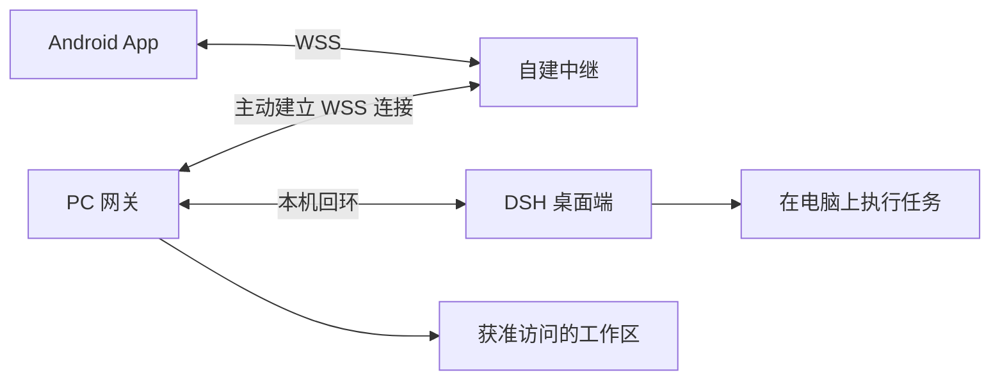

# DSH Remote

用 Android 手机查看并继续 Windows PC 上的 DSH（DeepSeek Harness）会话，浏览工作区文件，接收任务进度并处理审批。手机和电脑都主动连接自建中继，可通过 Wi-Fi 或移动网络使用。

**当前版本：v2.12.0 · Android 8.0+ · 2026-10-22**

[下载 Android 安装包](https://github.com/puthead/dsh-remote-android/releases/latest) · [安装与配对](#安装与配对) · [升级说明](#升级) · [文档中心](docs/README.md) · [版本记录](docs/06-项目管理/变更记录.md)

## 可以做什么

| 功能 | 说明 |
| --- | --- |
| 电脑会话 | 查看历史、继续对话、实时接收回答与执行轨迹，按轮次定位历史消息 |
| 图片与 Markdown | 渲染代码、表格、链接和图片；工作区内的 Markdown 图片可直接展示，点图查看大图 |
| 思考与任务清单 | 思考过程和任务清单分别折叠、展开，清单显示完成进度 |
| 工作区浏览 | 同步电脑端工作区，浏览目录、文本、Markdown 和 PNG/JPEG/GIF/WebP 图片 |
| 新建任务 | 选择工作区、执行位置、模型和权限，发送第一条消息后进入会话 |
| 审批与权限 | 在手机处理审批、回答提问；支持修改电脑端会话的权限档位 |
| 连接恢复 | 断线自动重连，保留离线历史，读操作在隧道恢复后重试 |

### v2.12.0 更新

- 修复本地图片只显示路径的问题，兼容中文、空格和 Windows 路径；工作区文件页也能查看图片。
- 同一路径的图片更新后重新读取，适用于二维码等会被覆盖的文件。
- 分开处理实时思考与回答，保留 Markdown 段落边界，修复回答后残留重复用户气泡的问题。
- 思考与任务清单默认折叠；展开长清单时可滚动，翻阅历史时保留对应消息的折叠状态。
- 改进工作区导航、刷新反馈和错误提示。

本次图片功能需要 **App 与电脑网关一起升级到 v2.12.0**。详情见[交付说明](deliverables/交付说明.md)。

## 工作方式



- **Android App**：Kotlin + Jetpack Compose，负责对话、文件预览和操作入口。
- **PC 网关**：Node.js 服务，桥接桌面端、工作区与手机；推荐只监听 `127.0.0.1:8787`。
- **自建中继**：转发手机与网关之间的请求和流式响应，电脑无需开放公网入站端口。

手机新建的任务默认由电脑端 DSH 执行，与桌面端共享同一会话。桌面端通道不可用时，已有电脑会话会降级为只读；网关自有会话使用独立的 `DSH_HOME`。

## 安装与配对

### 1. 准备环境

| 位置 | 要求 |
| --- | --- |
| 手机 | Android 8.0 或以上，安装 [Release APK](https://github.com/puthead/dsh-remote-android/releases/latest) |
| 电脑 | Windows、Git、PowerShell、Node.js 24，以及已安装并可使用的 DSH 桌面端 |
| 中继 | 一台手机与电脑均可访问的服务器；公网使用 WSS、有效 TLS 证书和注册口令 |

桌面端适配已在 DSH `0.2.0-rc.2` 上验证。桌面端接口变化可能需要更新网关；当前网关可自动发现桌面端的随机回环端口。

### 2. 部署中继

按[中继部署手册](docs/05-运维/中继部署手册.md)部署 `tools/dsh-relay`，准备好手机能访问的地址，例如 `wss://relay.example.com:9443`，以及中继的 `relaySecret`。

### 3. 初始化电脑网关

在 PowerShell 中执行：

```powershell
git clone https://github.com/puthead/dsh-remote-android.git
cd dsh-remote-android

# 将 D:\Projects 替换成你实际存在的工作区目录。
powershell -File scripts/setup-pc.ps1 -BindHost 127.0.0.1 -Workspace "D:\Projects"
```

按脚本提示完成初始化，再编辑 `%USERPROFILE%\.dsh-remote\config.json`，将下面的 `relay` 对象合并到配置中，保留其他字段：

```json
{
  "relay": {
    "enabled": true,
    "url": "wss://relay.example.com:9443",
    "homeName": "我的电脑",
    "relaySecret": "替换为中继的注册口令"
  }
}
```

启动网关并检查中继连接：

```powershell
powershell -File scripts/start-gateway.ps1
curl.exe -X POST http://127.0.0.1:8787/api/v2/relay/connect
curl.exe http://127.0.0.1:8787/api/v2/relay/status
```

状态中的 `connected` 应为 `true`。路径、端口和启动方式的更多选项见[部署手册](docs/05-运维/部署手册.md)。

### 4. 配对手机

在电脑上生成配对码：

```powershell
powershell -File scripts/relay-pair.ps1
```

打开手机 App，输入中继地址与配对码，按提示完成配对。电脑端 DSH 保持运行后，即可在「电脑会话」里继续对话，在「工作区」里浏览文件。

配对码过期时重新运行脚本。手机端应填写服务器的 WSS 地址；手机上的 `127.0.0.1` 指向手机本身。

## 升级

1. 等待正在执行的任务完成，在电脑仓库目录执行 `git pull --ff-only`。
2. 重启电脑网关，使新的图片接口生效：

   ```powershell
   powershell -File scripts/stop-gateway.ps1
   powershell -File scripts/start-gateway.ps1
   ```

3. 从 [最新 Release](https://github.com/puthead/dsh-remote-android/releases/latest) 下载并覆盖安装 APK。沿用相同签名，通常无需卸载或重新配对。
4. 如需确认网关版本，在电脑执行 `curl.exe http://127.0.0.1:8787/api/v2/health`，检查 `gatewayVersion` 为 `2.12.0`，`capabilities` 包含 `workspace.image`。

保留网关运行目录中的配置和配对状态。本次升级无需更换中继。

## 常见问题

| 情况 | 排查方法 |
| --- | --- |
| 手机显示电脑离线 | 确认电脑未休眠、网关已启动；检查 `/api/v2/relay/status` 的连接状态、中继地址和 TLS 证书 |
| 能看历史但不能继续电脑会话 | 打开 DSH 桌面端，检查网关是否能发现桌面端 runtime |
| 图片仍只显示链接或加载失败 | 确认 App 与网关均已升级；文件需仍然存在，且位于获准访问的工作区内 |
| 工作区中的图片打不开 | 支持 PNG/JPEG/GIF/WebP，单张最多 8 MiB；其他二进制类型不会作为图片加载 |
| 二维码已经过期 | 刷新或重新打开图片读取最新文件；App 不会延长二维码本身的有效期 |

## 开发与构建

Android 工具链：JDK 17、Android SDK 34、Gradle 8.9。先配置 `android/local.properties` 的 `sdk.dir`，再运行：

```powershell
cd android
.\gradlew.bat :app:assembleDebug :app:testDebugUnitTest
```

构建正式 APK 需准备自己的签名材料，再执行 `:app:assembleRelease`。具体配置见 [Android 构建说明](android/BUILD.md)。私钥和口令不随仓库提供，自行签名的 APK 不能直接覆盖官方签名安装包。

网关与中继均采用 Node.js ESM，无第三方运行时依赖。已有网关测试可在仓库根目录执行：

```powershell
node --test tools/dsh-remote/test/*.test.mjs
```

发布前已完成 Android 单元测试、相关网关测试、Release 构建和签名校验；本次未连接手机进行真机界面验收。

## 目录与文档

```text
android/          Android 客户端
tools/dsh-remote/  PC 网关
tools/dsh-relay/   自建中继
scripts/          Windows 部署、配对与运维脚本
docs/             需求、协议、开发与部署文档
deliverables/     交付说明；APK 通过 GitHub Release 分发
```

| 文档 | 内容 |
| --- | --- |
| [文档中心](docs/README.md) | 完整文档索引 |
| [中继部署](docs/05-运维/中继部署手册.md) | WSS、证书、服务器与连接排查 |
| [电脑端部署](docs/05-运维/部署手册.md) | 网关配置、启动与维护 |
| [协议契约 v2](docs/01-设计/协议契约-v2.md) | API、能力位与桌面端桥接 |
| [版本记录](docs/06-项目管理/变更记录.md) | 功能变更与兼容说明 |

网关按工作区白名单和设备令牌控制访问。公网部署使用 WSS，并妥善保管 API Key、`relaySecret`、设备令牌和签名材料；这些文件与本地运行数据不应提交到 Git。
