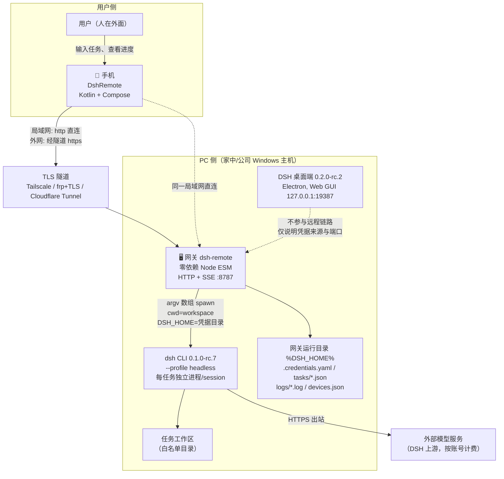
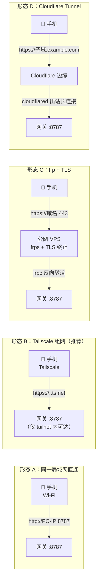
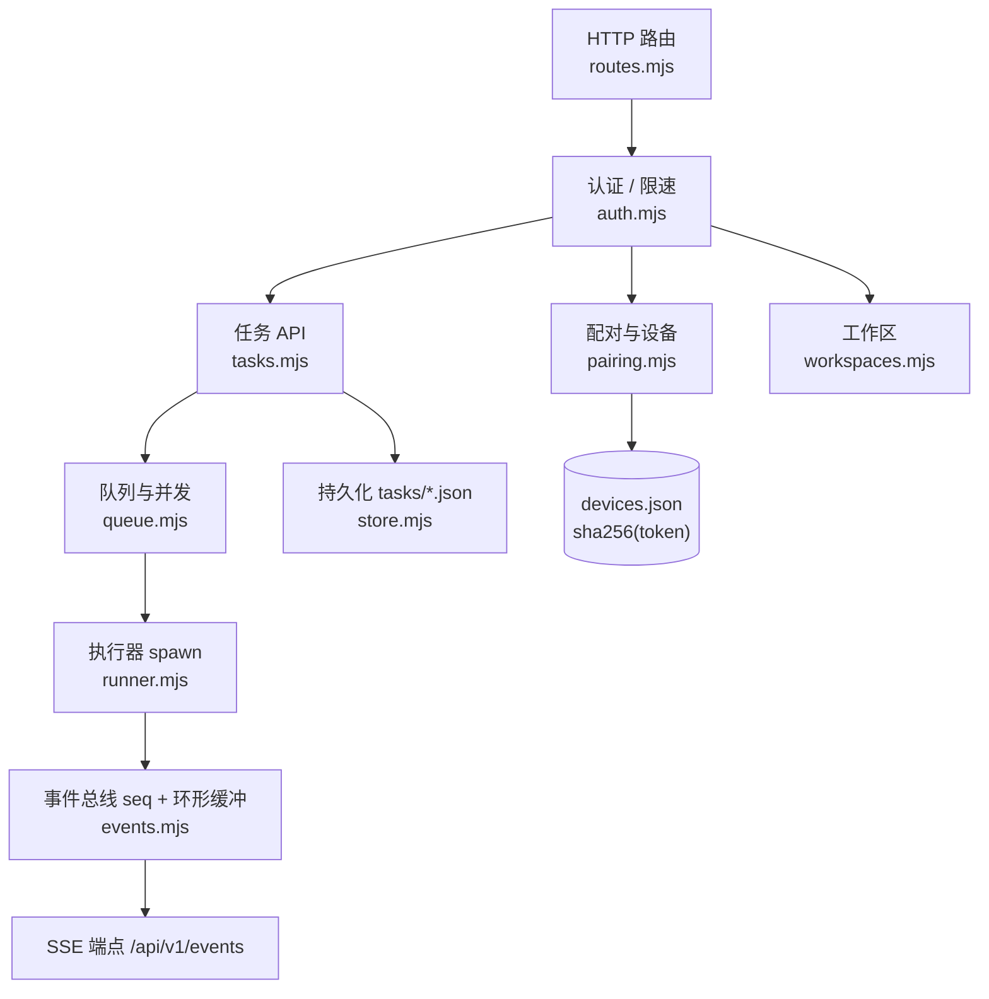
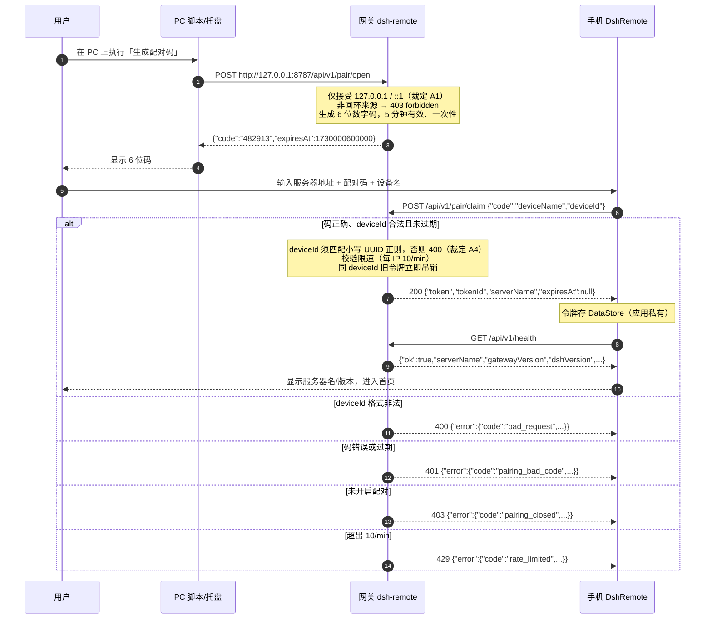
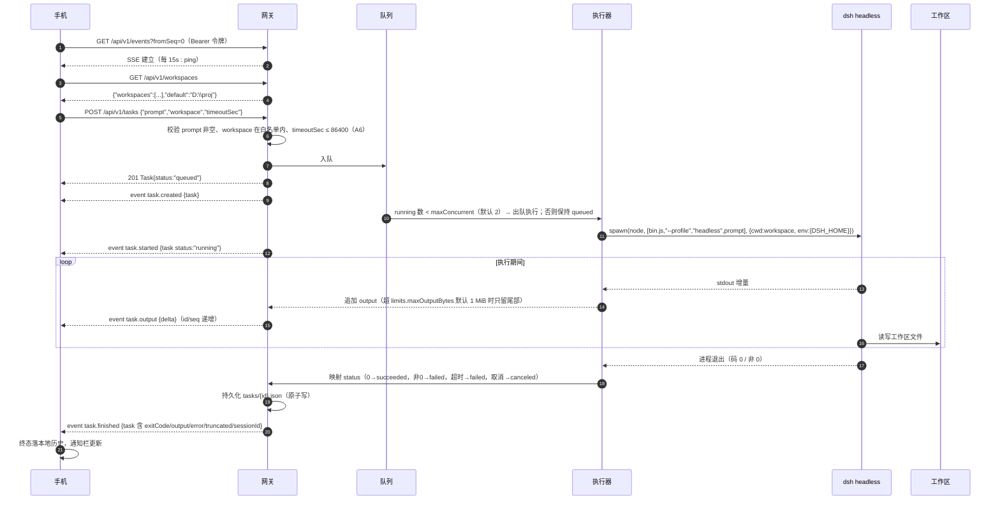
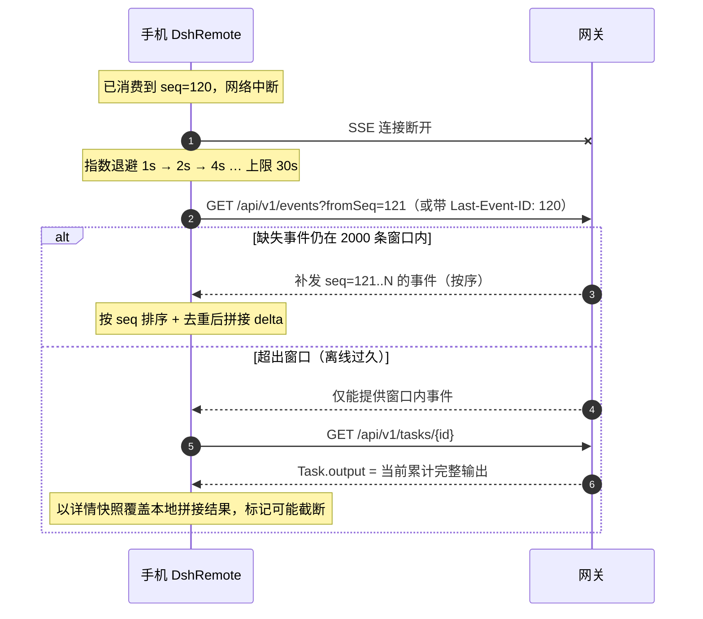
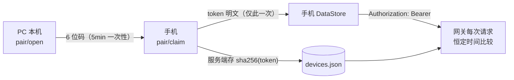

# DSH Remote 概要设计

| 项 | 值 |
|---|---|
| 文档编号 | HLD-DSHR-001 |
| 版本 | v1.1.1（对齐契约「裁定补充（v1.1）」A1~A7；配置键名按交付版实现回填） |
| 接口基线 | [API契约.md](API契约.md) v1（冻结；路径/字段/状态机/错误码以该文件为准）+ 裁定补充 v1.1 |
| 需求基线 | [需求规格说明书](../00-需求/需求规格说明书.md) v1.1（FR-01 ~ FR-31 / NFR-xx） |

---

## 1. 设计目标与约束回顾

| # | 目标 | 落地手段 | 对应需求 |
|---|---|---|---|
| G1 | 手机能远程驱动 PC 上的 DSH 干活 | 自建网关 + 官方 CLI headless profile | FR-04, FR-05 |
| G2 | 过程实时可见、可取消 | SSE 增量事件 + 进程树终止 | FR-09, FR-12 |
| G3 | 断线不丢数据 | 服务端 2000 条环形缓冲 + `fromSeq` 续传 + 客户端本地历史 | FR-10, FR-14 |
| G4 | 不被局域网/公网抢注 | 本机回环配对 + Bearer 令牌 + 只存 sha256 + 限速 | NFR-SEC-01 ~ 04 |
| G5 | 不依赖脆弱私有协议 | 不碰桌面端 WebSocket RPC，CLI 作为唯一执行入口 | 约束 O1, O2 |

**硬约束**：桌面端 `0.2.0-rc.2` 只监听回环 `127.0.0.1:19387` 且凭据为账号平台设备授权（第三方不可复用）→ 远程链路必须由**本机进程**发起，这正是网关存在的理由。

---

## 2. 系统上下文

### 2.1 上下文图



**边界说明**

| 边界 | 规则 |
|---|---|
| 手机 ↔ 网关 | 唯一跨设备接口 = [API契约.md](API契约.md)；手机不得直接访问 CLI 或桌面端 |
| 网关 ↔ CLI | 进程调用（argv 数组 + `spawn`，禁止 shell 拼接）；退出码与 stdout 为结果来源 |
| 网关 ↔ 桌面端 | **无接口**。二者只共享「同一台机器 + 同一套 DSH 凭据来源」这一事实 |
| 网关 ↔ 上游模型服务 | 由 CLI 内部处理，网关不感知模型调用细节 |
| 网关 ↔ 文件系统 | 仅白名单内工作区可写；运行目录写凭据、任务、日志 |

### 2.2 部署拓扑



| 形态 | 适用 | TLS | 暴露面 | 前置条件 | 验收 |
|---|---|---|---|---|---|
| A 局域网直连 | 在家、同 Wi-Fi | 否（明文，内网） | 局域网内可见 `8787` | 手机与 PC 同网段 | TC-46 |
| B Tailscale | **推荐**：外网首选 | 是（WireGuard + HTTPS） | tailnet 内 | 手机与 PC 各装 Tailscale 并登录同一账号 | TC-47 |
| C frp + TLS | 有自己的 VPS 与域名 | 是（TLS 终止在 frps） | 公网 443 | 域名证书、frps/frpc | TC-48 |
| D Cloudflare Tunnel | 不想开端口 | 是（边缘 TLS） | 公网 443 | 域名托管在 Cloudflare、`cloudflared` | TC-49 |

> 禁止：把 `8787` 以裸端口映射（NAT/端口转发）直接暴露公网 —— 见 NFR-SEC-05、TC-60。

---

## 3. 组件设计

### 3.1 组件职责

| 组件 | 技术 | 职责 | 明确不做 |
|---|---|---|---|
| `dsh-remote` HTTP 层 | Node ESM `node:http` | 路由、JSON 编解码、Bearer 校验、限速、错误体统一为 `{"error":{"code","message"}}` | 不解析业务语义之外的路径 |
| 任务管理器 | Node ESM | 入队/两级并发控制（`maxConcurrent` 默认 2 只限 `running`；`queued` 达 `maxQueue` 默认 100 才 `busy`）/超时/取消/状态机流转/输出截断（`limits.maxOutputBytes` 默认 1 MiB）/持久化 | 不拼 shell 命令 |
| 进程执行器 | `node:child_process` `spawn` | argv 数组启动 `node <bin.js> --profile headless "<prompt>"`，注入 `cwd` 与 `DSH_HOME`，采集 stdout/stderr | 不解析模型协议 |
| 事件总线 + SSE | Node ESM | `seq` 全局递增、环形缓冲 2000 条、`fromSeq`/`Last-Event-ID` 补发、15 s `: ping` 心跳 | 不做持久化（历史看 Task 文件） |
| 配对与设备库 | `node:crypto` | 6 位码生成/校验（5 分钟、一次性、仅回环 `pair/open`）、令牌签发、只存 `sha256`、恒定时间比较、`deviceId` 正则校验（裁定 A4）、重配吊销旧令牌；同时向 REST 与 CLI 暴露设备列表/吊销（裁定 A3） | 不含账号体系、不引入本地管理口令 |
| 持久化层 | `node:fs` | `tasks/*.json`（临时文件 + rename 原子写）、`devices.json`、`logs/gateway-YYYYMMDD.log` | 不引入数据库 |
| `DshRemote` 数据层 | Kotlin, OkHttp, org.json, DataStore | HTTP 调用、SSE 长连接（读超时 0）、事件按 `seq` 拼接去重、本地历史 | 不直连桌面端 |
| `DshRemote` UI 层 | Compose Material3 | 配置页 / 首页 / 任务详情 / 历史，状态单向驱动 | 不阻塞事件流消费 |
| 后台保活 | 前台服务 + 通知渠道 | App 退后台维持 SSE，退避重连 1s→30s | 不做推送通道 |

### 3.2 网关内部分层



**关键不变量**

| # | 不变量 | 违反后果 |
|---|---|---|
| I1 | `seq` 全局单调递增，跨任务共享同一序列 | 客户端排序/续传失效 |
| I2 | 任务状态只单向流转：`queued → running → succeeded \| failed \| canceled` | 客户端终态判断错乱 |
| I3 | 每个任务恰好一个子进程、一个独立 `DSH_HOME`/session | 会话串味、输出错乱 |
| I4 | 令牌在网关侧不落明文（只存 `sha256`） | 泄露即长期可用 |
| I5 | 工作区必须落在白名单内（含子目录判定） | 越界写用户文件 |
| I6 | `task.output` 事件按 `seq` 拼接即为 `output` 全文；但输出超 `limits.maxOutputBytes` 被截断后，**以详情接口的 `output` 为准**（已推送 `delta` 不回滚，裁定 A5） | 详情页与事件流不一致（截断场景可接受，须以详情为准） |
| I7 | 非回环来源的 `pair/open` 必须被拒（`403 forbidden`），网关不存在任何"本地管理口令"配置项 | 局域网内可抢注配对码 |
| I8 | `maxConcurrent` 只限制 `running`；`queued` 未达 `maxQueue` 时必须入队而不是直接拒绝 | 正常请求被误拒，与裁定 A2 冲突 |

---

## 4. 关键流程时序

### 4.1 配对（首次连接）



### 4.2 任务下发 → headless 执行 → 流式回传



**并发、超时与输出上限分支（裁定 A2 / A5 / A6 / A7）**

| 条件 | 网关行为 | 事件 | 契约 |
|---|---|---|---|
| `running` 数 < `maxConcurrent`（默认 2） | 立即出队执行 | `task.started` | §3.1, A2 |
| `running` 数 = `maxConcurrent` 且 `queued` < `maxQueue`（默认 100） | 任务保持 `queued` 排队（**不拒绝**） | `task.progress {phase:"queued",note:"等待并发空位"}` | §4, A2 |
| `queued` 长度达到 `maxQueue` | `429 {"error":{"code":"busy"}}` | 无 | §3.1, A2 |
| 单任务累计输出超 `limits.maxOutputBytes`（默认 1048576） | 只保留**尾部**上限字节并置 `truncated:true`；已推送 `delta` 不回滚 | `task.output` 继续推送；详情接口 `output` 为准 | A5 |
| `timeoutSec` > 86400 或非正整数 | `400 {"error":{"code":"bad_request"}}`，不创建任务 | 无 | A6 |
| 超过 `timeoutSec` | 终止进程树，置 `failed`，`error` 说明超时 | `task.finished` | §3.1, A6 |
| 用户 `POST .../cancel` | 活动任务杀进程树置 `canceled`；`queued` 直接出队置 `canceled` | `task.finished` | §3.4 |
| 退出码非 0 | 置 `failed`，`error` 取可读失败信息 | `task.finished` | §3.1 |
| `DELETE` 活动态任务 | `409 {"error":{"code":"conflict"}}`，不改状态 | 无 | §3.5, A7 |
| `DELETE` 终态任务 | 删除记录并返回 `204` | 无 | §3.5, A7 |

### 4.3 断线续传



**客户端重连规则（契约 §7）**

| 项 | 规则 |
|---|---|
| 退避序列 | 1s → 2s → 4s → 8s → 16s → 30s（上限 30 s），成功后重置 |
| 续传参数 | `fromSeq = 本地最大 seq + 1`；同时带 `Last-Event-ID` 头 |
| 去重 | 收到 `seq ≤ 本地最大 seq` 的事件直接丢弃 |
| 窗口溢出兜底 | 若服务端无法补齐，改拉 `GET /api/v1/tasks/{id}` 全量快照（FR-07）；输出被截断时（`truncated:true`）**详情接口的 `output` 为准**，本地已拼接的 `delta` 不回滚（A5） |
| 并发安全 | 事件消费在后台线程写内存环形缓冲 + 本地库，不阻塞 UI |

---

## 5. 数据模型

### 5.1 Task（契约 §3.1，字段逐字对齐）

| 字段 | 类型 | 说明 |
|---|---|---|
| `id` | string | 形如 `task_01J…` |
| `title` | string | 缺省取 `prompt` 前 40 字 |
| `prompt` | string | 任务文本（含中文、换行） |
| `workspace` | string | 必须落在白名单内 |
| `status` | enum | `queued` / `running` / `succeeded` / `failed` / `canceled` |
| `createdAt` | int(ms) | Unix 毫秒 |
| `startedAt` | int(ms) \| null | — |
| `finishedAt` | int(ms) \| null | — |
| `exitCode` | int \| null | 子进程退出码 |
| `output` | string | **当前累计**完整输出；超 `limits.maxOutputBytes` 后为**尾部**内容（裁定 A5） |
| `error` | string \| null | 失败/超时/中断原因 |
| `truncated` | bool | 输出是否被截断（超 `limits.maxOutputBytes` 默认 1048576 即置 `true`，裁定 A5） |
| `sessionId` | string \| null | 该任务对应的 DSH session 标识 |

### 5.2 Device（本地设备库，`devices.json`）

| 字段 | 类型 | 说明 | 契约对应 |
|---|---|---|---|
| `tokenId` | string | `tok_…`，对外可见标识 | `GET /api/v1/devices` |
| `tokenHash` | string | `sha256(token)`，**仅服务端持有，不出现在任何响应** | §6.3 |
| `deviceName` | string | 配对时提交 | 响应字段 `deviceName` |
| `deviceId` | string | 客户端生成的小写 UUID 文本，须匹配 `^[0-9a-f]{8}-[0-9a-f]{4}-[0-9a-f]{4}-[0-9a-f]{4}-[0-9a-f]{12}$`（裁定 A4）；用于重配吊销 | §2.2, A4 |
| `pairedAt` | int(ms) | 配对时间 | 响应字段 `pairedAt` |
| `lastSeenAt` | int(ms) | 最近认证成功时间 | 响应字段 `lastSeenAt` |
| `revoked` | bool | 吊销标记 | `DELETE /api/v1/devices/{tokenId}` |

### 5.3 事件（契约 §4）

| 字段 | 类型 | 说明 |
|---|---|---|
| `seq` | int | 全局单调递增，SSE `id:` 同值 |
| `taskId` | string | 所属任务 |
| `at` | int(ms) | 事件产生时间 |
| `type` | enum | `task.created` / `task.started` / `task.output` / `task.finished` / `task.progress` |
| `task` | object | 仅 `created`/`started`/`finished` 携带 |
| `delta` | string | 仅 `task.output` 携带，增量文本 |
| `phase`, `note` | string | 仅 `task.progress` 携带 |

约束：`data` 恒为**单行 JSON**，内部换行以 `\n` 转义；环形缓冲保留最近 **2000** 条；心跳 `: ping` 每 **15 s**。

### 5.4 网关运行目录（`%DSH_HOME%`）

```text
%DSH_HOME%/
├── .credentials.yaml         # DEEPSEEK_API_KEY: <key>（不入仓库、不进日志）
├── config.json               # host/port、maxConcurrent 2、maxQueue 100、limits.maxOutputBytes 1048576、timeout 3600、workspaceAllowlist
├── devices.json              # 设备库（只含 tokenHash，无明文令牌）
├── tasks/
│   └── task_01J….json        # 每任务一份，临时文件 + rename 原子写
└── logs/
    └── gateway-YYYYMMDD.log  # 含每个任务的 sessionId 与耗时
```

> 待验证：`config.json` 与 `devices.json` 的具体字段名以网关实现与[部署手册](../05-运维/部署手册.md)为准，实施后须回填本表。

### 5.5 客户端本地模型（DataStore Preferences）

| 键 | 内容 | 备注 |
|---|---|---|
| `baseUrl` | 网关地址（`http`/`https`） | 契约 §7 指定 DataStore Preferences |
| `token` | 设备令牌明文 | 仅应用私有存储，不落日志（NFR-SEC-08） |
| `deviceId` | 客户端生成的小写 UUID 文本 | 契约 §7 指定 DataStore Preferences；必须匹配裁定 A4 的正则，重配时用于吊销旧令牌 |
| 历史记录 | 已见 Task 快照（终态落库） | 支撑离线查看（FR-10） |

---

## 6. 接口一览（引用契约，不重复定义）

| 端点 | 方法 | 认证 | 成功 | 契约章节 |
|---|---|---|---|---|
| `/api/v1/health` | GET | 否 | `200` | §1 |
| `/api/v1/pair/open` | POST | **仅回环**（非回环 `403 forbidden`，裁定 A1） | `200` | §2.1 |
| `/api/v1/pair/claim` | POST | 否（限速 10/min；`deviceId` 非法 `400`，裁定 A4） | `200` | §2.2 |
| `/api/v1/tasks` | POST | Bearer | `201` | §3.1 |
| `/api/v1/tasks` | GET | Bearer | `200` | §3.2 |
| `/api/v1/tasks/{id}` | GET | Bearer | `200` | §3.3 |
| `/api/v1/tasks/{id}/cancel` | POST | Bearer | `200` | §3.4 |
| `/api/v1/tasks/{id}` | DELETE | Bearer | 终态 `204`；活动态 `409 conflict`（裁定 A7） | §3.5 |
| `/api/v1/events` | GET (SSE) | Bearer | `200` 事件流 | §4 |
| `/api/v1/workspaces` | GET | Bearer | `200` | §5 |
| `/api/v1/devices` | GET | Bearer | `200` | §5 |
| `/api/v1/devices/{tokenId}` | DELETE | Bearer | `204` | §5 |

**等价 CLI（裁定 A3）**：`node gateway.mjs devices list` 与 `node gateway.mjs devices revoke <tokenId>`，语义与上表 REST 端点一致（同一设备库、同一吊销结果）。

**错误码（契约 §0，逐字一致，共 11 种）**：`unauthorized`(401) `forbidden`(403) `not_found`(404) `bad_request`(400) `pairing_closed`(403) `pairing_bad_code`(401) `rate_limited`(429) `busy`(429) `conflict`(409) `payload_too_large`(413) `internal`(500)。

---

## 7. 错误处理与降级

### 7.1 错误映射

| 触发场景 | HTTP | `error.code` | 客户端表现 | 契约 |
|---|---|---|---|---|
| 缺少/错误 Bearer 令牌 | 401 | `unauthorized` | 清会话回到配置页提示重新配对 | §0, §6.2 |
| 令牌被吊销 | 401 | `unauthorized` | 同上 | §5 |
| **`pair/open` 来自非回环来源** | 403 | `forbidden` | 仅 PC 端可见（脚本报错），App 不涉及 | §2.1, A1 |
| 未开启配对 | 403 | `pairing_closed` | 提示「请先在 PC 上生成配对码」 | §2.2 |
| 配对码错误/过期 | 401 | `pairing_bad_code` | 保留输入，提示重取码 | §2.2 |
| **`deviceId` 不匹配小写 UUID 正则** | 400 | `bad_request` | 本地生成 UUID，正常不可达；出现则提示重装/清数据 | A4 |
| `prompt` 为空 / `workspace` 不存在或越界 | 400 | `bad_request` | 表单就地报错 | §3.1 |
| **`timeoutSec` 超上限（> 86400）或非法** | 400 | `bad_request` | 表单校验，回落到默认 3600 | A6 |
| 请求体超限 | 413 | `payload_too_large` | 提示任务文本过大，截断后重试 | §0 |
| 任务不存在 / 设备不存在 | 404 | `not_found` | 刷新列表 | §3.3, §5 |
| **`queued` 达到 `maxQueue`（默认 100）** | 429 | `busy` | 提示队列已满稍后重试 | §3.1, A2 |
| 触发限速 | 429 | `rate_limited` | 退避后重试，不自动循环 | §6.4 |
| **删除活动态任务** | 409 | `conflict` | 提示「任务仍在运行，请先取消」 | §3.5, A7 |
| 网关内部异常 | 500 | `internal` | 展示可读信息 + 保留本地历史 | §0 |

### 7.2 降级策略

| # | 故障 | 降级行为 | 用户可见结果 |
|---|---|---|---|
| D1 | 网关不可达（PC 关机/断网） | 客户端进入错误态，停止无限重试，退避重连 | 明确提示连不上；历史可离线查看（NFR-AVAIL-02） |
| D2 | SSE 断开 | 指数退避重连 + `fromSeq` 续传；窗口溢出则拉任务详情快照 | 输出不丢不重（尽量），最坏情况以快照为准 |
| D3 | `running` 已达 `maxConcurrent` | 任务保持 `queued` 排队并发 `task.progress`；仅 `queued` 达 `maxQueue` 才返回 `busy`（裁定 A2） | 用户看到「排队中」；队列满时才提示稍后重试 |
| D4 | CLI 退出码非 0 | 任务置 `failed`，`error` 携带可读原因，`output` 保留已产生输出 | 失败原因可定位（凭据/参数/工作区） |
| D5 | 任务超时 | 终止进程树，置 `failed` | 明确「超时」而非「卡住」 |
| D6 | 输出超 `limits.maxOutputBytes`（默认 1 MiB） | 只保留尾部上限字节并置 `truncated=true`；已推送 `delta` 不回滚，客户端以详情接口 `output` 为准（裁定 A5）；事件窗口固定 2000 条 | 详情页显示「输出已截断（保留尾部）」 |
| D7 | 网关重启 | 历史任务从 `tasks/*.json` 恢复；重启前 `running` 任务置终态并说明中断 | 无悬挂「运行中」（FR-27） |
| D8 | 隧道断开（Tailscale/frp/CF） | 同 D1，客户端表现为网关不可达 | 恢复隧道后自动续传 |

---

## 8. 技术选型与替代方案

### 8.1 核心决策：执行入口与传输方式

| 方案 | 说明 | 优点 | 缺点 | 结论 |
|---|---|---|---|---|
| **A. 自建网关 + CLI headless（选定）** | 网关 `spawn` 官方 CLI `--profile headless`，HTTP+SSE 对手机服务 | 只用公开 CLI 接口；已实测可用（2.6 s 完成写文件任务、文件真实落盘）；独立 session；无版本耦合于私有协议 | 需自建一层网关；无法复用桌面端 UI 交互能力 | ✅ 采用 |
| B. 直连桌面端私有 WebSocket RPC | 逆向 `127.0.0.1:19387` 的渲染进程 RPC | 看似省一层 | 协议无公开文档、**随版本升级即失效**；依赖内部实现细节；桌面端只监听回环，仍需转发层 | ❌ 否决 |
| C. UI 自动化（模拟点击桌面端） | 屏幕/控件自动化 | 不需要协议 | 极不稳定、不能 headless、并发差、屏幕必须登录 | ❌ 否决 |
| D. 复用桌面端设备授权凭据 | 把桌面端凭据复制给第三方客户端 | — | 属内部授权，**第三方客户端无法直接复用**；合规风险 | ❌ 否决 |
| E. 云端中转服务 | 自建公网中继 | 免隧道 | 引入账号体系、数据出境、运维成本 | ❌ 范围外（O3） |

### 8.2 次要选型

| 维度 | 选定 | 备选 | 理由 |
|---|---|---|---|
| 网关运行时 | Node.js ESM + 标准库（零第三方依赖） | Express / Fastify | 契约端点仅 12 个，标准库足够；零依赖=零供应链风险（NFR-MAINT-01） |
| 回传通道 | SSE（`text/event-stream`） | WebSocket / 轮询 | 单向增量推送即可满足；HTTP 语义简单、可断点续传（`Last-Event-ID` 原生支持）；轮询浪费且延迟高 |
| 客户端 | 原生 Android（Kotlin + Compose） | Flutter / React Native | 前台服务 + 通知渠道 + SSE 长连接需原生能力；单用户自用无跨端收益 |
| 客户端网络库 | OkHttp（SSE 读超时 0） | Ktor / HttpURLConnection | 契约 §7 明确指定；长连接稳定性好 |
| JSON 解析 | `org.json` | Gson / kotlinx.serialization | 契约 §7 明确指定；字段少、无代码生成开销 |
| 本地存储 | DataStore Preferences | Room / SQLite | 契约 §7 指定；历史为「最近若干条快照」，无需关系模型 |
| 状态持久化 | `tasks/*.json` + 原子 rename | SQLite / LevelDB | 单用户、写入频率低（每任务 1~2 次终态写）；零依赖（NFR-MAINT-01） |
| 外网接入 | Tailscale（首选）/ frp+TLS / CF Tunnel | 裸端口映射 | 全部自带 TLS 与身份层；裸映射被明令禁止（NFR-SEC-05） |
| 认证 | 设备令牌（Bearer）+ 服务端只存 sha256 | JWT / Basic | 无状态签发需求弱，令牌足够；避免密钥管理与过期刷新复杂度 |
| 配对 | 本机回环 6 位码 | 二维码（本机显示）/ 口令 | 码只需读一眼；二维码作为可选增强（部署手册 4 节） |

---

## 9. 安全设计

### 9.1 认证与凭据流转



| 控制点 | 措施 | 需求 |
|---|---|---|
| 配对入口 | 仅回环来源；短有效期；一次性 | NFR-SEC-03 |
| 令牌存储 | 服务端只存 `sha256`；明文只在响应中出现一次 | NFR-SEC-02 |
| 令牌比较 | 恒定时间函数，避免时序侧信道 | NFR-SEC-02 |
| 暴力破解 | `pair/claim` 10/min/IP；认证失败 30/min/IP → `429 rate_limited` | NFR-SEC-04 |
| 越权路径 | 工作区白名单（含子目录），越界 `bad_request` | NFR-SEC-06 |
| 命令注入 | argv 数组 `spawn`，禁止 shell 拼接 | NFR-SEC-07 |
| 传输 | 外网必须 TLS 隧道；明文档说明内网明文风险 | NFR-SEC-05, FR-15 |
| 交付物 | APK 为 debug 签名自用包，明确不外发 | NFR-SEC-09 |

### 9.2 威胁模型（STRIDE 摘要）

| 威胁 | 场景 | 对策 | 验收 |
|---|---|---|---|
| Spoofing | 局域网旁人抢用配对码 | 本机回环生成 + 5 分钟 + 一次性 + 限速 | TC-14, TC-15, TC-74, TC-75 |
| Tampering | 中间人篡改任务/输出 | 外网强制 TLS，隧道自带完整性 | TC-46, TC-60 |
| Repudiation | 无法确认谁下发了任务 | `devices.json` 记录 `deviceName`/`pairedAt`/`lastSeenAt`，日志含 `sessionId` | TC-16, TC-54 |
| Information disclosure | 令牌或 Key 泄露 | 只存哈希、不进日志、不入仓库、App 私有存储 | TC-71, TC-73, TC-78 |
| Denial of service | 刷 `pair/claim` 或海量任务 | 限速 + 并发上限 + 队列 + 超时 | TC-27, TC-29, TC-75, TC-76 |
| Elevation of privilege | 借任务执行越界写系统文件 | 白名单工作区 + 不做提权 + 禁 shell 拼接 | TC-22, TC-77 |

---

## 10. 可观测性与运维设计

| 关注点 | 设计 | 落点 |
|---|---|---|
| 健康探针 | `GET /api/v1/health` 暴露 `ok`/`activeTasks`/`queuedTasks`/`pairingOpen`/`dshVersion` | 契约 §1；TC-01 |
| 任务级追踪 | 日志记录每个任务的 `id`、`sessionId`、起止时间、耗时、退出码 | `logs/gateway-YYYYMMDD.log`；TC-54 |
| 事件可回放 | 2000 条环形缓冲 + `fromSeq` 补发 | 契约 §4；TC-32, TC-57 |
| 持久化恢复 | `tasks/*.json` 原子写；重启后历史仍在 | FR-16；TC-53 |
| 进程治理 | 取消/超时终止进程树，避免孤儿 | NFR-AVAIL-06；TC-29 |
| 自启动 | Windows 计划任务（登录时触发），可幂等安装/卸载 | FR-16；TC-50, TC-51 |

---

## 11. 设计对需求的覆盖自检

| 需求组 | 覆盖章节 | 缺口 |
|---|---|---|
| FR-01 ~ FR-03（连通/配对/工作区） | §3.1, §4.1, §6 | 无 |
| FR-04 ~ FR-09, FR-11, FR-25, FR-27, FR-29, FR-30（任务生命周期） | §4.2, §5.1, §6, §7 | 无 |
| FR-10, FR-12, FR-14, FR-20（实时与续传） | §4.3, §5.3 | 无 |
| FR-13, FR-15, FR-17, FR-21 ~ FR-23（客户端） | §3.1, §5.5, §8.2 | 无 |
| FR-16, FR-18, FR-19, FR-24, FR-26（运维/设备/安全） | §3.1, §6, §9, §10 | 无 |
| FR-28, FR-31（裁定输入校验与新增错误码） | §4.1, §4.2, §7.1 | 无 |
| 裁定 A1 ~ A7 | §3.1（不变量 I7/I8）, §4.1, §4.2, §5.1 ~ §5.2, §6, §7 | 无 |
| NFR-SEC-* | §9 | 无 |
| NFR-PERF-* | §4.2（输出上限）, §8.2, §10 | 无 |
| NFR-AVAIL-* | §4.3, §7.2 | 无 |
| NFR-COMPAT-* | §2.2, §8.2 | Win10 / Android 15 / Node 下限待实测 |
| NFR-MAINT-* | §8.1, §8.2 | 无 |
