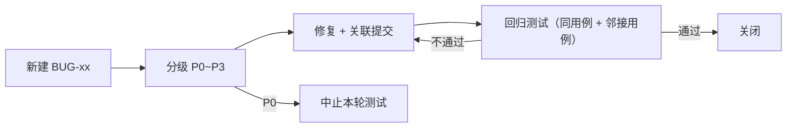

# DSH Remote 测试计划

| 项 | 值 |
|---|---|
| 文档编号 | TP-DSHR-001 |
| 版本 | v1.1.1（对齐契约「裁定补充（v1.1）」A1~A7；§6 为需求↔验收矩阵单点事实源） |
| 接口基线 | [API契约.md](../01-设计/API契约.md) v1（冻结）+ 裁定补充 v1.1 |
| 需求基线 | [需求规格说明书](../00-需求/需求规格说明书.md) v1.1.1（FR-01 ~ FR-31 / NFR-xx / US-xx） |
| 验收矩阵 | 见本文 **§6 需求 ↔ 验收矩阵（单点事实源）**；[验收报告](../04-验收/验收报告.md) 与需求规格说明书 §8 均引用此表 |
| 用例编号 | `TC-xx`（与 §6 验收矩阵一一对应） |
| 缺陷编号 | `BUG-xx`（见 [§7 缺陷管理](#7-缺陷管理)） |

---

## 1. 测试策略

| 项 | 内容 |
|---|---|
| 目标 | 证明「人在外面用手机下发任务 → PC 上 headless DSH 执行 → 过程与结果实时回传」在**正常、异常、安全**三类路径下都符合契约与需求 |
| 原则 | 契约优先（断言以[API契约.md](../01-设计/API契约.md)逐字字段为准）；自动化优先；未实测项一律标 `> 待验证：`；不得以「看起来能用」代替断言 |
| 边界 | 不测试 DSH 模型输出质量（属上游能力）；不测试桌面端功能（不在链路内）；不测厂商 ROM 后台策略的兼容性穷举 |
| 分层比例目标 | 单元 ≈ 50%，集成 ≈ 30%，端到端 + 手工 ≈ 20% |

### 1.1 测试分层

| 层 | 对象 | 工具 | 运行方式 | 通过要求 |
|---|---|---|---|---|
| L1 单元 | 网关各模块（限速、认证、白名单、SSE 分帧、环形缓冲、状态机、原子写） | `node:test` | `node --test tools/dsh-remote/test` | 全绿，无跳过 |
| L1 单元（客户端） | JSON 解析、SSE 帧解析、`seq` 拼接去重、退避序列 | JUnit4 + 纯 Kotlin（可用 MockWebServer） | `gradlew.bat :app:testDebugUnitTest` | 全绿，无跳过 |
| L2 集成 | 网关全部契约端点（真实 HTTP，本地起服务 + 临时 `DSH_HOME`） | `node:test` + 内置 `fetch` | 同上（集成用例同套件） | 契约 §1~§5 全部端点被覆盖 |
| L3 端到端 | 真实手机/模拟器 ↔ 真实网关 ↔ 真实 dsh CLI | 手工 + 脚本 | 按 §4 环境矩阵执行 | 核心链路 US-01/02/03/05 全通过 |
| L4 手工验收 | UI 交互、后台保活、外网接入、装机 | 人工 | 按用例逐步执行 | 用例步骤与期望结果全部符合 |
| L5 运维 | 安装、自启、重启恢复、日志 | PowerShell 脚本 | `scripts/selftest.ps1` / `verify.ps1` | 逐项 PASS，退出码 0 |
| L6 交付检查 | APK 签名与哈希、文档一致性 | 脚本 + 人工 | `scripts/verify.ps1` | 报告表全项 PASS |


### 1.2 进入 / 退出条件（单轮测试）

| 条件 | 内容 |
|---|---|
| 进入 | 代码已合并到待测分支；网关可启动；`dsh` CLI 可用且版本为 `0.1.0-rc.7`；`.credentials.yaml` 就绪；APK 可构建 |
| 退出 | 本文 §7 准出标准全部满足 |
| 中止 | 出现 P0 缺陷（任务无法完成 / 凭据泄露）→ 立即中止并出报告 |

---

## 2. 测试环境矩阵

### 2.1 PC 侧

| 项 | 配置 | 备注 |
|---|---|---|
| 操作系统 | Windows 11（实测环境） | Windows 10 21H2+ `> 待验证：未实测` |
| 执行引擎 | `dsh` CLI `0.1.0-rc.7`，`--profile headless` | 版本由 `health.dshVersion` 回显校验 |
| 运行时 | Node.js（网关零第三方依赖，仅标准库） | `> 待验证：Node 主版本下限以安装脚本探测结果为准` |
| 桌面端 | DSH `0.2.0-rc.2`（Electron，Web GUI `127.0.0.1:19387`） | **不参与测试链路**，仅作为同机凭据来源环境说明 |
| 凭据 | `%DSH_HOME%/.credentials.yaml` 内含 `DEEPSEEK_API_KEY` | 测试环境使用专用 Key，不写入仓库 |
| 工作区 | `D:\proj`（主）+ 含中文/空格路径目录各一 | 覆盖 NFR-COMPAT-05 |
| 端口 | 网关 `8787` | 被占用时应能明确报错 |

### 2.2 移动侧

| 项 | 配置 |
|---|---|
| 最低版本 | Android 8.0（API 26） |
| 目标版本 | Android 14（API 34）`targetSdk 34` |
| 覆盖范围 | Android 8 / 10 / 12 / 13 / 14（实机或模拟器），Android 15 `> 待验证：未逐机型实测` |
| 机型建议 | 至少 1 台厂商 ROM（后台清理激进）+ 1 台原生/近原生 |
| 网络形态 | 同局域网 Wi-Fi；蜂窝（经隧道）；断网/弱网模拟（飞行模式切换） |
| 安装包 | debug 签名 APK（自用），记录大小与 `sha256` |

### 2.3 网络与部署形态

| 编号 | 形态 | 配置 | 对应用例 |
|---|---|---|---|
| E1 | 局域网直连 | 手机与 PC 同网段，`http://<PC-IP>:8787` | TC-46 |
| E2 | Tailscale | 两端登录同一 tailnet，`https://<pc>.<tailnet>.ts.net` | TC-47 |
| E3 | frp + TLS | 公网 VPS + 证书 + `frpc` 反向隧道 | TC-48 |
| E4 | Cloudflare Tunnel | `cloudflared` 出站隧道 + 域名 | TC-49 |
| E5 | 无隧道裸映射 | **仅作为反例**，用于验证部署检查项能识别风险 | TC-60 |

### 2.4 测试数据准备

| 数据 | 内容 | 用途 |
|---|---|---|
| 任务 T1 | `写一个文件 test-dshr.txt，内容为 OK，然后回答 DONE` | 已验证基准：2.6 s 完成、文件真实落盘 |
| 任务 T2 | 含中文、引号、换行、`&`/`|`/`%` 的 prompt | NFR-SEC-07 / TC-77 |
| 任务 T3 | 长时任务（循环 5 分钟） | 取消、超时、后台保活 |
| 任务 T4 | 会失败的任务（访问不存在路径或非法参数） | 退出码非 0 → `failed` |
| 任务 T5 | 中文 + 空格工作区路径 | NFR-COMPAT-05 |
| 任务 T6 | 大量输出任务（产生 > 1 MB stdout） | 截断标志、环形缓冲 |
| 配对码 | 正常码 / 已用码 / 过期码 / 随机错误码 | 配对用例 |

---

## 3. 测试用例

### 3.1 L1 网关单元（TC-01 ~ TC-09）

| TC | 名称 | 前置 | 步骤 | 期望结果 | 需求 |
|---|---|---|---|---|---|
| TC-01 | 健康探针字段完整 | 网关启动 | `GET /api/v1/health` | `200`；含 `ok`/`apiVersion`/`serverName`/`gatewayVersion`/`dshVersion`/`uptimeMs`/`activeTasks`/`queuedTasks`/`pairingOpen`/`authRequired`/`capabilities`；`capabilities` 含 `tasks,events,pairing,workspaces,cancel` | FR-01 |
| TC-02 | 健康探针无需认证 | 无令牌 | 同上 | `200`（不返回 401） | FR-01 |
| TC-03 | 健康探针反映活动态 | 有 1 个 `running`、1 个 `queued` | `GET /api/v1/health` | `activeTasks=1`、`queuedTasks=1` | FR-01, US-06 |
| TC-04 | 客户端无网络可启动 | 未配置服务器 | 冷启动 App | 进入配置页，无 ANR/崩溃 | FR-17 |
| TC-05 | 统一错误体 | 任意错误请求 | 触发 4xx | 响应体形如 `{"error":{"code","message"}}`，`code` ∈ 契约 §0 九种枚举 | 契约 §0 |
| TC-06 | 时间字段格式 | 有任务 | 校验 `createdAt`/`startedAt`/`finishedAt`/`at` | 均为 Unix 毫秒整数或 `null`；字段名以 `At` 结尾 | 契约 §0 |
| TC-07 | SSE 分帧与多行转义 | 任务输出含换行 | 抓取 SSE 原始字节 | `data:` 恒为**单行** JSON；内部换行为 `\n`；无裸换行破坏分帧 | FR-20 |
| TC-08 | 环形缓冲上限 | 持续产生事件 | 观察内存与可补发窗口 | 仅保留最近 **2000** 条；内存无界增长即失败 | NFR-PERF-04 |
| TC-09 | 原子写 | 任务终态 | 观察 `tasks/*.json` 写入 | 先写临时文件再 rename；中途中断不产生半截 JSON | FR-16 |

### 3.2 L1 客户端单元（TC-90 ~ TC-95）

| TC | 名称 | 步骤 | 期望结果 | 需求 |
|---|---|---|---|---|
| TC-90 | Task JSON 解析 | 用契约 §3.1 样例反序列化 | 13 个字段全部解析正确；`null` 字段不崩 | FR-07 |
| TC-91 | 未知字段容忍 | 加入未知字段后解析 | 不报错、不丢失已知字段 | 开发规范 A7 |
| TC-92 | SSE 帧解析 | 输入含 `id`/`event`/`data`/`: ping` 的混合流 | 正确切帧；注释行被忽略；增量 `delta` 提取正确 | FR-12 |
| TC-93 | seq 拼接与去重 | 打乱顺序注入 seq=1..5，重复注入 3 | 拼接结果按 seq 严格有序，重复项只计一次 | FR-14 |
| TC-94 | 重连退避序列 | 模拟连续失败 | 间隔为 1s→2s→4s→8s→16s→**30s（上限）**；成功后重置 | FR-14, NFR-AVAIL-01 |
| TC-95 | 窗口溢出兜底 | 服务端无法补齐 `fromSeq` | 客户端改拉 `GET /api/v1/tasks/{id}` 并以快照覆盖本地拼接结果 | FR-14, FR-07 |

### 3.3 L2 集成 · 配对与认证（TC-10 ~ TC-19）

| TC | 名称 | 步骤 | 期望结果 | 需求 |
|---|---|---|---|---|
| TC-10 | 正常配对 | 回环 `POST /api/v1/pair/open` → 手机 `POST /api/v1/pair/claim`（正确码+设备名+deviceId） | `open` 返回 6 位数字 `code` 与 `expiresAt`；`claim` 返回 `200` 含 `token`/`tokenId`/`serverName`/`expiresAt:null` | FR-02, US-11 |
| TC-11 | 配对码一次性 | 同一码连续 `claim` 两次 | 第一次成功；第二次 `401 pairing_bad_code` | FR-02, FR-19 |
| TC-12 | 同 deviceId 重配 | 用相同 `deviceId` 再次配对 | 返回新 `token`；旧 `tokenId` 立即失效（旧令牌请求返回 `401 unauthorized`） | FR-24, US-08 |
| TC-13 | 配置页校验 | 保存地址与令牌后调 `GET /api/v1/health` | 显示 `serverName` 与 `gatewayVersion`；地址错误时给出明确错误 | FR-13 |
| TC-14 | 未开启配对 | 不调 `open` 直接 `claim` | `403 pairing_closed` | FR-19 |
| TC-15 | 非回环调用 `pair/open` | 从非 `127.0.0.1`/`::1` 来源 `POST /api/v1/pair/open`（局域网另一台机器） | **`403 forbidden`**，不生成配对码；网关无任何"本地管理口令"配置项（裁定 A1） | FR-19, NFR-SEC-03 |
| TC-16 | 设备列表 | `GET /api/v1/devices` | 返回 `devices[]` 含 `tokenId`/`deviceName`/`pairedAt`/`lastSeenAt`；**不含明文令牌** | FR-18 |
| TC-17 | 吊销令牌 | `DELETE /api/v1/devices/{tokenId}` → 用该令牌再请求 | 删除返回 `204`；旧令牌请求 `401 unauthorized` | FR-18 |
| TC-18 | 设备不存在 | `DELETE /api/v1/devices/tok_notexist` | `404 not_found` | 契约 §0 |
| TC-19 | 配对码有效期 | 生成码后等待 > 5 分钟再 `claim` | `401 pairing_bad_code` | FR-02 |
| TC-96 | `deviceId` 格式校验 | 分别提交：合法小写 UUID、大写 UUID、缺段、含非法字符、空串共 5 种 `deviceId` | 仅合法小写 UUID 通过；其余 `400 bad_request`，且不签发令牌（裁定 A4） | FR-02, FR-28, NFR-SEC-03 |

### 3.4 L2/L3 集成 · 任务生命周期（TC-20 ~ TC-29）

| TC | 名称 | 步骤 | 期望结果 | 需求 |
|---|---|---|---|---|
| TC-20 | 提交任务成功 | `POST /api/v1/tasks`（prompt+workspace） | `201` + 完整 Task；`status="queued"`；`output=""`；`error=null`；`truncated=false` | FR-04, US-01 |
| TC-21 | 工作区列表 | `GET /api/v1/workspaces` | 返回白名单 `path`/`label`/`exists` 与 `default` | FR-03 |
| TC-22 | 白名单外工作区 | `POST /api/v1/tasks` 传白名单外路径（含 `..` 穿越尝试） | `400 bad_request`，不创建任务 | NFR-SEC-06 |
| TC-23 | 工作区子目录 | 传白名单目录的子目录 | 接受（白名单含子目录） | FR-04 |
| TC-24 | 基准任务端到端 | 提交 T1（写文件并回答 DONE） | `succeeded`；`exitCode=0`；文件**真实落盘**；`output` 含 `DONE`；耗时秒级（基准 2.6 s） | FR-05, NFR-PERF-01 |
| TC-25 | 取消活动任务 | 提交 T3 → 活动态 `POST /api/v1/tasks/{id}/cancel` | 返回 Task `status="canceled"`；进程树终止；无孤儿 node 进程 | FR-09, US-05 |
| TC-26 | 取消终态任务 | 对已 `succeeded` 任务再 cancel | 幂等返回原对象，状态不变 | FR-09 |
| TC-27 | 并发与入队（裁定 A2） | 配置 `maxConcurrent=2`，同时提交 3 个长任务 | 前 2 个 `running`，第 3 个**保持 `queued` 排队**（不是 `busy`）；前序结束后自动转 `running`；收到 `task.progress {phase:"queued"}` | FR-25, NFR-AVAIL-05 |
| TC-28 | 状态机单向 | 全程采集状态序列 | 只出现 `queued→running→(succeeded\|failed\|canceled)`，无回退、无跳跃 | FR-06 |
| TC-29 | 失败与超时 | 提交 T4（必失败）与超时任务（`timeoutSec` 设小） | 均置 `failed`；`error` 可读；`exitCode` 或超时信息正确；无残留进程 | FR-05, FR-25, NFR-AVAIL-06 |
| TC-97 | `timeoutSec` 上限（裁定 A6） | 分别提交 `timeoutSec` = 3600、86400、86401、0、-1、`"abc"` | 3600/86400 接受；86401/0/-1/`"abc"` 全部 `400 bad_request` 且不创建任务 | FR-04, FR-25 |
| TC-99 | 队列满（裁定 A2） | 配置 `maxQueue=3`，提交大量长任务直至队列塞满再提交 1 个 | 队列未满时任务 `queued`；达到上限后**该次提交**返回 `429 busy`，错误体 `code="busy"` | FR-25, NFR-AVAIL-05 |
| TC-100 | 输出截断（裁定 A5） | 配置 `limits.maxOutputBytes=4096`，提交产生 > 8 KiB 输出的任务，执行中与终态各拉一次详情，并比对已收 `delta` | 终态 `output` 长度 ≤ 4096 且为**尾部**内容；`truncated=true`；已推送 `delta` 不回滚；详情 `output` 与事件拼接结果允许不一致（以详情为准） | FR-30, NFR-PERF-04 |

### 3.5 L2/L3 集成 · SSE 实时回传（TC-30 ~ TC-34, TC-40 ~ TC-43）

| TC | 名称 | 步骤 | 期望结果 | 需求 |
|---|---|---|---|---|
| TC-30 | 事件类型齐全 | 订阅 `GET /api/v1/events`（不带 `taskId`）并提交任务 | 依次收到 `task.created`(`task`)、`task.started`(`task`)、若干 `task.output`(`delta`)、`task.finished`(`task`)；可选 `task.progress`(`phase`,`note`) | FR-12, US-02 |
| TC-31 | 增量拼接等于全文 | 收完所有 `delta` 后对比 `GET /api/v1/tasks/{id}` 的 `output` | 未截断（`truncated=false`）时拼接结果与 `output` **一致**（含中文与换行）；`truncated=true` 时以详情 `output` 为准（TC-100） | FR-20, FR-07, FR-30 |
| TC-32 | fromSeq 补发 | 收 10 条后断连，带 `fromSeq` 重连 | 从缺失序号起补齐，无遗漏、无重复 | FR-14 |
| TC-33 | Last-Event-ID 续传 | 用 `Last-Event-ID: <已收最大 id>` 重连 | 行为同 TC-32 | FR-14 |
| TC-34 | 任务详情累计输出 | 运行中与终态各拉一次 `GET /api/v1/tasks/{id}` | `output` 均为**当前累计完整输出**（非增量） | FR-07, FR-22 |
| TC-40 | 断线自动恢复 | 执行长任务中开关飞行模式 30~60 s | 1s→30s 退避后自动重连；`fromSeq` 补齐；界面输出不断档 | FR-14, NFR-AVAIL-01 |
| TC-41 | 退出码映射 | 提交退出码 0 与非 0 的任务各一 | 0→`succeeded`；非 0→`failed` 且 `error` 可读 | FR-05 |
| TC-42 | 多行/中文输出 | 提交产出多行中文的任务 | SSE 分帧不破；手机端显示与 PC 端 `output` 一致 | FR-20, NFR-COMPAT-05 |
| TC-43 | 心跳与后台保活 | 空闲订阅 45 s；App 退后台 10 分钟 | 每 **15 s** 收到 `: ping`；后台连接仍收到事件（目标）`> 待验证：需真机与厂商 ROM 实测` | FR-12, FR-23, NFR-AVAIL-07 |

### 3.6 L4 手工验收 · 客户端与网络（TC-35 ~ TC-39, TC-44 ~ TC-49）

| TC | 名称 | 步骤 | 期望结果 | 需求 |
|---|---|---|---|---|
| TC-35 | 历史记录落库 | 完成任务后关闭 App 再开 | 历史页可见该任务且状态正确 | FR-10, US-09 |
| TC-36 | 离线查看历史 | 断网后打开历史页 | 可查看上次输出，不崩溃 | FR-10, NFR-AVAIL-02 |
| TC-37 | 列表分页与倒序 | `GET /api/v1/tasks?status=all&limit=2` | 按 `createdAt` 倒序；返回 `nextCursor` 可用于下一页 | FR-08 |
| TC-38 | 删除终态任务 | `DELETE /api/v1/tasks/{id}`（终态） | `204`；`tasks?status=all` 中消失 | FR-11, FR-29 |
| TC-39 | 删除活动任务 | 对 `running` 任务 `DELETE`（再对 `queued` 任务重复一次） | **`409 conflict`**，`error.code="conflict"`，任务状态不变（裁定 A7） | FR-11, FR-29 |
| TC-98 | 活动态删除的客户端表现 | 在任务详情页对运行中任务触发删除 | 提示「任务仍在运行，请先取消」；任务状态不变；App 不崩溃（`409 conflict` 已处理） | FR-11, FR-29, FR-31 |
| TC-44 | 网关不可达 | 关闭 PC 网关上拉任务 | 明确错误态提示，不无限转圈；不崩溃 | NFR-AVAIL-02, US-06 |
| TC-45 | 多版本装机 | Android 8/10/12/13/14 安装并跑通一次任务 | 均可安装、可提交、可看输出（Android 15 `> 待验证`） | NFR-COMPAT-02, FR-23 |
| TC-46 | 局域网直连 | 形态 E1 | 手机可连、可配对、可跑任务；文档提示内网明文风险 | NFR-COMPAT-06, FR-15 |
| TC-47 | Tailscale 接入 | 形态 E2 | 经 tailnet 可连（HTTPS）；离开家庭网络仍可用 | NFR-COMPAT-06, NFR-SEC-05 |
| TC-48 | frp + TLS 接入 | 形态 E3 | 经公网域名 443 可连；证书有效 | NFR-COMPAT-06 |
| TC-49 | Cloudflare Tunnel 接入 | 形态 E4 | 经隧道域名可连；无需对外开放端口 | NFR-COMPAT-06 |
| TC-60 | 外网安全评审 | 逐项检查部署配置（E5 反例） | 无裸端口映射；无不带 TLS 的公网入口；文档有警告 | NFR-SEC-05, US-04 |
| TC-61 | 手动粘贴令牌 | 配置页绕过配对直接粘贴令牌 | 可正常使用；无效令牌给出明确错误 | FR-13 |
| TC-101 | 新增错误码的客户端处理 | 构造 `409 conflict` 与 `payload_too_large` 两种错误响应（MockWebServer 或真实触发超限请求体），在 App 内触发 | 两种错误码均有可读中文提示；App 不崩溃、不卡死、不误清会话（裁定 A7 / 契约 §0） | FR-31 |

### 3.7 L5 运维验收（TC-50 ~ TC-59, TC-102）

| TC | 名称 | 步骤 | 期望结果 | 需求 |
|---|---|---|---|---|
| TC-50 | 一键安装 | 在干净环境跑 `scripts/setup-pc.ps1` | 探测到 node/dsh 路径；创建运行目录；写入凭据（UTF-8 无 BOM）并回读校验；生成 `config.json`；打印下一步命令 | FR-16, NFR-COMPAT-04 |
| TC-51 | 开机自启 | 安装计划任务 → 重启/重新登录 | 网关自动运行；`GET /api/v1/health` 为 `ok:true` | FR-16, US-12 |
| TC-52 | 一键自检 | 跑 `scripts/selftest.ps1` | 逐项 PASS/FAIL；失败项有原因；非零退出码表示失败 | FR-01, US-13 |
| TC-53 | 重启后历史仍在 | 完成任务 → 重启网关 → 查列表 | 历史任务与 `output` 仍在（`tasks/*.json` 恢复） | FR-16, NFR-AVAIL-03 |
| TC-54 | 日志可追溯 | 跑一个任务后查 `logs/gateway-YYYYMMDD.log` | 含该任务 `id`、`sessionId`、起止时间与耗时；**无令牌明文** | FR-16, FR-26 |
| TC-55 | 重启恢复活动任务 | 任务运行中强杀网关并重启 | 该任务不停留在 `running`；置终态且 `error` 说明中断 | FR-27, NFR-AVAIL-04 |
| TC-56 | 内存占用 | 空载运行 24 h 采样 | ≤ 80 MB（目标）`> 待验证：需长稳实测` | NFR-PERF-03 |
| TC-57 | 事件窗口长稳 | 连续产生 > 5000 条事件 | 仅保留 2000 条；内存曲线平稳，无持续增长 | NFR-PERF-04 |
| TC-58 | 历史列表性能 | 本地 500 条记录滚屏 | 首屏 ≤ 1 s、滚动无明显卡顿（目标）`> 待验证：需真机基准` | NFR-PERF-05 |
| TC-59 | 幂等安装/卸载 | 重复跑安装脚本；再跑卸载脚本 | 不破坏既有配置（已存在则备份 `.bak-<时间戳>`）；卸载后计划任务被清除 | FR-16 |
| TC-102 | CLI 设备管理（裁定 A3） | 先 `node gateway.mjs devices list`，再 `node gateway.mjs devices revoke <tokenId>`，然后用该令牌请求 REST 接口 | `devices list` 输出与 `GET /api/v1/devices` 一致；revoke 后该令牌请求返回 `401 unauthorized`；REST 与 CLI 看到同一设备库（语义一致） | FR-18 |

### 3.8 L4/L6 安全用例（TC-70 ~ TC-86）

| TC | 名称 | 步骤 | 期望结果 | 需求 |
|---|---|---|---|---|
| TC-70 | 未授权访问 | 不带 `Authorization` 请求 `/api/v1/tasks`、`/events`、`/workspaces`、`/devices` | 全部 `401 unauthorized` | NFR-SEC-01 |
| TC-71 | 令牌只存哈希 | 检索 `devices.json`、`tasks/*.json`、日志 | 只有 `sha256` 摘要与 `tokenId`，**无明文令牌** | NFR-SEC-02, FR-26 |
| TC-72 | 错误令牌 | 用 `Bearer wrong` 请求 | `401 unauthorized` | NFR-SEC-01 |
| TC-73 | 恒定时间比较 | 代码评审 + 用例覆盖 | 比较不因前缀匹配提前返回；长度不同也走完整路径 | NFR-SEC-02 |
| TC-74 | 配对码不可抢注 | 局域网另一设备直接调 `pair/open` | `403 forbidden`（仅回环可达，裁定 A1）；不生成配对码 | NFR-SEC-03, FR-19 |
| TC-75 | pair/claim 限速 | 1 分钟内 > 10 次 `claim` | 超出返回 `429 rate_limited` | NFR-SEC-04 |
| TC-76 | 认证失败限速 | 1 分钟内 > 30 次错误令牌 | 超出返回 `429 rate_limited` | NFR-SEC-04 |
| TC-77 | 命令注入防护 | 提交 T2（含 `"` `&` `\|` `%` 换行 `..`） | 全部作为字面量传入 CLI；任务正常执行或明确失败；**无 shell 解释** | NFR-SEC-07 |
| TC-78 | 手机端令牌存放 | 检查 App 私有存储与 logcat | 令牌只在 DataStore；日志与外部存储无明文 | NFR-SEC-08 |
| TC-79 | APK 签名如实声明 | `apksigner verify`（或等价检查） | 为 debug 签名；README/文档明确标注自用、不外发 | NFR-SEC-09 |
| TC-80 | 中文与特殊路径 | 用中文+空格工作区提交 T5 | 路径正确传递；输出正确落盘 | NFR-COMPAT-05 |
| TC-81 | 客户端依赖收敛 | 检查 Gradle 依赖树 | 仅 `OkHttp`/`org.json`/`DataStore Preferences` + 官方 AndroidX/Compose | NFR-COMPAT-07 |
| TC-82 | 网关零依赖 | 检查 `tools/dsh-remote/package.json` | `dependencies` 为空 | NFR-MAINT-01 |
| TC-83 | 端点覆盖 | 统计集成用例覆盖的端点 | 契约 §1~§5 全部端点有对应用例 | NFR-MAINT-02 |
| TC-84 | 静态检查 | 两端跑各自风格检查 | 无阻断级告警 | NFR-MAINT-03 |
| TC-85 | 契约变更流程 | 人为发起一次接口变更演练 | 契约 + `X-Api-Version` + FR + TC + 变更记录五处同步 | NFR-MAINT-04 |
| TC-86 | 文档齐备 | 核对 `docs/**` | 索引/需求/契约/设计/规范/测试/部署/变更记录齐备；验收矩阵无空项 | NFR-MAINT-05 |

---

## 4. 执行方式

### 4.1 自动化命令

| 层 | 命令 | 通过判据 |
|---|---|---|
| L1/L2 网关 | `node --test tools/dsh-remote/test` | 全部通过、无跳过；输出用例数贴入报告 |
| L1 客户端 | `android\gradlew.bat :app:testDebugUnitTest` | `BUILD SUCCESSFUL`；报告无失败 |
| 构建 | `android\gradlew.bat :app:assembleDebug` | 产出 APK，记录大小与 `sha256` |
| L5 自检 | `pwsh -File scripts/selftest.ps1` | 逐项 PASS，退出码 0 |
| L6 验收 | `pwsh -File scripts/verify.ps1` | 报告表全项 PASS |

### 4.2 手工验收脚本模板（L3/L4）

| 字段 | 填写要求 |
|---|---|
| 用例编号 | TC-xx |
| 环境 | PC 版本 / 手机型号与 Android 版本 / 网络形态（E1~E4） |
| 前置 | 网关版本、`dshVersion`、已配对设备名 |
| 步骤 | 编号步骤，含具体命令与输入 |
| 实际结果 | 原始输出或截图路径（不得只写「正常」） |
| 判定 | PASS / FAIL / BLOCKED |
| 备注 | 如为 `> 待验证` 项，注明未覆盖原因 |

### 4.3 缺陷复现最小信息

| 项 | 内容 |
|---|---|
| 必填 | 用例编号、环境、时间戳、任务 `id` 与 `sessionId`、网关日志片段、请求与响应原文 |
| 禁止 | 提交含真实令牌或 API Key 的日志（脱敏为 `dshr_****` / `sk-****`） |

---

## 5. 覆盖统计与追溯校验方法

> 本节给出**统计口径与校验方法**，[§6 需求 ↔ 验收矩阵](#6-需求--验收矩阵单点事实源) 给出**逐条数据**；两者配合可复现覆盖结论。

| 统计项 | 值 | 口径 |
|---|---|---|
| 用例总数 | 91（TC-01 ~ TC-102，含子编号段） | §3 中每个 `TC-xx` 表行计 1 条 |
| 功能需求 | 31（FR-01 ~ FR-31） | 需求规格说明书 §4 |
| 非功能需求 | 34（NFR-SEC 9 / PERF 6 / AVAIL 7 / COMPAT 7 / MAINT 5） | 需求规格说明书 §5 |
| 用户故事 | 13（US-01 ~ US-13） | 需求规格说明书 §3 |
| 裁定条目 | 7（A1 ~ A7） | 契约「裁定补充（v1.1）」 |

**追溯校验方法（三步，可用脚本复现）**

| 步 | 检查 | 通过判据 |
|---|---|---|
| 1 | 提取 §6 矩阵中「验收方法」列的全部 `TC-\d+`，与 §3 中定义的 TC 编号集合求差 | 差集为空 → 无悬空引用 |
| 2 | 提取 §3 中定义的全部 TC 编号，与 §6 矩阵引用的集合求差 | 差集仅允许「通用约定类」用例（TC-05/06/07/08/09），且须在 §6.4 用例反查中说明 |
| 3 | 对 FR-01 ~ FR-31、NFR-* 全量编号检查是否都在 §6 矩阵中出现过 | 无缺失行 |

**已知未覆盖项**见 [§6.4](#64-校验结论与未覆盖说明)。

---

## 6. 需求 ↔ 验收矩阵（单点事实源）

> **本表是「需求 ↔ 验收方法」的唯一事实源**，[需求规格说明书 §8](../00-需求/需求规格说明书.md) 只保留需求族摘要，[验收报告](../04-验收/验收报告.md) 直接引用本表，避免多份口径分叉。
> 维护规则：新增/修改 FR、NFR 或 TC 时**只改这一张表**，然后在需求规格说明书 §8 的摘要行与本文件 §3 用例表之间核对一致性。

列含义：**验收方法 = 主管用例编号（TC-xx）**；**类型** = 集成 / 端到端 / 手工 / 安全 / 运维 / 评审 / 交付检查；**判定标准** = 该需求「算通过」的可观察条件；**契约** = 接口落点章节（`A1~A7` 指契约「裁定补充（v1.1）」）。

### 6.1 功能需求（FR-01 ~ FR-31）

| 需求 ID | 需求摘要 | 验收方法（TC） | 类型 | 判定标准 | 契约 |
|---|---|---|---|---|---|
| FR-01 | 健康探针（无需认证） | TC-01, TC-02, TC-03, TC-52 | 集成 | `health` 字段齐全；`ok:true`；活动/排队计数正确 | §1 |
| FR-02 | 两步配对（回环生成码 → 手机换令牌） | TC-10, TC-11, TC-13, TC-19, TC-96 | 集成 + 手工 | 配对成功拿到令牌；码一次性且 5 分钟过期；`deviceId` 非法 `400` | §2, A4 |
| FR-03 | 工作区白名单列表 | TC-21 | 集成 | 返回 `workspaces[]`（`path`/`label`/`exists`）与 `default` | §5 |
| FR-04 | 提交任务与入参校验 | TC-20, TC-22, TC-23, TC-97 | 集成 | `201` + `status="queued"`；越界/非法入参 `400`；`timeoutSec` 超 86400 `400` | §3.1, A6 |
| FR-05 | 独立子进程 + headless 执行 | TC-24, TC-29, TC-41 | 端到端 | 文件真实落盘；退出码 0→`succeeded`、非 0→`failed` | §0, §3.1 |
| FR-06 | 状态机单向流转 | TC-28 | 集成 | 仅 `queued→running→终态`，无回退无跳跃 | §0 |
| FR-07 | 任务详情累计输出 | TC-31, TC-34, TC-90 | 集成 | `output` 为当前累计完整输出（非增量） | §3.3 |
| FR-08 | 任务列表分页倒序 | TC-37 | 集成 | 按 `createdAt` 倒序；`nextCursor` 可用 | §3.2 |
| FR-09 | 取消任务 | TC-25, TC-26 | 集成 | 活动任务 `canceled` 且进程树终止；终态幂等 | §3.4 |
| FR-10 | 本地历史与离线查看 | TC-35, TC-36 | 手工 | 完成后可查历史；断网可看上次输出 | §7 |
| FR-11 | 删除任务（仅终态） | TC-38, TC-39, TC-98 | 集成 | 终态 `204`；活动态 `409 conflict` | §3.5, A7 |
| FR-12 | SSE 事件流与心跳 | TC-30, TC-43, TC-92 | 集成 + 手工 | 五类事件可收；每 15 s `: ping` | §4 |
| FR-13 | 配置页与配对/校验 | TC-13, TC-61 | 手工 | 保存后显示 `serverName`/`gatewayVersion`；支持手动粘贴令牌 | §1, §2.2 |
| FR-14 | 退避重连与 `fromSeq` 续传 | TC-32, TC-33, TC-40, TC-93, TC-94, TC-95 | 集成 + 手工 | 断网后自动补齐；按 `seq` 去重不乱序；退避上限 30 s | §4, §7 |
| FR-15 | `http`/`https` 两种地址 | TC-46, TC-60 | 手工 + 部署评审 | 明文与 TLS 均可连；外网无裸端口 | §6.5 |
| FR-16 | 自启、日志滚动、持久化 | TC-50, TC-51, TC-53, TC-54, TC-59 | 运维 | 登录后自动运行；日志含 `sessionId` 与耗时；重启历史仍在 | — |
| FR-17 | 无网络也能启动 | TC-04 | 手工 | 未配置时进入配置页，不白屏不崩溃 | — |
| FR-18 | 设备列表与吊销（REST + CLI） | TC-16, TC-17, TC-18, TC-102 | 集成 + 运维 | 列表不含明文令牌；吊销后 `401`；REST 与 CLI 同一设备库 | §5, A3 |
| FR-19 | 配对错误语义与回环限制 | TC-11, TC-14, TC-15, TC-19 | 安全 | 码错/过期 `401`；未开启 `403`；非回环 `403 forbidden` | §2.1, A1 |
| FR-20 | SSE 单行 JSON 与增量拼接 | TC-07, TC-31, TC-42 | 集成 | 换行转义不破帧；多行中文拼接无损 | §4 |
| FR-21 | 首页提交与活动卡片 | TC-20, TC-21, TC-30 | 手工 + 集成 | 可提交并看到实时输出尾部 | §3.1, §5 |
| FR-22 | 详情页流式/取消/终态 | TC-25, TC-34 | 手工 | 输出滚动、可取消、终态显示退出码与全文 | §3.3, §3.4 |
| FR-23 | 前台服务与后台保活 | TC-43, TC-45 | 手工 | 后台仍收事件（多版本装机可跑通） | §7 |
| FR-24 | 同 `deviceId` 重配吊销旧令牌 | TC-12 | 集成 | 旧 `tokenId` 立即失效 | §2.2, A4 |
| FR-25 | 两级并发与超时 | TC-27, TC-29, TC-97, TC-99 | 集成 | 超额入队、队列满 `busy`；超时终止并 `failed` | §3.1, A2, A6 |
| FR-26 | 令牌与 Key 不落日志 | TC-54, TC-71 | 安全 | 日志与任务文件无明文令牌/Key | §6.3 |
| FR-27 | 重启不留悬挂活动任务 | TC-55 | 集成 | 重启后无 `running` 残留 | §0 |
| FR-28 | `deviceId` 小写 UUID 正则 | TC-96 | 集成 | 大写/缺段/非法字符/空串均 `400 bad_request` | A4 |
| FR-29 | 删除的状态约束 | TC-38, TC-39, TC-98 | 集成 | 终态 `204`；活动态 `409`；不存在 `404` | §3.5, A7 |
| FR-30 | 输出上限与尾部截断 | TC-31, TC-100 | 集成 | 超 `limits.maxOutputBytes` 只留尾部且 `truncated=true`；`delta` 不回滚 | A5 |
| FR-31 | 新增错误码的客户端处理 | TC-98, TC-101 | 集成 + 手工 | `409`/`413` 均有可读提示、不崩溃、不误清会话 | §0 |

### 6.2 非功能需求（NFR-xx）

| 需求 ID | 需求摘要 | 验收方法（TC） | 类型 | 判定标准 | 契约 |
|---|---|---|---|---|---|
| NFR-SEC-01 | 除 `health`/`pair/claim` 外强制 Bearer | TC-70, TC-72 | 安全 | 未授权 100% `401` | §6.2 |
| NFR-SEC-02 | 只存 `sha256` + 恒定时间比较 | TC-71, TC-73 | 安全 | 无可逆存储；比较无短路 | §6.3 |
| NFR-SEC-03 | 回环配对 / 6 位码 / 一次性 | TC-15, TC-74 | 安全 | 非回环 `403`；码用后即废 | §2.1, A1 |
| NFR-SEC-04 | 限速 10/min 与 30/min | TC-75, TC-76 | 安全 | 超限 `429 rate_limited` | §6.4 |
| NFR-SEC-05 | 外网必须 TLS | TC-47, TC-60 | 部署评审 | 无裸端口映射 | §6.5 |
| NFR-SEC-06 | 工作区白名单（含子目录） | TC-22 | 安全 | 白名单外 `400 bad_request` | §6.6 |
| NFR-SEC-07 | 禁 shell 拼接、按字面量传参 | TC-77 | 安全 | 注入字符全部字面量传递 | — |
| NFR-SEC-08 | App 令牌私有存储 | TC-78 | 安全 | 日志/外部存储无明文 | §7 |
| NFR-SEC-09 | APK debug 签名如实声明 | TC-79 | 交付检查 | 签名与文档声明一致、明确不外发 | — |
| NFR-PERF-01 | 简单任务秒级完成 | TC-24 | 集成 | 实测基准 2.6 s | — |
| NFR-PERF-02 | 增量推送延迟 | TC-31 | 手工 | 局域网 P95 ≤ 1 s `> 待验证` | §4 |
| NFR-PERF-03 | 网关空载内存 | TC-56 | 运维 | ≤ 80 MB `> 待验证` | — |
| NFR-PERF-04 | 事件窗口 2000 + 输出上限 | TC-08, TC-57, TC-100 | 集成 | 窗口固定；输出受 `limits.maxOutputBytes` 约束、无界增长即失败 | §4, A5 |
| NFR-PERF-05 | 历史列表 500 条流畅 | TC-58 | 手工 | 首屏 ≤ 1 s `> 待验证` | §7 |
| NFR-PERF-06 | 补齐缺失事件耗时 | TC-40 | 集成 | ≤ 2 s（2000 条窗口内）`> 待验证` | §4 |
| NFR-AVAIL-01 | 断线自动恢复 | TC-40, TC-94 | 集成 + 手工 | 断网 60 s 内恢复且不丢事件 | §7 |
| NFR-AVAIL-02 | 不可达时明确错误态 | TC-36, TC-44 | 手工 | 错误态可见、离线历史可读 | — |
| NFR-AVAIL-03 | 重启后历史仍可查 | TC-53 | 运维 | `tasks?status=all` 仍返回旧任务 | — |
| NFR-AVAIL-04 | 无悬挂活动任务 | TC-55 | 集成 | 重启后无 `running` 残留 | §0 |
| NFR-AVAIL-05 | 并发/队列语义与 A2 一致 | TC-27, TC-99 | 集成 | 队列未满必入队、队列满必 `busy`（两分支均可复现） | §3.1, A2 |
| NFR-AVAIL-06 | 超时终止进程树 | TC-25, TC-29 | 集成 | 无孤儿 node 进程 | §3.4 |
| NFR-AVAIL-07 | 后台连接存活 | TC-43 | 手工 | 后台 10 分钟仍收事件 `> 待验证` | §7 |
| NFR-COMPAT-01 | Windows 11（实测） | TC-50 | 运维 | Win11 通过；Win10 `> 待验证` | — |
| NFR-COMPAT-02 | Android 8 ~ 15 | TC-45 | 手工 | 8/10/12/13/14 可装可用；15 `> 待验证` | — |
| NFR-COMPAT-03 | `dsh` CLI 0.1.0-rc.7 headless | TC-24 | 集成 | 退出码语义正确 | — |
| NFR-COMPAT-04 | Node 运行时可用 | TC-50 | 运维 | 脚本探测到并记录版本 `> 待验证` | — |
| NFR-COMPAT-05 | 中文/空格/盘符路径 | TC-42, TC-80 | 集成 | 路径无损传递、输出正确落盘 | — |
| NFR-COMPAT-06 | 四种网络形态 | TC-46, TC-47, TC-48, TC-49 | 手工 | 局域网/Tailscale/frp+TLS/CF 均可连 | §6.5 |
| NFR-COMPAT-07 | 客户端依赖收敛 | TC-81 | 评审 | 仅契约 §7 所列依赖 | §7 |
| NFR-MAINT-01 | 网关零第三方依赖 | TC-82 | 评审 | 无运行时 `dependencies` | — |
| NFR-MAINT-02 | `node --test` 覆盖全部端点 | TC-83 | 集成 | 契约 §1~§5 端点全覆盖 | — |
| NFR-MAINT-03 | 静态检查通过 | TC-84 | 评审 | 无阻断级告警 | — |
| NFR-MAINT-04 | 契约变更流程 | TC-85 | 评审 | 五处同步且变更记录有条目 | — |
| NFR-MAINT-05 | 文档齐备可追溯 | TC-86 | 评审 | 本矩阵无空项、无悬空 TC | — |

### 6.3 裁定落地对照（A1 ~ A7）

| 裁定 | 内容 | 主管用例 | 落地文档 |
|---|---|---|---|
| A1 | `pair/open` 仅回环，非回环 `403 forbidden` | TC-15, TC-74 | 需求 FR-19；设计 I7/§4.1/§7.1；部署 §5.1/§12.3 |
| A2 | `maxConcurrent` 只限 `running`；`maxQueue` 满才 `busy` | TC-27, TC-99 | 需求 FR-25/NFR-AVAIL-05；设计 I8/§4.2/D3；部署 §3.2/§9 |
| A3 | REST + CLI 双通道吊销，语义一致 | TC-102 | 需求 FR-18；设计 §6；部署 §5.3 |
| A4 | `deviceId` 小写 UUID 正则，否则 `400` | TC-96 | 需求 FR-02/24/28；设计 §5.2/§5.5；部署 §5.2 |
| A5 | `limits.maxOutputBytes` 1 MiB，只留尾部，`delta` 不回滚 | TC-100 | 需求 FR-30/NFR-PERF-04；设计 I6/§4.2/D6；部署 §3.2/§9 |
| A6 | `timeoutSec` 缺省 3600 / 上限 86400 | TC-97 | 需求 FR-04/FR-25；设计 §4.2/§7.1；部署 §3.2/§9 |
| A7 | 活动态 `DELETE` → `409 conflict` | TC-98 | 需求 FR-11/FR-29；设计 §4.2/§6/§7.1；部署 §9 |

### 6.4 校验结论与未覆盖说明

**用例反查**：TC-05/TC-06 校验契约 §0 通用约定（错误体封套、时间字段）；TC-09 校验持久化原子写；TC-90 ~ TC-95、TC-101 为客户端单元/手工用例；TC-102 为网关 CLI 运维用例；其余用例均已在上表归属到具体需求。

**v1.1 变更影响**：随契约「裁定补充（v1.1）」修订 TC-15/TC-27/TC-31/TC-39/TC-74，并新增 TC-96（`deviceId` 格式）、TC-97（`timeoutSec` 上限）、TC-98（活动态删除 `409`）、TC-99（队列满 `busy`）、TC-100（输出截断）、TC-101（新增错误码客户端处理）、TC-102（CLI 设备管理）。

未覆盖项与原因：

| 项 | 原因 | 处置 |
|---|---|---|
| 模型输出质量 | 属上游 DSH 能力 | 不在本计划范围 |
| 桌面端功能 | 不在远程链路 | 仅验证「不依赖桌面端即可执行」 |
| 厂商 ROM 后台策略穷举 | 机型组合爆炸 | 只做代表机型 + 退避重连兜底 |
| 真实公网攻击流量 | 环境不可控 | 以限速与恒定时间比较用例替代 |

---

## 7. 缺陷管理

### 7.1 缺陷等级定义

| 等级 | 定义 | 典型例子 | 处置时限 |
|---|---|---|---|
| **P0 阻断** | 核心链路不可用或凭据泄露 | 任务无法完成；令牌明文出现在日志/文件；配对可被局域网抢注 | 立即停止测试，修复后才继续 |
| **P1 严重** | 主要功能错误或数据丢失 | SSE 丢事件导致输出不完整；取消无效；状态机回退；重启历史丢失 | 本轮必须修复 |
| **P2 一般** | 影响体验但有绕过方式 | 重连偶发失效需手动刷新；错误提示不清晰；历史列表卡顿 | 本轮修复或登记下轮 |
| **P3 轻微** | 文案、样式、非阻断告警 | 错别字；间距；日志级别不当 | 可延后 |

### 7.2 缺陷生命周期



| 规则 | 内容 |
|---|---|
| 每个缺陷必须有唯一 `BUG-xx` 编号与一个主管用例编号 |
| P0/P1 缺陷修复后必须回归**同用例 + 邻接用例**（如修 SSE 拼接要回归 TC-31/TC-32/TC-40） |
| 缺陷关闭需附回归证据（原始输出），不接受「应该好了」 |
| 缺陷相关变更必须登记[变更记录](../06-项目管理/变更记录.md) |

---

## 8. 准出标准

### 8.1 必须全部满足

| # | 准出项 | 判据 |
|---|---|---|
| Q1 | 网关自动化测试 | `node --test tools/dsh-remote/test` 全绿、无跳过；契约 §1~§5 端点覆盖 100%（TC-83） |
| Q2 | 客户端自动化测试 | `:app:testDebugUnitTest` `BUILD SUCCESSFUL`，含 JSON/SSE/seq/退避四类用例（TC-90 ~ TC-95） |
| Q3 | 构建产物 | `:app:assembleDebug` 成功；APK 存在且记录大小与 `sha256`；debug 签名已如实声明（TC-79） |
| Q4 | 核心链路端到端 | TC-20/TC-24/TC-30/TC-31/TC-40 通过（真实手机 + 真实网关 + 真实 CLI） |
| Q5 | 安全用例 | TC-70 ~ TC-79 全部通过，其中 TC-71/TC-73/TC-77 为硬性 |
| Q6 | 异常与降级 | TC-22/TC-25/TC-27/TC-29/TC-44/TC-55 通过 |
| Q6b | 裁定 A1~A7 落地验证 | TC-15（A1 非回环 `403`）/TC-27 + TC-99（A2 排队与队列满）/TC-102（A3 CLI 与 REST 一致）/TC-96（A4 `deviceId` 格式）/TC-100（A5 截断）/TC-97（A6 超时上限）/TC-98（A7 `409 conflict`）全部通过 |
| Q7 | 运维验收 | TC-50/TC-51/TC-52/TC-53/TC-54 通过，`selftest.ps1` 退出码 0 |
| Q8 | 缺陷状态 | P0/P1 缺陷数为 **0**；P2 有明确处置计划 |
| Q9 | 文档一致性 | 契约 / FR / 设计 / TC 四处字段与状态机逐字一致（TC-86、TC-85） |
| Q10 | 未验证标注 | 全部未实测项在文档中标注 `> 待验证：`，且 README/部署手册未把未实现写成已实现 |
| Q11 | 错误码枚举完整 | 契约 §0 的 11 种错误码（含 `conflict`、`payload_too_large`）在网关实现中有对应分支与用例，客户端对全部错误码给出可读提示而不崩溃（TC-98、TC-101） |

### 8.2 允许带条件交付的项（须在交付说明中列明）

| 项 | 条件 |
|---|---|
| NFR-PERF-02/03/05/06、NFR-AVAIL-07、NFR-COMPAT-01/02/04 | 目标值未实测，标注 `> 待验证：` 并在交付说明列出实测计划 |
| 外网形态 E3/E4 | 若无对应环境，至少完成 E1 + E2，E3/E4 标注待验证 |

### 8.3 测试报告最小内容

| 章节 | 内容 |
|---|---|
| 环境 | 表格化：PC 版本、`dshVersion`、手机型号与 Android 版本、网络形态 |
| 执行汇总 | 用例总数 / 通过 / 失败 / 阻塞 / 跳过；各层通过率 |
| 失败明细 | 用例号、现象、原始输出、`BUG-xx` |
| 安全结论 | TC-70 ~ TC-79 逐项结论 |
| 未覆盖与待验证 | 明确列出 `> 待验证：` 项与原因 |
| 准出判定 | Q1 ~ Q10 逐项 PASS/FAIL |

---

## 9. v2 用例（TC-V2-*）与跨网络验收判据

> 依据：`docs/01-设计/协议契约-v2.md`（§2 中继 HTTP、§3 隧道、§4 网关 v2 API、§6 验收口径、§7 续聊裁定、§8 环境约束）。
> 自动化脚本：`scripts/e2e-crossnetwork.ps1`（判据 A~E）、`scripts/selftest.ps1`（自检）、
> `scripts/tests/phone-sim.mjs`（纯 Node 手机模拟器）、`scripts/tests/relay-rfc-check.mjs`、
> `scripts/tests/check-real-dsh-readonly.mjs`、`scripts/tests/mock-tunnel.mjs`（线束自检替身，**不作 §6 证据**）。

### 9.1 用例表

| 用例 | 层次 | 步骤 | 期望 |
|---|---|---|---|
| TC-V2-01 | L1 中继单元 | `node --test "test/*.test.mjs"`（tools/dsh-relay） | 全绿（relay-dev 实测 83/83） |
| TC-V2-02 | L1 中继握手 | `computeAccept('dGhlIHNhbXBsZSBub25jZQ==')`（RFC 6455 §1.3 官方向量） | `s3pPLMBiTxaQ9kYGzzhZRbK+xOo=`；任何偏离都判 FAIL |
| TC-V2-03 | L1 帧编解码 | WS 分片 / 掩码 / ping-pong / 256KiB chunk 边界 | 中继单测覆盖；模拟器侧由 `mock-tunnel.mjs` 线束自检覆盖 |
| TC-V2-04 | L2 配对 | 网关 `POST /api/v2/pair/open` → 手机侧 `POST <relay>/api/v2/pair/claim` | 200 且返回 `token` + `relay.{homeId,deviceToken,tunnelUrl}` |
| TC-V2-05 | L2 配对失败 | 错的/过期的/已用的码 | 401 `pairing_bad_code`；PC 未开窗 → 403 `pairing_closed`；PC 掉线 → 503 `home_offline` |
| TC-V2-06 | L2 隧道准入 | 无/错 deviceToken 连 `/api/v2/tunnel/device` | 握手期 401，不升级 |
| TC-V2-07 | L2 会话镜像 | 经隧道 `GET /api/v2/sessions` | 200，含镜像 PC 会话（`source:"computer"`）与手机任务（`source:"phone"`） |
| TC-V2-08 | L2 transcript | 经隧道 `GET /api/v2/sessions/{id}/transcript?tail=N` | 200，消息含中文原样、`toolCalls`/`deliverables` 字段存在 |
| TC-V2-09 | L2 工作区浏览 | 经隧道 `GET /api/v2/workspaces/files?path=&depth=1` | 200，`entries` 非空；`changes` 返回 `vcs` 与改动列表 |
| TC-V2-10 | L3 路径越界 | `GET /api/v2/workspaces/file?path=<ws>\..\..` | 403 `workspace_outside`（符号链接/UNC/`..` 同类断言） |
| TC-V2-11 | L3 手机任务 | 经隧道 `POST /api/v2/tasks {prompt,workspace}` | 202 `{accepted,sessionId,source:"phone",turnId,fromSeq}`；`sessionId` 形如 `session-<uuid>` |
| TC-V2-12 | L3 真实续聊 | 对 TC-V2-11 的会话 `POST /api/v2/sessions/{id}/turns` | 202；SSE 收 `turn.ended`；transcript 出现本轮提问与新助手消息（**真的续聊**，非拼历史） |
| TC-V2-13 | L3 桌面会话续聊（**v2.4.0 起语义变更**） | 对**未被占用**的镜像桌面会话 `POST .../turns`；再对该会话**正在运行时**发一次 `POST .../turns` | **未占用 → `202`**，回执含 `driver:"desktop"`、`source:"computer"`、`fromSeq`/`turnId`；随后 SSE 收 `turn.ended`、transcript 出现本轮问答（由**电脑端 runtime** 真实执行）；**占用 → `409 session_busy`**（文案「该会话正由电脑端驱动，请在电脑端继续或在手机端新建会话」）。**网关绝不写入镜像 home**。（v2.0 旧判据：一律 409） |
| TC-V2-14 | L3 SSE 增量 | 隧道内 `GET /api/v2/sessions/stream?fromSeq=` 逐 chunk 解析；另跑一次带 `?sessionId=<id>` 的流 | `turn.started`/`message.delta`/`turn.ended` 可增量解析；`cancel` 后服务端停流。**带 `?sessionId=` 时只收到该会话的帧**（其它会话 0 帧），不带 `sessionId` 的全局事件（`heartbeat`）仍下发；**不传参数 = 全局流，与旧版逐字一致**。客户端须按**会话+轮次**去重 `turn.started`（网关驱动的一轮恒 2 条）；新流 + `?fromSeq=0` 回放历史属契约行为（不得判为重复投递缺陷） |
| TC-V2-15 | L3 掉线可见 | 停网关 → 手机侧 | 收到 `notice{kind:'home_offline'}`；请求得 503 `{error:{code:"home_offline"}}` |
| TC-V2-16 | L3 掉线恢复 | 重启网关 | 收到 `notice{kind:'home_online'}`，请求恢复 200 |
| TC-V2-17 | L3 中继自愈 | 重启中继进程 | 网关自动重连（`relay/status.reconnects` 增长、`connected:true`），手机侧重连并恢复请求 |
| TC-V2-18 | L4 只监听回环 | 网关进程的 `netstat -ano -p tcp` | 只出现 `127.0.0.1:<实际端口>` LISTENING，**不存在** `0.0.0.0:<实际端口>` |
| TC-V2-19 | L4 手机无法直连 | 从本机局域网 IP / `10.0.2.2` 打网关端口 | TCP 连接失败 + HTTP 失败；同时 `127.0.0.1:<端口>` 必须 200（正向对照） |
| TC-V2-20 | L4 中继监听 | `netstat` 看中继端口 | `0.0.0.0:<实际端口>`（或 `[::]`）LISTENING |
| TC-V2-21 | L5 镜像只读红线 | `node scripts/tests/check-real-dsh-readonly.mjs --snapshot <基线>` | PASS：真实 `~/.dsh` 无网关痕迹、projcache 无网关 cwd、无新增网关产物（含**阴性对照**：假 home 必须 FAIL） |
| TC-V2-22 | L5 脚本静态校验 | `powershell -File scripts/tests/check-scripts.ps1` | 全部 `.ps1` UTF-8 带 BOM、5.1 解析通过、无 PS7-only 语法 |
| TC-V2-23 | L5 公网部署命令 | `scripts/deploy-relay.ps1 … -DryRun` | 退出码 0，打印完整命令链并写出 `deploy-commands.sh` + `dsh-relay.service` + 两个续期钩子；**公网连通性已实测**（2026-10-13，见 §9.2 与《中继部署手册》§9.2） |
| TC-V2-24 | L5 公网 IP 证书形态 | 真实 VPS：`curl -sS https://<IP>:9443/health`（严格校验）+ 手机模拟器 `phone-sim.mjs claim/probe` | 证书 SAN `IP Address:<IP>` 通过系统信任链校验；经公网配对 200、真实任务 202 + 助手回复、探针 12/12（证据 `.runtime/acceptance/relay-public-e2e-*`、`.runtime/acceptance/relay-port-9443-20261013-221430/`）。**2026-10-13 22:14 起公网入口为 `:9443`**（安全组已放行；80 保留给 Let's Encrypt http-01 续期） |
| TC-V2-25 | L5 证书自动续期 | `certbot renew --dry-run --no-random-sleep-on-renew` + 钩子写入 `renewal/*.conf` | 模拟续期成功（pre-hook 停中继 → http-01 → post-hook 拉起），部署钩子对 staging 证书跳过，`journalctl -t dsh-relay-cert` 可见记录 |
| TC-V2-26 | L2 transcript 分页语义 | 经隧道依次取：① `GET .../transcript?limit=60`（首屏）② 用①的 `nextCursor` 取 `?limit=60&cursor=<c>` ③ 一直取到 `nextCursor == null` | ① `messages.length == 60`、`to - from == 60`、`nextCursor != null`；② 该页**最旧**一条的 seq **严格小于**①该页最旧一条的 seq，且两页无重复 seq；③ 最早一页的 `nextCursor == null`（`from == 0`）；全程 `total` 恒定不变 |
| TC-V2-27 | L1 轨迹投影（客户端单元） | `buildTrajectory(messages)` | user 消息 → 恰好 1 行 `TURN`；含 2 个 `toolCall`（1 有结果 1 无）且文本非空的 assistant → 恰好 **4** 行且顺序为 `TOOL`/`RESULT`/`TOOL`/`THOUGHT`（**每个** toolCall 各出 1 行 TOOL，有结果的紧随其后追加 1 行 RESULT，文本最后出 1 行 THOUGHT）；`todos` 每个 1 行、`deliverables` 每个 1 行；`isEmpty` 消息不产出任何行；`index` 在同一条消息内自 0 连续、跨消息重置；`rowKey = "seq:index:kind"` 在投影结果内**唯一**（轨迹列表用它作 LazyColumn key，重复即崩溃） |
| TC-V2-28 | L1 分页窗口语义（客户端单元） | `TranscriptPagerTest`（`gradlew --offline :app:testDebugUnitTest`） | 首屏 merge 一页后窗口 == 该页且 `nextCursor == page.from`；capacity=10 连续 merge 后窗口恒为 10 条且严格升序；上拉（`trimOldest=false`）时**刚载入的那一页必须留得下来**；重叠页按 seq 去重且**后到者胜**；**`nextCursor` 只在服务端给出严格更小的游标时才前进**，同页重来一次 ⇒ 游标关掉（不空转）；**服务端明确回 `nextCursor: null` ⇒ 关掉上拉入口**，而**字段缺失（老网关）⇒ 保留旧游标**（二者必须分开，见契约 §4.2.1）；本地乐观消息排窗口最末且对外 `seq == 0`；只有 `messages` 无分页字段的旧网关闭包解析为「分页信息不可用」而不是崩溃；`loadedCount` 等于**窗口内实际服务端条数**（不许用上界推算） |
| TC-V2-29 | L4 长会话分页手动验收 | 真机/模拟器打开一个 ≥ 500 条消息的会话：上拉触发「加载更早」、切到「轨迹」视图、点「回到最新」 | 连续上拉可看到更早的消息且**视口不回弹到底部**；副标题「已加载 X/Y 条」随加载增长；到最早后入口显示「已到最早」；切换视图不发起新请求；「回到最新」一次点击即回到底部；全程无 ANR/OOM（单页不再渲染全量） |

### 9.1.1 分页实现的自动化证据（本轮）

| 项 | 命令 | 判据 |
|---|---|---|
| Android 单测（含分页窗口与轨迹投影） | `cd android; $env:JAVA_HOME='<jdk17>'; .\gradlew.bat --offline :app:testDebugUnitTest` | BUILD SUCCESSFUL，**291 tests / 0 failures / 1 skipped**（v2.2.0 基线 249 + 本轮新增 42：`TranscriptPagerTest` 28 + `TrajectoryListTest` 12 + `JsonV2Test` 分页字段用例；那 1 条 skipped 是刻意保留的 `@Ignore` 空槽，见变更记录 §11.4）。统计请读 `android/app/build/test-results/testDebugUnitTest/TEST-*.xml`，**用 `[regex]::Match` 而不要用 `[xml]`**（后者会因编码报 coercion 错） |
| Android 编译 | `.\gradlew.bat --offline :app:compileDebugKotlin` | BUILD SUCCESSFUL（界面层改动不引入新依赖） |
| Android 打包 | `.\gradlew.bat --offline :app:assembleDebug` | BUILD SUCCESSFUL，产物 `android/app/build/outputs/apk/debug/app-debug.apk` |
| 网关侧分页行为（既有测试） | `cd tools/dsh-remote; node --test "test/*.test.mjs"` | **171 pass / 0 fail**（`paginate` 的 `cursor`/`limit`/`tail` 语义用例全绿；本轮未改网关代码） |
| 手机端长会话分页 E2E（模拟器） | `powershell -ExecutionPolicy Bypass -File android/evidence/v4/run-paging-check.ps1 -Port 9545` | 一轮约 194~199 秒；断言清单与两侧时间轴见 `paging-check-report.txt`，结论与截图对应见 `paging-findings.md`。**最终轮 46 PASS / 0 FAIL**（首轮基线 31 PASS / 9 FAIL，暴露 D1~D5；后续并发复核又发现 D6/D7，见变更记录 §11.1~§11.3）。历史轮归档 `paging-check-report-iter1.txt`/`iter2/`/`iter3/`。**仍未取证**：600 条窗口上限与裁剪路径（夹具 220 条未触达）、真实网关全链路、实体手机 |

### 9.2 跨网络验收判据（契约 §6 的落地口径）

| 判据 | 脚本 | 通过条件（脚本断言） |
|---|---|---|
| A. 手机无法直连 PC | `e2e-crossnetwork.ps1 -Criteria A` | 局域网 IP / `10.0.2.2` / 主机名的 `<端口>` TCP 与 HTTP **都失败**，且 `127.0.0.1:<端口>` 返回 200 |
| B. 手机只经中继可达 | `-Criteria B` | 经隧道完成：claim → `sessions` → `{id}` → `transcript` → `workspaces/files` → `workspaces/changes` → 越界 403 → `POST /turns` 真实续聊（12 项断言全 PASS）；镜像桌面会话另断言 409 |
| C. PC 只出站 | `-Criteria C` | `netstat -ano -p tcp`：网关**该进程**只监听 `127.0.0.1:<实际端口>`；中继监听 `0.0.0.0:<实际端口>` |
| D. PC 掉线可见 | `-Criteria D` | 手机侧事件流出现 `notice{home_offline}`；重启网关后出现 `notice{home_online}` 且请求恢复 `ok:true` |
| E. 中继重启自愈 | `-Criteria E` | 重启中继后：`/health` 恢复、网关 `connected:true` 且 `reconnects` 增长、手机侧出现重连事件与 `ok:true` 请求 |

**两条口径纪律**（Lead 裁定，2026-10-08）：

1. **不要写死 8787**。v1 网关（已交付现场）占用 8787，属既有验收环境，不得为了脚本方便去停它。
   判据 C 的断言写成「**该网关进程只监听回环地址**」（`127.0.0.1:<实际端口>` 且不存在 `0.0.0.0:<实际端口>`），
   端口号只作为参数（`-Port`）并写进报告。参考跑法：`-Port 18787 -RelayPort 19443`。
2. **手机可以续聊电脑端的会话**（**v2.4.0 起语义变更**；旧表述为「手机不能续聊电脑端正在用的会话」）。
   判据 B 的续聊对象仍**优先**用**网关自有 `DSH_HOME` 里的「手机任务」会话**（经 `POST /api/v2/tasks` 新建，
   `source:"phone"`），链路最短最稳；若要覆盖电脑端会话，则对**未被占用**的 `source:"computer"` 会话应断言
   **`202` 且回执 `driver:"desktop"`**（轮次由电脑端 runtime 真实执行，契约 §7.4/§7.5），**仅在会话正被占用时**
   才断言 **`409 session_busy`**。写成"一律 409"会让测试员对**已实现并已验收**的能力开假 bug（2026-10-14 Lead 裁定）。
   镜像红线不变：网关**绝不写入**镜像 home（`%USERPROFILE%\.dsh`），该红线仍由 TC-V2-21 把守。

### 9.3 本轮由测试发现的真实缺陷（已固化为回归用例）

| # | 缺陷 | 发现方式 | 回归用例 |
|---|---|---|---|
| 1 | 中继 `WS_GUID` 常量少一个 `C`、多一个 `F`，标准 WS 客户端全部拒绝握手；中继自带测试客户端抄了同一错常量 → 自洽全绿 | 用有效 homeToken 对真实中继做裸握手，RFC 期望值与服务端返回不一致；再反解出 `sha1(key+错GUID)` 逐字节相同 | TC-V2-02（RFC 官方向量） |
| 2 | 中继/网关心跳记账非对称（中继只认 JSON 帧、tick 先判 idle 后发 ping、`timeoutMs == intervalMs`）→ 健康连接每 ~31s 被误杀且不可自愈，`pair/claim` 落在窗口即 503 | 中继日志 `心跳超时（3000Xms 无任何帧）` + 网关 `reconnects` 每 ~30s +1 + claim 实测 503 | **已修复**（中继：任何入站活动含协议级 ping/pong 都计存活、先发 ping 再判 idle、默认 90s、`<2×` 启动即拒；网关：间隔 30s→10s、连上即 ping、判活用 `ws.isOpen`）→ 回归用例 **TC-V2-SEC-05/06/07** 与 `interop-heartbeat-liveness.mjs` |
| 3 | `home-token` 注册后运行中的中继不热加载（新令牌 401） | 交叉验证：注册后立即握手 401，重启后 200 | 中继持久化/热加载用例 |
| 4 | Node 长连接 `createWriteStream` 独占事件文件，PowerShell 侧 `File.ReadAllText` 抛「正由另一进程使用」→ 判据 D/E 假失败 | 隔离复现（长连接 vs `appendFileSync` 两种写法对比） | `scripts/tests/phone-sim.mjs` 改用 append 语义 + `Read-JsonLinesFile` 回退 `FileShare.ReadWrite` |
| 5 | 旧版 `dsh.binPath`（`profiles\node_modules\...\bin.js`）不支持 `--json/--session-id/--profile sdk` | 契约 §8.2 + 实测 | `scripts/setup-pc.ps1` 探测 `dsh.launcher`；`selftest.ps1` 增补启动器检查 |

### 9.4 线束自检（不依赖真实中继）

`scripts/tests/mock-tunnel.mjs` 是单进程测试替身（relay + 桩 home + 控制面），用于在真实实现不可用时
验证**手机模拟器侧**的帧编解码、id 多路复用、chunk 重组、SSE 增量、notice、重连逻辑：

```powershell
node scripts/tests/mock-tunnel.mjs --port 19443
node scripts/tests/phone-sim.mjs claim --relay http://127.0.0.1:19443 --code 123456 --token-file .runtime\tmp\token.json --events .runtime\tmp\ev.jsonl
node scripts/tests/phone-sim.mjs probe --relay http://127.0.0.1:19443 --token-file .runtime\tmp\token.json --events .runtime\tmp\ev.jsonl
```
实测：`probe` 12 项断言全 PASS。**该替身不得作为契约 §6 的验收证据**（那是真实 relay + 真实 gateway 的职责）。

### 9.5 v2 安全用例（TC-V2-SEC-*）

> 背景：本轮互操作审计发现「按**字面路径**做前缀判定」可被 `..` / 百分号编码绕过（中继侧与网关侧**都存在**）。
> 因经隧道进来的请求来源天然是 `127.0.0.1`，§4.1「仅回环」在隧道路径上会完全失效 —— 属安全级缺陷。
> 修复采用两层：①中继基于**规范化 pathname** 判定；②网关侧「字面路径 ≠ 规范化路径 → 400」+
> 隧道内部标记头 `x-dsh-tunnel` 由 relay-client **先剥除后强制置 1**，管理端点拒绝任何携带该标记的请求。
> **推广约束**：禁止用前缀/包含关系做安全判定；安全判定一律规范化后**精确匹配**（已写入契约 §5.5.1）。

| 用例 | 步骤 | 期望 | 自动化 |
|---|---|---|---|
| TC-V2-SEC-01 | 对运行中的网关发 6 种绕过写法：`/x/../api/v2/relay/status`、`/%2e%2e/api/v2/relay/status`、`/api/v2/relay/./status`、`/api/v2/relay/%2e/status`、`/.%2e/api/v2/relay/status`、`//api/v2/relay/status`，以及 `pair/open` 的两种写法 | 全部 **400**（`bad_request`，文案「请求路径必须已规范化」/「必须是绝对路径且不得是协议相对形式」） | `scripts/tests/verify-admin-bypass.mjs`（裸 `http.request`，不复用被测代码的路径规范化） |
| TC-V2-SEC-02 | 直连携带 `x-dsh-tunnel`（任意值 / 空值）以及伪造 `x-dsh-tunnel: 1` 打 `relay/connect`、`relay/disconnect` | **403**（管理端点不接受经隧道的请求；该头为内部标记，客户端携带即 fail-closed 拒绝） | 同上 |
| TC-V2-SEC-03 | 伪造 `x-dsh-tunnel: 1` 打业务端点 `/api/v2/sessions` | 仍须 **401**（伪造隧道标记不得让业务端点免鉴权） | 同上 |
| TC-V2-SEC-04 | 镜像只读红线：真实 `~/.dsh` 无网关自有会话 / projcache 无网关 cwd / 无新增网关产物 | PASS，且**阴性对照**（假 home 植入 `sdk-probe-LEAK` + cwd 指向 `.runtime`）必须 FAIL | `scripts/tests/check-real-dsh-readonly.mjs --snapshot <基线>` |

**实测输出（本机，2026-10-08，`node scripts/tests/verify-admin-bypass.mjs tools/dsh-remote "<node.exe>"`）**：

```
网关已在 127.0.0.1:53816 就绪（隔离 home=…）
PASS  基线：直连 /api/v2/relay/status 回环来源可用  status=200
PASS  绕过被拒 /x/../api/v2/relay/status        status=400
PASS  绕过被拒 /%2e%2e/api/v2/relay/status      status=400
PASS  绕过被拒 /api/v2/relay/./status           status=400
PASS  绕过被拒 /api/v2/relay/%2e/status         status=400
PASS  绕过被拒 /.%2e/api/v2/relay/status        status=400
PASS  绕过被拒 //api/v2/relay/status            status=400
PASS  绕过被拒 /x/../api/v2/pair/open           status=400
PASS  绕过被拒 /%2e%2e/api/v2/pair/open         status=400
PASS  直连携带 x-dsh-tunnel（任意值）→ 管理端点 fail-closed 拒绝  status=403
PASS  直连携带空 x-dsh-tunnel → 同样 fail-closed  status=403
PASS  伪造 x-dsh-tunnel:1 打 relay/connect 被拒   status=403
PASS  伪造 x-dsh-tunnel:1 打 relay/disconnect 被拒 status=403
PASS  伪造隧道标记不得让业务端点免鉴权（仍须 401） status=401
PASS  公共端点 /api/v1/health 仍 200  status=200
PASS  /api/v2/sessions 未鉴权 → 401（而不是被路径门禁误杀）  status=401
通过 16 / 共 16    exit=0
```

**镜像只读红线的阴性对照**（证明不是恒绿）：

```
真实 DSH home：<假 home>
  泄漏目录：\sessions\--D-X--\sdk-probe-LEAK
  leak.json -> D:\\Workspace\\dsh_android\\.runtime\\dsh-sdk-probe
FAIL 判据 1 失败：真实 home 的 sessions 下出现网关自有会话 1 个
FAIL 判据 2 失败：真实 projcache 里有 1 个会话的 cwd 指向网关路径
exit=1
```

### 9.6 一键复跑（PC 侧，按顺序）

```powershell
powershell -File scripts/tests/check-scripts.ps1                 # 全部 .ps1：BOM + 5.1 解析 + PS7-only
node scripts/tests/relay-rfc-check.mjs                           # RFC 6455 官方向量
node scripts/tests/verify-admin-bypass.mjs tools/dsh-remote "<node.exe>"   # 管理端点越权（16/16）
node scripts/tests/check-real-dsh-readonly.mjs --snapshot .runtime\acceptance\real-dsh-baseline.json
powershell -File scripts/selftest.ps1                            # 16 项自检（含中继/v2/只读红线）
powershell -File scripts/e2e-crossnetwork.ps1 -Port 18787 -RelayPort 19443
```

### 9.7 心跳与互操作回归（心跳 P0 修复后固化）

> 背景：中继与网关的心跳记账一度非对称（中继只把 **JSON 文本帧**计入存活、tick 先判 idle 后发 ping、
> 且默认 `timeoutMs == intervalMs == 30000`）→ 健康 home 隧道**每 ~30s 必被误杀且不可自愈**，
> 表现为 `reconnects` 持续增长、`pair/claim` 偶发 503、判据 D/E 无法稳定通过。
> 修复后：中继把**任何入站活动（含 RFC 6455 协议级 ping/pong）**都计入存活、tick 先发 ping 再判 idle、
> 默认 `timeoutMs = 90000`，且 `timeoutMs < intervalMs × 2` **启动即拒**；网关发送间隔 30s → 10s、
> 连上即发首个 ping、判活用 `ws.isOpen` 而不是 `connected`。

| 用例 | 步骤 | 期望 | 自动化 |
|---|---|---|---|
| TC-V2-SEC-05 | 真实 relay × gateway，心跳压缩到 1000/3000ms，跑满 5 个周期后经隧道发业务请求 | 隧道仍在线（`connected=true`）、`reconnects` **0→0**、`homeId` 未变、relay 日志**零次**「心跳超时」与「home 隧道下线」、业务请求 200 | `node scripts/tests/interop-heartbeat-liveness.mjs 5` |
| TC-V2-SEC-06 | 对端进程被强杀（无优雅关闭） | relay 仍会在阈值内清理死链并推 `notice{home_offline}`（"不响应仍被清理"，不能为了不误杀而永不清理） | E2E 判据 D + 中继心跳用例 |
| TC-V2-SEC-07 | 配置 `heartbeat.timeoutMs < intervalMs × 2` | 中继**拒绝启动**并给出可自助修复的错误（退出码非 0，不会带着坏配置起来） | `setup-relay.ps1`（会自动修复为 `×3`）+ 中继配置校验单测 |

**实测输出（本机，`node scripts/tests/interop-heartbeat-liveness.mjs 5`）**：

```
relay port=19600  heartbeat=1000/3000ms  homeId=home_eLHQMEyJLaacCmE2Jx28EA
观察 5 个心跳周期（5s）…
  PASS  跑满 5 个心跳周期后隧道仍在线  —— connected=true
  PASS  网关 reconnects 未增长（零重连）  —— 0 → 0
  PASS  homeId 未变（连接未被重建）  —— home_eLHQMEyJLaacCmE2Jx28EA → home_eLHQMEyJLaacCmE2Jx28EA
  PASS  relay 日志零次「心跳超时」  —— 匹配到 0 次
  PASS  relay 日志零次「home 隧道下线」  —— 匹配到 0 次
  SKIP  心跳 tick 次数  —— debug 级日志默认不落盘，本脚本不做计数
  PASS  观察期结束后经隧道业务请求仍成功  —— status=200
  PASS  device 隧道 ready.homeId 与 home 一致
总体：PASS（断言 7/7 通过，另有 1 项 SKIP 不计入）
```

**E2E 侧同口径证据**（`e2e-final-run2.log`，23:45 跑）：长连接期间 `relay/status` 两次采样均为
`"reconnects":0`；该轮 relay 日志在 15:47–15:52 窗口内 **`心跳超时` 0 次**，唯一一次
`home 隧道下线` 是判据 D 主动 `stop-gateway` 造成的 `reason=peer_closed`。

### 9.8 手动互操作脚本（`scripts/tests/interop-*.mjs`，从仓库根运行）

> 这些脚本会**真起 relay + gateway 进程**（隔离运行目录 `.runtime\interop\run\<label>-<ts>\`），
> 不属于自包含单测，因此默认不进 CI；端口段与 E2E（18787/19443）无交集。用法见 `scripts/tests/interop.md`。

```powershell
node scripts/tests/interop-smoke.mjs off                 # 33/33
node scripts/tests/interop-smoke.mjs selfsigned          # 33/33
node scripts/tests/interop-smoke.mjs off --with-task      # 37/37（真起 DSH SDK 子进程）
node scripts/tests/interop-boundary.mjs off               # 51/51（只接受 off|selfsigned）
node scripts/tests/interop-boundary.mjs selfsigned        # 51/51
node scripts/tests/interop-hello-handshake.mjs            # 9/9
node scripts/tests/interop-heartbeat-liveness.mjs 5       # 7/7（心跳回归）
node scripts/tests/interop-audit-path-bypass.mjs          # 403×4 + 200 对照
node scripts/tests/interop-audit-headers.mjs              # 响应头审计（证据型）
python - < scripts/tests/interop-R2-report.md             # 仅供阅读：R2 互操作报告
```

### 9.9 判据 A~E ↔ 互操作脚本映射（relay-dev 整理，ops-doc 落笔）

> 这些脚本**真起 relay + gateway 进程**（不是 mock），用法总表见 `scripts/tests/interop.md`
> （其「与契约 §6 判据 A~E 的对应」一节是脚本侧交叉引用，含逐条实测耗时与建议顺序，与本节互补）。
> `e2e-crossnetwork.ps1 -WithInterop` 会把下表前 5 项作为**附加断言**跑一遍（不替代 A/C 的 netstat/DNS 断言）。

| 判据（契约 §6） | 脚本 + 参数 | 断言数 | 期望末行 | 备注 |
|---|---|---|---|---|
| **A. 手机无法直连 PC** | ——（无对应脚本） | — | — | 由 `e2e-crossnetwork.ps1` 的局域网 IP / `10.0.2.2` / 主机名 TCP+HTTP 断言覆盖。支撑事实：互操作套件里 gateway 一律 `host:127.0.0.1` + `port:0`，从不对外绑定 |
| **B. 手机只经中继可达** | `node scripts/tests/interop-smoke.mjs off` | **33**（+1 SKIP） | `总体：PASS（场景 off）` | 隧道内 `/api/v1/health`、`/api/v2/health` 与直连**逐字段一致**；`/api/v2/sessions`、`/api/v2/workspaces/files`；经隧道 v1/v2 配对注入；无令牌 401 |
| 同上（TLS 档） | `interop-smoke.mjs selfsigned` | **33** | `总体：PASS（场景 selfsigned）` | `wss://` + 自签证书（网关需 `relay.tls.rejectUnauthorized:false`） |
| 同上（含真实业务写入） | `interop-smoke.mjs off --with-task` | **37** | `总体：PASS` | 真起 SDK 子进程 → 202 `source:"phone"` + transcript 可读（**消耗模型额度，仅验收期跑**） |
| **B 的对抗面** | `interop-boundary.mjs off`（或 `selfsigned`；**只接受这两个值**，非法参数 exit 2 且**一个进程都不起**，实测 242ms） | **51** | `=== 边界与恶意输入（tls.mode=off）：51/51 通过 ===` | 伪造/轮换令牌 401 且不透传、跨 home 拒绝、控制面越权、overflow、429、TLS 档 401 可读性 |
| **C. PC 只出站** | ——（无对应脚本） | — | — | 由 `netstat` 断言覆盖（网关仅 `127.0.0.1:<实际端口>`、中继 `0.0.0.0:<实际端口>`）。支撑证据：`interop-heartbeat-liveness.mjs` 证明网关侧靠一条**出站** WS 长连接长期在线（零重连、无入站端口） |
| **D. PC 掉线可见** | `interop-boundary.mjs off` 的 **§7 段** | 51 中的 **2** | `PASS device 收到 notice{kind:home_offline}` / `PASS 掉线后请求 → 503 home_offline` | 用 `SIGKILL` **强杀**网关进程（不是优雅退出），比 stop-gateway 更严苛 |
| **E. 中继重启自愈** | `interop-boundary.mjs off` 的 **§8 段** | 51 中的 **4** | `PASS 网关无人工干预自动重连成功` / `reconnects 递增 0 → 1` / `homeId 不变` / `重连后经隧道业务恢复` | 同端口重启 relay、复用 `homes.json` |

**超出 A~E 的回归**（建议作为"验收自检"）：

| 脚本 | 断言数 | 期望 | 守住什么 |
|---|---|---|---|
| `interop-hello-handshake.mjs` | 9 | `总体：PASS` | hello/ready 死锁（未发 hello 前中继零帧、超时 1008 关闭、日志可读） |
| `interop-heartbeat-liveness.mjs 5` | 7（+1 SKIP） | `总体：PASS（断言 7/7 通过，另有 1 项 SKIP 不计入）` | 心跳误杀（压缩心跳跑 5 周期：零重连、零「心跳超时」）—— 见 §9.7 |
| `interop-audit-path-bypass.mjs` | 9 | `=== 路径绕过回归：9/9 通过 ===` | **安全级**：`/x/../api/v2/relay/status` 曾返回 200（可直达"仅回环"端点） |
| `interop-audit-headers.mjs` | 3 探针（**证据型，不断言**） | `=== 响应头审计：3 条探针，逐跳头泄漏 N 条 ===` | 逐跳头透传观察（当前 N=0） |

**编排要点**（`-WithInterop` 已按此实现）：

1. 在**仓库根**执行；node 用 DSH 自带运行时（`D:\DSH\resources\runtime\primary-runtime\dependencies\node\bin\node.exe`）。
2. 退出码：`0=全过；1=有失败断言；2=参数/环境错误（未起进程）` —— 直接用 `$LASTEXITCODE` 判定，**不需要解析输出**。
3. 端口：relay 固定 **19100(off) / 19300(tls) / 19500(boundary) / 19600(heartbeat) / 19700(headers) / 19750(bypass)**，gateway 一律 `port:0`；与 E2E 的 18787/19443 **无交集**。多人并发时设 `$env:DSH_INTEROP_PORT_BASE = 50` 整体挪一段。
4. 耗时（relay-dev 逐条重测，2026-10-09）：清理自检 6.3s、smoke off 4.4s / selfsigned 5.9s、`off --with-task` 5.7s、boundary off 18s / selfsigned 19s、hello 4.1s、heartbeat 8.7s、path-bypass 3.0s、headers 3.0s —— **8 套合计 ≈ 70s**（不含 `--with-task`）。
5. 证据目录：`.runtime/interop/run/<label>-<时间戳>/`（含 `relay.stderr.txt` / `gateway.stdout.txt`）；用 `$env:DSH_INTEROP_RUNDIR` 可指到 `.runtime\acceptance\` 与 E2E 证据放一起（`-WithInterop` 已自动这样做）。
6. 建议顺序：① `interop-selftest-cleanup.mjs`（**先证明不会误伤队友**）→ ② `interop-smoke off`（判据 B 最快自证）→ ③ `interop-boundary off`（判据 D/E + 安全面）→ ④ 本脚本 netstat 断言（A/C）→ ⑤ 需要 `wss` 证据时再跑两套 selfsigned → ⑥ 验收期最后跑 `--with-task`。

**实测（`e2e-crossnetwork.ps1 -WithInterop`，2026-10-09 00:02）：PASS=16 FAIL=0，退出码 0**
（A~E 11 项 + 互操作 5 项：smoke 33/33、boundary 51/51、hello 9/9、heartbeat 7/7、path-bypass 9/9；
证据 `e2e-with-interop.log`、`e2e-crossnetwork-with-interop.json`、`interop-20261009-000242/`）。

**共享工作区并发铁律（本轮真实事故固化）**：

1. **清理进程只允许按 PID**：只杀自己 `spawn` 登记的那棵子树（`taskkill /PID <pid> /T /F`），并校验
   "本次运行登记 + `CreationDate` 晚于脚本启动（防 PID 复用）+ 命令行含本次运行的隔离 home"。
2. **禁止按进程名 / 命令行关键字匹配杀进程**。事故复盘：`android/evidence/v2/run-e2e-real.ps1` 的
   `Stop-NodeByScript()`（117–137 行，被 424/438/452 行调用）按 `*tools\dsh-relay\relay.mjs*` 匹配后
   `Stop-Process -Force`，会命中**任何队友**的 relay/gateway（表现为进程静默消失：无崩溃栈、无优雅关闭日志），
   使并发运行的 E2E/互操作证据不可信。`run-ui-check.ps1:118-122` 对 `mock-tunnel.mjs` 同理。
3. **共享夹具要隔离**：中继/网关/mock 的端口与运行目录一律参数化（本仓库现状：E2E 18787/19443、
   互操作 19100–19750、可用 `DSH_INTEROP_PORT_BASE`/`DSH_INTEROP_RUNDIR` 整体挪段）。
4. **验证资产**：`node scripts/tests/interop-selftest-cleanup.mjs`（**11/11 PASS**；ops-doc 独立复跑同样 11/11，证据 `.runtime\acceptance\interop-selftest-cleanup.txt`，含"别人的同名进程调用 killOwned → SKIP 且仍存活""强杀网关不牵连 relay"）——
   它起一个"看起来完全像我们的"别人的进程，调 `killOwned()` 必须打印 SKIP 且该进程仍存活；
   并发验证：A 实例 `heartbeat-liveness 8` 与 B `smoke off`(+50)、C `selftest-cleanup`(+60) 同时跑，A 仍 7/7 且日志无中断痕迹。
6. **"连不上"的失败必须自带可读根因**（否则红色结论不可信）：任何 `ECONNREFUSED` 类失败都要能一眼区分
   「**没起来 / 起不来 / 被外部杀掉**」。relay-dev 已在套件里落实两条：TCP 就绪探测（等完 stdout 启动行后再做一次
   真实 TCP 连接，≤8s —— "打印了启动行"≠"已经能连"，不等就绪会把一次竞态放大成十几条级联假红）；
   以及连接失败时的直读诊断，例如：
   `connect ECONNREFUSED 127.0.0.1:19305｜relay(pid=27828) 已退出（exitCode=1）→ 端口 19305 无人监听`。
   **本仓库 E2E 的经验**：这条诊断若早存在，我三次运行里那两次"被自己人杀掉"的 red 当场就能定案，不必翻 `android/evidence/`。
7. **`SKIP` 只能表示「环境不满足、未验证」，不得表示「已实现但未通过」**（与"假 PASS"同源，属同一类失真）：
   本轮最后一项缺口一度被记成 `SKIP(environment)`，看起来只是"环境不满足"，实际是**功能缺口** ——
   App 进入离线态后不再发请求去发现"隧道已通"，导致「网关重启后手机自动恢复」「重启中继后手机自动恢复」
   「网关隧道随中继重启自动重连」三条断言被跳过；修复后三条**全 PASS**。判定规则：
   * 被测对象没有被环境阻断、只是行为不对 → 必须记 **FAIL**；
   * 只有"该场景在本环境无法构造/无法运行"（缺设备、缺公网、缺权限）才允许 `SKIP`，且必须写明缺什么；
   * 汇报里 `SKIP` 与 `FAIL` 都不得计入"通过"，且 `SKIP` 必须能被审计（谁、为什么、缺什么）。
   同类实例（5 类"假失败/假 PASS"）可交叉引用 gateway-dev 证据文档 `.runtime\gw-probe\v2-e2e-evidence.md` §11
   （该文件在 `.runtime` 下、不入库；若需长期引用请让其搬入 `docs/`）。
8. `scripts/**` 侧现状**已符合**该铁律（`_common.ps1 Stop-ProcessTree` → `taskkill /PID /T /F`；
   `stop-relay/stop-gateway` 读 `*.pid.json`；`e2e-crossnetwork` 只杀自己登记的 watch PID），保持即可。

### 9.10 审批/提问应答（契约 §7.7，v2.6.0）的用例与自动化证据

> 对应契约 [§7.7](../01-设计/协议契约-v2.md)（端点、错误码、`PublicApproval` 字段、四条限制）。
> 全部 18 例落在 `tools/dsh-remote/test/approvals.test.mjs`（**新增**，582 行），分三层：**纯函数线形状** /
> **桥本身（常驻订阅与自愈）** / **真 HTTP 集成**。层次记法与 §9.1 一致（L1 = `node --test` 单测层）。

| 用例（`test/approvals.test.mjs` 内的 test 名） | 层次 | 守住的失效模式（写错会怎样） |
|---|---|---|
| `buildOutcome 把审批结论翻成线协议的 {kind:'result', value}` | L1 | 线形状错 → `dsh-user-approval` 静默归一成 `unavailable`（＝**用户明明点的是同意却变成拒绝**） |
| `buildOutcome 把提问答案翻成 {answers:[{id,selected,custom?}]} 并做逐项校验` | L1 | 逐项校验缺失 → 残缺答案提交给桌面端才炸 |
| `normalizeQuestions 只做形状收窄（丢未知字段、缺省补 null、过滤垃圾项）` | L1 | UI 读到 `undefined`（单选时 `multiSelect` 整个键缺席） |
| `publicEntry 只下发手机端需要的 8 个字段`（**断言实为 9 个键**，标题是笔误：`at/callId/eventId/expiresAt/kind/questions/reason/sessionId/toolName`） | L1 | 内部字段泄漏到手机端 |
| `ready 帧给出 clientId；waterfall 帧进未决表并发 approval.asked` | L1 | `clientId` 自己编 → 提交必被拒 |
| `只有两条 waterfall 事件被消费（emit 帧、未知 waterfall 一律忽略）` | L1 | 把 fire-and-forget 帧当可答帧 → 手机端出现永远答不掉的卡 |
| `answer 用 ready 帧的 clientId 提交，成功后清空未决并广播 approval.decided` | L1 | 答案提交到错误的对账键 |
| `提问答案走同一条通道，value 形状是 {answers}` | L1 | 提问被当审批答（形状不同） |
| `未知 / 非法 / 未连接 三种失败各自给不同错误码（手机端据此决定刷新还是重试）` | L1 | 错误码混用 → 手机把"刷新列表"错做成"重试提交" |
| `桌面端报 "no active event stream" → 立即标记断开，等重连（而不是死循环重试同一条）` | L1 | 拿同一个 `clientId` 空转重试 |
| `TTL 只做网关侧记账 —— 过期后不能再答，并广播 approval.expired` | L1 | 把 TTL 当"电脑端已超时"（**电脑端那一轮其实还挂着**） |
| `未决表有上限，超出时丢最旧的（桌面端异常时不无界增长）` | L1 | 桌面端异常时内存无界增长 |
| `stop() 清空未决表并结束常驻订阅（不留下永不返回的循环）` | L1 | 进程退不出去（与 D-06 同类） |
| `桌面端通道为 null 时桥不可用且 start() 是安全空操作` | L1 | 未接桌面端时刷错误日志/空转 |
| `HTTP：GET /api/v2/approvals 需要 Bearer；未知方法 405；health 宣告能力与桥状态` | L1（真 HTTP） | 端点被匿名读；手机无法判断网关是否支持审批 |
| `HTTP：桌面端提问 → 手机从 SSE 看到 approval.asked → POST 答案 200 且带 event/outcome` | L1（真 HTTP） | 端到端链路断裂（含"事件必须带 `sessionId`"这条判据） |
| `HTTP：答案的错误码映射 —— 未知 404 / 非法 400 / 已过期 409` | L1（真 HTTP） | 状态码语义与契约 §7.7.3 不一致 |
| `HTTP：?sessionId= 过滤真的生效（两条未决分属两个会话）` | L1（真 HTTP） | 过滤参数读错来源（`routeOf()` 只吃 pathname，路由对象里从来没有 `sessionId`）→ 手机以为按会话隔离、实际拿到**全部**未决项，会替别的会话作答 |

| 项 | 命令 | 判据 |
|---|---|---|
| 网关全套单测（含本轮 18 例） | `cd tools/dsh-remote; node --test "test/*.test.mjs"` | **`tests 207 pass 207 fail 0`**（`skipped 0` / `cancelled 0` / `todo 0`；退出码 **0**；本机耗时 ≈234 s。207 = 原 206 + 本轮修复新增的 `?sessionId=` 过滤用例） |
| 只跑本轮新用例 | `cd tools/dsh-remote; node --test test/approvals.test.mjs` | 18 例全绿（该文件自包含：`helpers.mjs` 的桌面端 stub + `v2-harness.mjs` 的真 gateway/HTTP 线束） |

**本套件不覆盖（如实登记，勿当成已验）**：

1. **真桌面端跨端 e2e**：桌面端为 stub —— "真桌面端弹审批 → 手机点放行 → 工具真的执行"这条**没有**自动化证据
   （对照：探针文档 `.probe/APPROVAL-TRIGGER.md` 记录过一次人工实测，但那是临时会话、不入库、不作判据）。
2. **客户端（Android）应答 UI**：本轮未改 `android/**`，无客户端用例。
3. **多条审批并发、跨会话误答**：`$events` 转发**所有**会话的 waterfall 帧，套件未覆盖"过滤错会话"的对抗用例。
   （`GET /api/v2/approvals?sessionId=` 的**过滤**已不再是缺口：v2.6.0 修复并由第 18 条用例钉住，见上表。）