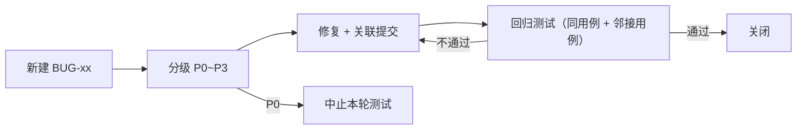

# DSH Remote 测试计划

| 项 | 值 |
|---|---|
| 文档编号 | TP-DSHR-001 |
| 版本 | v1.0 |
| 接口基线 | [API契约.md](../01-设计/API契约.md) v1（冻结） |
| 需求基线 | [需求规格说明书](../00-需求/需求规格说明书.md) v1.0（FR-xx / NFR-xx / US-xx） |
| 用例编号 | `TC-xx`（与需求验收矩阵一一对应） |
| 缺陷编号 | `BUG-xx`（见 [§6 缺陷管理](#6-缺陷管理)） |

---

## 1. 测试策略

| 项 | 内容 |
|---|---|
| 目标 | 证明「人在外面用手机下发任务 → PC 上 headless DSH 执行 → 过程与结果实时回传」在**正常、异常、安全**三类路径下都符合契约与需求 |
| 原则 | 契约优先（断言以[API契约.md](../01-设计/API契约.md)逐字字段为准）；自动化优先；未实测项一律标 `> 待验证：`；不得以「看起来能用」代替断言 |
| 边界 | 不测试 DSH 模型输出质量（属上游能力）；不测试桌面端功能（不在链路内）；不测厂商 ROM 后台策略的兼容性穷举 |
| 分层比例目标 | 单元 ≈ 50%，集成 ≈ 30%，端到端 + 手工 ≈ 20% |

### 1.1 测试分层

| 层 | 对象 | 工具 | 运行方式 | 通过要求 |
|---|---|---|---|---|
| L1 单元 | 网关各模块（限速、认证、白名单、SSE 分帧、环形缓冲、状态机、原子写） | `node:test` | `node --test tools/dsh-remote/test` | 全绿，无跳过 |
| L1 单元（客户端） | JSON 解析、SSE 帧解析、`seq` 拼接去重、退避序列 | JUnit4 + 纯 Kotlin（可用 MockWebServer） | `gradlew.bat :app:testDebugUnitTest` | 全绿，无跳过 |
| L2 集成 | 网关全部契约端点（真实 HTTP，本地起服务 + 临时 `DSH_HOME`） | `node:test` + 内置 `fetch` | 同上（集成用例同套件） | 契约 §1~§5 全部端点被覆盖 |
| L3 端到端 | 真实手机/模拟器 ↔ 真实网关 ↔ 真实 dsh CLI | 手工 + 脚本 | 按 §4 环境矩阵执行 | 核心链路 US-01/02/03/05 全通过 |
| L4 手工验收 | UI 交互、后台保活、外网接入、装机 | 人工 | 按用例逐步执行 | 用例步骤与期望结果全部符合 |
| L5 运维 | 安装、自启、重启恢复、日志 | PowerShell 脚本 | `scripts/selftest.ps1` / `verify.ps1` | 逐项 PASS，退出码 0 |
| L6 交付检查 | APK 签名与哈希、文档一致性 | 脚本 + 人工 | `scripts/verify.ps1` | 报告表全项 PASS |

### 1.2 进入 / 退出条件（单轮测试）

| 条件 | 内容 |
|---|---|
| 进入 | 代码已合并到待测分支；网关可启动；`dsh` CLI 可用且版本为 `0.1.0-rc.7`；`.credentials.yaml` 就绪；APK 可构建 |
| 退出 | 本文 §7 准出标准全部满足 |
| 中止 | 出现 P0 缺陷（任务无法完成 / 凭据泄露）→ 立即中止并出报告 |

---

## 2. 测试环境矩阵

### 2.1 PC 侧

| 项 | 配置 | 备注 |
|---|---|---|
| 操作系统 | Windows 11（实测环境） | Windows 10 21H2+ `> 待验证：未实测` |
| 执行引擎 | `dsh` CLI `0.1.0-rc.7`，`--profile headless` | 版本由 `health.dshVersion` 回显校验 |
| 运行时 | Node.js（网关零第三方依赖，仅标准库） | `> 待验证：Node 主版本下限以安装脚本探测结果为准` |
| 桌面端 | DSH `0.2.0-rc.2`（Electron，Web GUI `127.0.0.1:19387`） | **不参与测试链路**，仅作为同机凭据来源环境说明 |
| 凭据 | `%DSH_HOME%/.credentials.yaml` 内含 `DEEPSEEK_API_KEY` | 测试环境使用专用 Key，不写入仓库 |
| 工作区 | `D:\proj`（主）+ 含中文/空格路径目录各一 | 覆盖 NFR-COMPAT-05 |
| 端口 | 网关 `8787` | 被占用时应能明确报错 |

### 2.2 移动侧

| 项 | 配置 |
|---|---|
| 最低版本 | Android 8.0（API 26） |
| 目标版本 | Android 14（API 34）`targetSdk 34` |
| 覆盖范围 | Android 8 / 10 / 12 / 13 / 14（实机或模拟器），Android 15 `> 待验证：未逐机型实测` |
| 机型建议 | 至少 1 台厂商 ROM（后台清理激进）+ 1 台原生/近原生 |
| 网络形态 | 同局域网 Wi-Fi；蜂窝（经隧道）；断网/弱网模拟（飞行模式切换） |
| 安装包 | debug 签名 APK（自用），记录大小与 `sha256` |

### 2.3 网络与部署形态

| 编号 | 形态 | 配置 | 对应用例 |
|---|---|---|---|
| E1 | 局域网直连 | 手机与 PC 同网段，`http://<PC-IP>:8787` | TC-46 |
| E2 | Tailscale | 两端登录同一 tailnet，`https://<pc>.<tailnet>.ts.net` | TC-47 |
| E3 | frp + TLS | 公网 VPS + 证书 + `frpc` 反向隧道 | TC-48 |
| E4 | Cloudflare Tunnel | `cloudflared` 出站隧道 + 域名 | TC-49 |
| E5 | 无隧道裸映射 | **仅作为反例**，用于验证部署检查项能识别风险 | TC-60 |

### 2.4 测试数据准备

| 数据 | 内容 | 用途 |
|---|---|---|
| 任务 T1 | `写一个文件 test-dshr.txt，内容为 OK，然后回答 DONE` | 已验证基准：2.6 s 完成、文件真实落盘 |
| 任务 T2 | 含中文、引号、换行、`&`/`|`/`%` 的 prompt | NFR-SEC-07 / TC-77 |
| 任务 T3 | 长时任务（循环 5 分钟） | 取消、超时、后台保活 |
| 任务 T4 | 会失败的任务（访问不存在路径或非法参数） | 退出码非 0 → `failed` |
| 任务 T5 | 中文 + 空格工作区路径 | NFR-COMPAT-05 |
| 任务 T6 | 大量输出任务（产生 > 1 MB stdout） | 截断标志、环形缓冲 |
| 配对码 | 正常码 / 已用码 / 过期码 / 随机错误码 | 配对用例 |

---

## 3. 测试用例

### 3.1 L1 网关单元（TC-01 ~ TC-09）

| TC | 名称 | 前置 | 步骤 | 期望结果 | 需求 |
|---|---|---|---|---|---|
| TC-01 | 健康探针字段完整 | 网关启动 | `GET /api/v1/health` | `200`；含 `ok`/`apiVersion`/`serverName`/`gatewayVersion`/`dshVersion`/`uptimeMs`/`activeTasks`/`queuedTasks`/`pairingOpen`/`authRequired`/`capabilities`；`capabilities` 含 `tasks,events,pairing,workspaces,cancel` | FR-01 |
| TC-02 | 健康探针无需认证 | 无令牌 | 同上 | `200`（不返回 401） | FR-01 |
| TC-03 | 健康探针反映活动态 | 有 1 个 `running`、1 个 `queued` | `GET /api/v1/health` | `activeTasks=1`、`queuedTasks=1` | FR-01, US-06 |
| TC-04 | 客户端无网络可启动 | 未配置服务器 | 冷启动 App | 进入配置页，无 ANR/崩溃 | FR-17 |
| TC-05 | 统一错误体 | 任意错误请求 | 触发 4xx | 响应体形如 `{"error":{"code","message"}}`，`code` ∈ 契约 §0 九种枚举 | 契约 §0 |
| TC-06 | 时间字段格式 | 有任务 | 校验 `createdAt`/`startedAt`/`finishedAt`/`at` | 均为 Unix 毫秒整数或 `null`；字段名以 `At` 结尾 | 契约 §0 |
| TC-07 | SSE 分帧与多行转义 | 任务输出含换行 | 抓取 SSE 原始字节 | `data:` 恒为**单行** JSON；内部换行为 `\n`；无裸换行破坏分帧 | FR-20 |
| TC-08 | 环形缓冲上限 | 持续产生事件 | 观察内存与可补发窗口 | 仅保留最近 **2000** 条；内存无界增长即失败 | NFR-PERF-04 |
| TC-09 | 原子写 | 任务终态 | 观察 `tasks/*.json` 写入 | 先写临时文件再 rename；中途中断不产生半截 JSON | FR-16 |

### 3.2 L1 客户端单元（TC-90 ~ TC-95）

| TC | 名称 | 步骤 | 期望结果 | 需求 |
|---|---|---|---|---|
| TC-90 | Task JSON 解析 | 用契约 §3.1 样例反序列化 | 13 个字段全部解析正确；`null` 字段不崩 | FR-07 |
| TC-91 | 未知字段容忍 | 加入未知字段后解析 | 不报错、不丢失已知字段 | 开发规范 A7 |
| TC-92 | SSE 帧解析 | 输入含 `id`/`event`/`data`/`: ping` 的混合流 | 正确切帧；注释行被忽略；增量 `delta` 提取正确 | FR-12 |
| TC-93 | seq 拼接与去重 | 打乱顺序注入 seq=1..5，重复注入 3 | 拼接结果按 seq 严格有序，重复项只计一次 | FR-14 |
| TC-94 | 重连退避序列 | 模拟连续失败 | 间隔为 1s→2s→4s→8s→16s→**30s（上限）**；成功后重置 | FR-14, NFR-AVAIL-01 |
| TC-95 | 窗口溢出兜底 | 服务端无法补齐 `fromSeq` | 客户端改拉 `GET /api/v1/tasks/{id}` 并以快照覆盖本地拼接结果 | FR-14, FR-07 |

### 3.3 L2 集成 · 配对与认证（TC-10 ~ TC-19）

| TC | 名称 | 步骤 | 期望结果 | 需求 |
|---|---|---|---|---|
| TC-10 | 正常配对 | 回环 `POST /api/v1/pair/open` → 手机 `POST /api/v1/pair/claim`（正确码+设备名+deviceId） | `open` 返回 6 位数字 `code` 与 `expiresAt`；`claim` 返回 `200` 含 `token`/`tokenId`/`serverName`/`expiresAt:null` | FR-02, US-11 |
| TC-11 | 配对码一次性 | 同一码连续 `claim` 两次 | 第一次成功；第二次 `401 pairing_bad_code` | FR-02, FR-19 |
| TC-12 | 同 deviceId 重配 | 用相同 `deviceId` 再次配对 | 返回新 `token`；旧 `tokenId` 立即失效（旧令牌请求返回 `401 unauthorized`） | FR-24, US-08 |
| TC-13 | 配置页校验 | 保存地址与令牌后调 `GET /api/v1/health` | 显示 `serverName` 与 `gatewayVersion`；地址错误时给出明确错误 | FR-13 |
| TC-14 | 未开启配对 | 不调 `open` 直接 `claim` | `403 pairing_closed` | FR-19 |
| TC-15 | 非回环调用 `pair/open` | 从非 `127.0.0.1`/`::1` 来源 `POST /api/v1/pair/open` | 被拒绝（`403 forbidden` 或直接不可达），不生成码 | FR-19, NFR-SEC-03 |
| TC-16 | 设备列表 | `GET /api/v1/devices` | 返回 `devices[]` 含 `tokenId`/`deviceName`/`pairedAt`/`lastSeenAt`；**不含明文令牌** | FR-18 |
| TC-17 | 吊销令牌 | `DELETE /api/v1/devices/{tokenId}` → 用该令牌再请求 | 删除返回 `204`；旧令牌请求 `401 unauthorized` | FR-18 |
| TC-18 | 设备不存在 | `DELETE /api/v1/devices/tok_notexist` | `404 not_found` | 契约 §0 |
| TC-19 | 配对码有效期 | 生成码后等待 > 5 分钟再 `claim` | `401 pairing_bad_code` | FR-02 |

### 3.4 L2/L3 集成 · 任务生命周期（TC-20 ~ TC-29）

| TC | 名称 | 步骤 | 期望结果 | 需求 |
|---|---|---|---|---|
| TC-20 | 提交任务成功 | `POST /api/v1/tasks`（prompt+workspace） | `201` + 完整 Task；`status="queued"`；`output=""`；`error=null`；`truncated=false` | FR-04, US-01 |
| TC-21 | 工作区列表 | `GET /api/v1/workspaces` | 返回白名单 `path`/`label`/`exists` 与 `default` | FR-03 |
| TC-22 | 白名单外工作区 | `POST /api/v1/tasks` 传白名单外路径（含 `..` 穿越尝试） | `400 bad_request`，不创建任务 | NFR-SEC-06 |
| TC-23 | 工作区子目录 | 传白名单目录的子目录 | 接受（白名单含子目录） | FR-04 |
| TC-24 | 基准任务端到端 | 提交 T1（写文件并回答 DONE） | `succeeded`；`exitCode=0`；文件**真实落盘**；`output` 含 `DONE`；耗时秒级（基准 2.6 s） | FR-05, NFR-PERF-01 |
| TC-25 | 取消活动任务 | 提交 T3 → 活动态 `POST /api/v1/tasks/{id}/cancel` | 返回 Task `status="canceled"`；进程树终止；无孤儿 node 进程 | FR-09, US-05 |
| TC-26 | 取消终态任务 | 对已 `succeeded` 任务再 cancel | 幂等返回原对象，状态不变 | FR-09 |
| TC-27 | 并发上限 | 配置并发 2，同时提交 3 个长任务 | 第 3 个行为符合配置（`429 busy` 或入队 `queued`）；语义与契约 §3.1 一致 | FR-25 |
| TC-28 | 状态机单向 | 全程采集状态序列 | 只出现 `queued→running→(succeeded\|failed\|canceled)`，无回退、无跳跃 | FR-06 |
| TC-29 | 失败与超时 | 提交 T4（必失败）与超时任务（`timeoutSec` 设小） | 均置 `failed`；`error` 可读；`exitCode` 或超时信息正确；无残留进程 | FR-05, FR-25, NFR-AVAIL-06 |

### 3.5 L2/L3 集成 · SSE 实时回传（TC-30 ~ TC-34, TC-40 ~ TC-43）

| TC | 名称 | 步骤 | 期望结果 | 需求 |
|---|---|---|---|---|
| TC-30 | 事件类型齐全 | 订阅 `GET /api/v1/events`（不带 `taskId`）并提交任务 | 依次收到 `task.created`(`task`)、`task.started`(`task`)、若干 `task.output`(`delta`)、`task.finished`(`task`)；可选 `task.progress`(`phase`,`note`) | FR-12, US-02 |
| TC-31 | 增量拼接等于全文 | 收完所有 `delta` 后对比 `GET /api/v1/tasks/{id}` 的 `output` | 拼接结果与 `output` **一致**（含中文与换行） | FR-20, FR-07 |
| TC-32 | fromSeq 补发 | 收 10 条后断连，带 `fromSeq` 重连 | 从缺失序号起补齐，无遗漏、无重复 | FR-14 |
| TC-33 | Last-Event-ID 续传 | 用 `Last-Event-ID: <已收最大 id>` 重连 | 行为同 TC-32 | FR-14 |
| TC-34 | 任务详情累计输出 | 运行中与终态各拉一次 `GET /api/v1/tasks/{id}` | `output` 均为**当前累计完整输出**（非增量） | FR-07, FR-22 |
| TC-40 | 断线自动恢复 | 执行长任务中开关飞行模式 30~60 s | 1s→30s 退避后自动重连；`fromSeq` 补齐；界面输出不断档 | FR-14, NFR-AVAIL-01 |
| TC-41 | 退出码映射 | 提交退出码 0 与非 0 的任务各一 | 0→`succeeded`；非 0→`failed` 且 `error` 可读 | FR-05 |
| TC-42 | 多行/中文输出 | 提交产出多行中文的任务 | SSE 分帧不破；手机端显示与 PC 端 `output` 一致 | FR-20, NFR-COMPAT-05 |
| TC-43 | 心跳与后台保活 | 空闲订阅 45 s；App 退后台 10 分钟 | 每 **15 s** 收到 `: ping`；后台连接仍收到事件（目标）`> 待验证：需真机与厂商 ROM 实测` | FR-12, FR-23, NFR-AVAIL-07 |

### 3.6 L4 手工验收 · 客户端与网络（TC-35 ~ TC-39, TC-44 ~ TC-49）

| TC | 名称 | 步骤 | 期望结果 | 需求 |
|---|---|---|---|---|
| TC-35 | 历史记录落库 | 完成任务后关闭 App 再开 | 历史页可见该任务且状态正确 | FR-10, US-09 |
| TC-36 | 离线查看历史 | 断网后打开历史页 | 可查看上次输出，不崩溃 | FR-10, NFR-AVAIL-02 |
| TC-37 | 列表分页与倒序 | `GET /api/v1/tasks?status=all&limit=2` | 按 `createdAt` 倒序；返回 `nextCursor` 可用于下一页 | FR-08 |
| TC-38 | 删除终态任务 | `DELETE /api/v1/tasks/{id}`（终态） | `204`；`tasks?status=all` 中消失 | FR-11 |
| TC-39 | 删除活动任务 | 对 `running` 任务 `DELETE` | `400 bad_request`（仅终态可删） | FR-11 |
| TC-44 | 网关不可达 | 关闭 PC 网关上拉任务 | 明确错误态提示，不无限转圈；不崩溃 | NFR-AVAIL-02, US-06 |
| TC-45 | 多版本装机 | Android 8/10/12/13/14 安装并跑通一次任务 | 均可安装、可提交、可看输出（Android 15 `> 待验证`） | NFR-COMPAT-02, FR-23 |
| TC-46 | 局域网直连 | 形态 E1 | 手机可连、可配对、可跑任务；文档提示内网明文风险 | NFR-COMPAT-06, FR-15 |
| TC-47 | Tailscale 接入 | 形态 E2 | 经 tailnet 可连（HTTPS）；离开家庭网络仍可用 | NFR-COMPAT-06, NFR-SEC-05 |
| TC-48 | frp + TLS 接入 | 形态 E3 | 经公网域名 443 可连；证书有效 | NFR-COMPAT-06 |
| TC-49 | Cloudflare Tunnel 接入 | 形态 E4 | 经隧道域名可连；无需对外开放端口 | NFR-COMPAT-06 |
| TC-60 | 外网安全评审 | 逐项检查部署配置（E5 反例） | 无裸端口映射；无不带 TLS 的公网入口；文档有警告 | NFR-SEC-05, US-04 |
| TC-61 | 手动粘贴令牌 | 配置页绕过配对直接粘贴令牌 | 可正常使用；无效令牌给出明确错误 | FR-13 |

### 3.7 L5 运维验收（TC-50 ~ TC-59）

| TC | 名称 | 步骤 | 期望结果 | 需求 |
|---|---|---|---|---|
| TC-50 | 一键安装 | 在干净环境跑 `scripts/setup-pc.ps1` | 探测到 node/dsh 路径；创建运行目录；写入凭据（UTF-8 无 BOM）并回读校验；生成 `config.json`；打印下一步命令 | FR-16, NFR-COMPAT-04 |
| TC-51 | 开机自启 | 安装计划任务 → 重启/重新登录 | 网关自动运行；`GET /api/v1/health` 为 `ok:true` | FR-16, US-12 |
| TC-52 | 一键自检 | 跑 `scripts/selftest.ps1` | 逐项 PASS/FAIL；失败项有原因；非零退出码表示失败 | FR-01, US-13 |
| TC-53 | 重启后历史仍在 | 完成任务 → 重启网关 → 查列表 | 历史任务与 `output` 仍在（`tasks/*.json` 恢复） | FR-16, NFR-AVAIL-03 |
| TC-54 | 日志可追溯 | 跑一个任务后查 `logs/gateway-YYYYMMDD.log` | 含该任务 `id`、`sessionId`、起止时间与耗时；**无令牌明文** | FR-16, FR-26 |
| TC-55 | 重启恢复活动任务 | 任务运行中强杀网关并重启 | 该任务不停留在 `running`；置终态且 `error` 说明中断 | FR-27, NFR-AVAIL-04 |
| TC-56 | 内存占用 | 空载运行 24 h 采样 | ≤ 80 MB（目标）`> 待验证：需长稳实测` | NFR-PERF-03 |
| TC-57 | 事件窗口长稳 | 连续产生 > 5000 条事件 | 仅保留 2000 条；内存曲线平稳，无持续增长 | NFR-PERF-04 |
| TC-58 | 历史列表性能 | 本地 500 条记录滚屏 | 首屏 ≤ 1 s、滚动无明显卡顿（目标）`> 待验证：需真机基准` | NFR-PERF-05 |
| TC-59 | 幂等安装/卸载 | 重复跑安装脚本；再跑卸载脚本 | 不破坏既有配置（已存在则备份 `.bak-<时间戳>`）；卸载后计划任务被清除 | FR-16 |

### 3.8 L4/L6 安全用例（TC-70 ~ TC-86）

| TC | 名称 | 步骤 | 期望结果 | 需求 |
|---|---|---|---|---|
| TC-70 | 未授权访问 | 不带 `Authorization` 请求 `/api/v1/tasks`、`/events`、`/workspaces`、`/devices` | 全部 `401 unauthorized` | NFR-SEC-01 |
| TC-71 | 令牌只存哈希 | 检索 `devices.json`、`tasks/*.json`、日志 | 只有 `sha256` 摘要与 `tokenId`，**无明文令牌** | NFR-SEC-02, FR-26 |
| TC-72 | 错误令牌 | 用 `Bearer wrong` 请求 | `401 unauthorized` | NFR-SEC-01 |
| TC-73 | 恒定时间比较 | 代码评审 + 用例覆盖 | 比较不因前缀匹配提前返回；长度不同也走完整路径 | NFR-SEC-02 |
| TC-74 | 配对码不可抢注 | 局域网另一设备直接调 `pair/open` | 被拒绝（非回环） | NFR-SEC-03 |
| TC-75 | pair/claim 限速 | 1 分钟内 > 10 次 `claim` | 超出返回 `429 rate_limited` | NFR-SEC-04 |
| TC-76 | 认证失败限速 | 1 分钟内 > 30 次错误令牌 | 超出返回 `429 rate_limited` | NFR-SEC-04 |
| TC-77 | 命令注入防护 | 提交 T2（含 `"` `&` `\|` `%` 换行 `..`） | 全部作为字面量传入 CLI；任务正常执行或明确失败；**无 shell 解释** | NFR-SEC-07 |
| TC-78 | 手机端令牌存放 | 检查 App 私有存储与 logcat | 令牌只在 DataStore；日志与外部存储无明文 | NFR-SEC-08 |
| TC-79 | APK 签名如实声明 | `apksigner verify`（或等价检查） | 为 debug 签名；README/文档明确标注自用、不外发 | NFR-SEC-09 |
| TC-80 | 中文与特殊路径 | 用中文+空格工作区提交 T5 | 路径正确传递；输出正确落盘 | NFR-COMPAT-05 |
| TC-81 | 客户端依赖收敛 | 检查 Gradle 依赖树 | 仅 `OkHttp`/`org.json`/`DataStore Preferences` + 官方 AndroidX/Compose | NFR-COMPAT-07 |
| TC-82 | 网关零依赖 | 检查 `tools/dsh-remote/package.json` | `dependencies` 为空 | NFR-MAINT-01 |
| TC-83 | 端点覆盖 | 统计集成用例覆盖的端点 | 契约 §1~§5 全部端点有对应用例 | NFR-MAINT-02 |
| TC-84 | 静态检查 | 两端跑各自风格检查 | 无阻断级告警 | NFR-MAINT-03 |
| TC-85 | 契约变更流程 | 人为发起一次接口变更演练 | 契约 + `X-Api-Version` + FR + TC + 变更记录五处同步 | NFR-MAINT-04 |
| TC-86 | 文档齐备 | 核对 `docs/**` | 索引/需求/契约/设计/规范/测试/部署/变更记录齐备；验收矩阵无空项 | NFR-MAINT-05 |

---

## 4. 执行方式

### 4.1 自动化命令

| 层 | 命令 | 通过判据 |
|---|---|---|
| L1/L2 网关 | `node --test tools/dsh-remote/test` | 全部通过、无跳过；输出用例数贴入报告 |
| L1 客户端 | `android\gradlew.bat :app:testDebugUnitTest` | `BUILD SUCCESSFUL`；报告无失败 |
| 构建 | `android\gradlew.bat :app:assembleDebug` | 产出 APK，记录大小与 `sha256` |
| L5 自检 | `pwsh -File scripts/selftest.ps1` | 逐项 PASS，退出码 0 |
| L6 验收 | `pwsh -File scripts/verify.ps1` | 报告表全项 PASS |

### 4.2 手工验收脚本模板（L3/L4）

| 字段 | 填写要求 |
|---|---|
| 用例编号 | TC-xx |
| 环境 | PC 版本 / 手机型号与 Android 版本 / 网络形态（E1~E4） |
| 前置 | 网关版本、`dshVersion`、已配对设备名 |
| 步骤 | 编号步骤，含具体命令与输入 |
| 实际结果 | 原始输出或截图路径（不得只写「正常」） |
| 判定 | PASS / FAIL / BLOCKED |
| 备注 | 如为 `> 待验证` 项，注明未覆盖原因 |

### 4.3 缺陷复现最小信息

| 项 | 内容 |
|---|---|
| 必填 | 用例编号、环境、时间戳、任务 `id` 与 `sessionId`、网关日志片段、请求与响应原文 |
| 禁止 | 提交含真实令牌或 API Key 的日志（脱敏为 `dshr_****` / `sk-****`） |

---

## 5. 需求 ↔ 用例覆盖确认

| 需求 | 覆盖用例 | 状态 |
|---|---|---|
| FR-01 | TC-01, TC-02, TC-03, TC-52 | ✅ |
| FR-02 | TC-10, TC-11, TC-13, TC-19 | ✅ |
| FR-03 | TC-21 | ✅ |
| FR-04 | TC-20, TC-22, TC-23 | ✅ |
| FR-05 | TC-24, TC-29, TC-41 | ✅ |
| FR-06 | TC-28 | ✅ |
| FR-07 | TC-31, TC-34, TC-90 | ✅ |
| FR-08 | TC-37 | ✅ |
| FR-09 | TC-25, TC-26 | ✅ |
| FR-10 | TC-35, TC-36 | ✅ |
| FR-11 | TC-38, TC-39 | ✅ |
| FR-12 | TC-30, TC-43, TC-92 | ✅ |
| FR-13 | TC-13, TC-61 | ✅ |
| FR-14 | TC-32, TC-33, TC-40, TC-93, TC-94, TC-95 | ✅ |
| FR-15 | TC-46, TC-60 | ✅ |
| FR-16 | TC-50, TC-51, TC-53, TC-54, TC-59 | ✅ |
| FR-17 | TC-04 | ✅ |
| FR-18 | TC-16, TC-17, TC-18 | ✅ |
| FR-19 | TC-11, TC-14, TC-15, TC-19 | ✅ |
| FR-20 | TC-07, TC-31, TC-42 | ✅ |
| FR-21 | TC-20, TC-21, TC-30 | ✅ |
| FR-22 | TC-25, TC-34 | ✅ |
| FR-23 | TC-43, TC-45 | ✅ |
| FR-24 | TC-12 | ✅ |
| FR-25 | TC-27, TC-29 | ✅ |
| FR-26 | TC-54, TC-71 | ✅ |
| FR-27 | TC-55 | ✅ |
| NFR-SEC-01 | TC-70, TC-72 | ✅ |
| NFR-SEC-02 | TC-71, TC-73 | ✅ |
| NFR-SEC-03 | TC-15, TC-74 | ✅ |
| NFR-SEC-04 | TC-75, TC-76 | ✅ |
| NFR-SEC-05 | TC-47, TC-60 | ✅ |
| NFR-SEC-06 | TC-22 | ✅ |
| NFR-SEC-07 | TC-77 | ✅ |
| NFR-SEC-08 | TC-78 | ✅ |
| NFR-SEC-09 | TC-79 | ✅ |
| NFR-PERF-01 | TC-24 | ✅ |
| NFR-PERF-02 | TC-31 | ✅ |
| NFR-PERF-03 | TC-56 | ✅（`> 待验证`） |
| NFR-PERF-04 | TC-08, TC-57 | ✅ |
| NFR-PERF-05 | TC-58 | ✅（`> 待验证`） |
| NFR-PERF-06 | TC-40 | ✅（`> 待验证`） |
| NFR-AVAIL-01 | TC-40, TC-94 | ✅ |
| NFR-AVAIL-02 | TC-36, TC-44 | ✅ |
| NFR-AVAIL-03 | TC-53 | ✅ |
| NFR-AVAIL-04 | TC-55 | ✅ |
| NFR-AVAIL-05 | TC-27 | ✅ |
| NFR-AVAIL-06 | TC-25, TC-29 | ✅ |
| NFR-AVAIL-07 | TC-43 | ✅（`> 待验证`） |
| NFR-COMPAT-01 | TC-50 | ✅（Win10 `> 待验证`） |
| NFR-COMPAT-02 | TC-45 | ✅（Android 15 `> 待验证`） |
| NFR-COMPAT-03 | TC-24 | ✅ |
| NFR-COMPAT-04 | TC-50 | ✅（`> 待验证`） |
| NFR-COMPAT-05 | TC-42, TC-80 | ✅ |
| NFR-COMPAT-06 | TC-46, TC-47, TC-48, TC-49 | ✅ |
| NFR-COMPAT-07 | TC-81 | ✅ |
| NFR-MAINT-01 | TC-82 | ✅ |
| NFR-MAINT-02 | TC-83 | ✅ |
| NFR-MAINT-03 | TC-84 | ✅ |
| NFR-MAINT-04 | TC-85 | ✅ |
| NFR-MAINT-05 | TC-86 | ✅ |

**用例反查**：TC-05/TC-06 校验契约 §0 通用约定（错误体封套、时间字段）；TC-09 校验持久化原子写；TC-90 ~ TC-95 为客户端单元用例；其余用例均已在上表归属到具体需求。

未覆盖项与原因：

| 项 | 原因 | 处置 |
|---|---|---|
| 模型输出质量 | 属上游 DSH 能力 | 不在本计划范围 |
| 桌面端功能 | 不在远程链路 | 仅验证「不依赖桌面端即可执行」 |
| 厂商 ROM 后台策略穷举 | 机型组合爆炸 | 只做代表机型 + 退避重连兜底 |
| 真实公网攻击流量 | 环境不可控 | 以限速与恒定时间比较用例替代 |

---

## 6. 缺陷管理

### 6.1 缺陷等级定义

| 等级 | 定义 | 典型例子 | 处置时限 |
|---|---|---|---|
| **P0 阻断** | 核心链路不可用或凭据泄露 | 任务无法完成；令牌明文出现在日志/文件；配对可被局域网抢注 | 立即停止测试，修复后才继续 |
| **P1 严重** | 主要功能错误或数据丢失 | SSE 丢事件导致输出不完整；取消无效；状态机回退；重启历史丢失 | 本轮必须修复 |
| **P2 一般** | 影响体验但有绕过方式 | 重连偶发失效需手动刷新；错误提示不清晰；历史列表卡顿 | 本轮修复或登记下轮 |
| **P3 轻微** | 文案、样式、非阻断告警 | 错别字；间距；日志级别不当 | 可延后 |

### 6.2 缺陷生命周期

| 规则 | 内容 |
|---|---|
| 每个缺陷必须有唯一 `BUG-xx` 编号与一个主管用例编号 |
| P0/P1 缺陷修复后必须回归**同用例 + 邻接用例**（如修 SSE 拼接要回归 TC-31/TC-32/TC-40） |
| 缺陷关闭需附回归证据（原始输出），不接受「应该好了」 |
| 缺陷相关变更必须登记[变更记录](../06-项目管理/变更记录.md) |

---

## 7. 准出标准

### 7.1 必须全部满足

| # | 准出项 | 判据 |
|---|---|---|
| Q1 | 网关自动化测试 | `node --test tools/dsh-remote/test` 全绿、无跳过；契约 §1~§5 端点覆盖 100%（TC-83） |
| Q2 | 客户端自动化测试 | `:app:testDebugUnitTest` `BUILD SUCCESSFUL`，含 JSON/SSE/seq/退避四类用例（TC-90 ~ TC-95） |
| Q3 | 构建产物 | `:app:assembleDebug` 成功；APK 存在且记录大小与 `sha256`；debug 签名已如实声明（TC-79） |
| Q4 | 核心链路端到端 | TC-20/TC-24/TC-30/TC-31/TC-40 通过（真实手机 + 真实网关 + 真实 CLI） |
| Q5 | 安全用例 | TC-70 ~ TC-79 全部通过，其中 TC-71/TC-73/TC-77 为硬性 |
| Q6 | 异常与降级 | TC-22/TC-25/TC-27/TC-29/TC-44/TC-55 通过 |
| Q7 | 运维验收 | TC-50/TC-51/TC-52/TC-53/TC-54 通过，`selftest.ps1` 退出码 0 |
| Q8 | 缺陷状态 | P0/P1 缺陷数为 **0**；P2 有明确处置计划 |
| Q9 | 文档一致性 | 契约 / FR / 设计 / TC 四处字段与状态机逐字一致（TC-86、TC-85） |
| Q10 | 未验证标注 | 全部未实测项在文档中标注 `> 待验证：`，且 README/部署手册未把未实现写成已实现 |

### 7.2 允许带条件交付的项（须在交付说明中列明）

| 项 | 条件 |
|---|---|
| NFR-PERF-02/03/05/06、NFR-AVAIL-07、NFR-COMPAT-01/02/04 | 目标值未实测，标注 `> 待验证：` 并在交付说明列出实测计划 |
| 外网形态 E3/E4 | 若无对应环境，至少完成 E1 + E2，E3/E4 标注待验证 |

### 7.3 测试报告最小内容

| 章节 | 内容 |
|---|---|
| 环境 | 表格化：PC 版本、`dshVersion`、手机型号与 Android 版本、网络形态 |
| 执行汇总 | 用例总数 / 通过 / 失败 / 阻塞 / 跳过；各层通过率 |
| 失败明细 | 用例号、现象、原始输出、`BUG-xx` |
| 安全结论 | TC-70 ~ TC-79 逐项结论 |
| 未覆盖与待验证 | 明确列出 `> 待验证：` 项与原因 |
| 准出判定 | Q1 ~ Q10 逐项 PASS/FAIL |
