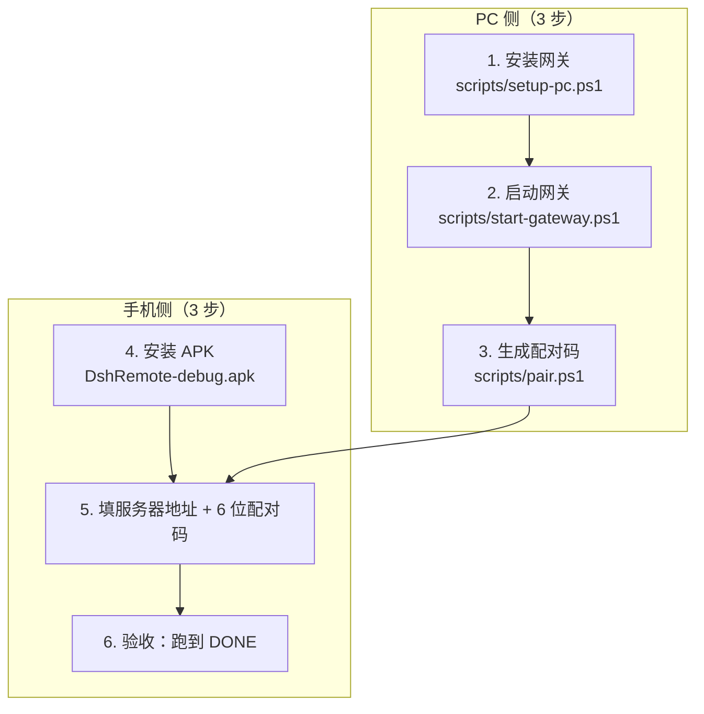

# DSH Remote 部署手册

| 项 | 值 |
|---|---|
| 文档编号 | OPS-DSHR-001 |
| 版本 | v1.2.0（2026-10-14 复核：**执行引擎与事实基线按当前实测更新**；已对齐契约「裁定补充（v1.1）」A1~A7，配置键名按交付版实现回填。文中仍标 `> 待验证：` 的条目为**尚未实测回填**的部分，勿当成已通过） |
| 适用对象 | PC 机主 / 运维 / 最终用户（单机自用场景） |
| 接口基线 | [API契约.md](../01-设计/API契约.md) v1（冻结，`X-Api-Version: 1`）+ [协议契约-v2.md](../01-设计/协议契约-v2.md) v2（`X-Api-Version: 2`；网关 `supportedApiVersions=[1,2]`，同时兼容两版）+ v1 裁定补充 v1.1 |
| 事实基线 | 桌面端 DSH `0.2.0-rc.2`（会话权威 + 默认执行者，回环 `127.0.0.1:19387`）；执行引擎**两条通道**：① 桌面端 DSH runtime（Typert Remote RPC，**手机新建任务的默认落点**，可驱动既有原生会话）② 网关自持 `dsh --profile sdk`（stdio JSON-RPC，**仅「仅在手机上执行」时使用**，启动器 `D:\DSH\resources\runtime\cli\bin\dsh.cmd` → `D:\DSH\DeepSeek Harness.exe`）；`--profile headless` **不能续聊既有会话**（`session … runs under agent preset "standard", which the one-shot runner does not compose`），**不是**当前执行引擎；引擎 `@deepseek-ai/dsh 0.1.0-rc.7`；Node `24.21.0`（网关用 DSH 自带 `primary-runtime\dependencies\node\bin\node.exe`）；网关 `gatewayVersion 2.2.0`（端口 `8787`，仅回环；代码常量 `lib/config.mjs:25` 为 `2.2.0`，但**正在跑的进程仍报启动时的 `2.1.0`**，见 §10.1.2 —— 判断跑的是哪一版代码看 `capabilities` 里有没有 `session.desktopRelay`）；中继 `relayVersion 2.0.1`（`wss://123.207.183.237:9443`） |

> **文档状态说明**：本手册给出完整的部署流程、配置项与排障表；其中标注 `> 待验证：` 的步骤命令，其**准确参数与输出**由 PC 安装脚本（`scripts/**`）与网关启动脚本（`tools/dsh-remote/**`）交付后回填核对。请勿把待验证步骤当成已实测通过的步骤使用。

> **安全前置（先读再做）**：① 配对码**只能在 PC 本机**生成；② 外网访问**必须**经 Tailscale / frp+TLS / Cloudflare Tunnel 等 TLS 隧道；③ **禁止**把 `8787` 端口以裸端口映射方式暴露到公网。

---

## 0. 部署前检查（Prerequisites）

| # | 检查项 | 合格标准 | 检查方式 |
|---|---|---|---|
| P1 | 操作系统 | Windows 11（实测）；Windows 10 21H2+ `> 待验证：未实测` | `winver` |
| P2 | DSH 桌面端 | 已装 `0.2.0-rc.2`（Electron）；Web GUI 监听 `127.0.0.1:19387` | 打开桌面端可正常使用 |
| P3 | `dsh` CLI | `0.1.0-rc.7`。**两套 profile 分工**：v2 手机任务的默认落点是桌面端 runtime（无需 CLI）；网关自持会话（「仅在手机上执行」）用 `--profile sdk`；v1 一次性任务用 `--profile headless`。`headless` **不能续聊既有会话** | 见下方探测命令 |
| P4 | Node.js 运行时 | 可执行 `node --version` `> 待验证：Node 主版本下限以安装脚本探测结果为准` | `node --version` |
| P5 | API 凭据 | 有可用的 `DEEPSEEK_API_KEY` | 由用户自行获取，**不入仓库** |
| P6 | 网络 | PC 与手机可达（同局域网或隧道已通） | `ping` / Tailscale 状态页 |
| P7 | 端口 | `8787` 未被占用 | `netstat -ano \| findstr :8787` |
| P8 | 磁盘 | 运行目录可写（任务与日志会持续增长） | 目录属性 |
| P9 | 权限 | 当前用户可创建计划任务（自启需要） | 见[§4 开机自启](#4-开机自启) |

**P3/P4 探测命令（实测环境参考值，实际路径以本机为准）**

```powershell
# node 运行时（实测环境示例路径；网关实际使用的就是这个 DSH 自带 node，v24.21.0）
D:\DSH\resources\runtime\primary-runtime\dependencies\node\bin\node.exe --version

# dsh CLI（实测环境示例路径）
C:\Users\<用户名>\.dsh\profiles\node_modules\@deepseek-ai\dsh\lib\bin.js

# v2 会话引擎（网关自持）："--profile sdk" 起 stdio JSON-RPC 服务端，由网关按需拉起并先做 initialize 握手
# 实际启动形状（见 tools/dsh-remote/lib/session-runner.mjs）：
#   D:\DSH\resources\runtime\cli\bin\dsh.cmd --expose-internals <…>\app.asar\dsh\node_modules\@deepseek-ai\dsh-desktop-host\lib\cli.js --profile sdk
# 手工冒烟：确认上面的 dsh.cmd 可执行即可，协议往返由网关负责（无需手工喂 JSON）。

# v1 任务探测（headless，一次性；退出码 0 表示可用，仅用于 /api/v1/tasks 那条老路径）
& <node.exe> <bin.js> --profile headless "回答 DONE"
```

| 期望 | 说明 |
|---|---|
| 退出码 `0` | v1 的 headless 探测：一次性会话可用（**不代表能续聊既有会话**） |
| `--profile sdk` | v2 手机任务（`source:"phone"`）的引擎；能否续聊取决于它，而不是 headless |
| stdout 末段 | 即最终答复文本（网关据此写入 `output`，仅 v1 任务） |
| 基准参考 | 实测「写文件并回答 DONE」任务 **2.6 秒**完成，文件真实落盘 |

> 待验证：上述路径为当前实测环境的具体值；正式安装请以 `scripts/setup-pc.ps1` 的探测输出为准，并支持 `-DshRoot` 覆盖。

---

## 1. 总览：PC 侧 3 步 + 手机侧 3 步



| 阶段 | 目标状态 | 验证点 |
|---|---|---|
| PC 安装完成 | 运行目录、凭据、`config.json` 就绪 | `config.json` 存在；凭据回读成功 |
| 网关运行中 | `GET /api/v1/health` 返回 `ok:true` | 浏览器/`curl` 可见 `serverName`/`gatewayVersion`/`dshVersion` |
| 取得配对码 | PC 上显示 6 位数字，5 分钟内有效 | 码为一次性 |
| 手机连上 | App 配置页显示服务器名与版本 | 保存后调 `GET /api/v1/health` 成功 |
| 端到端通过 | 手机提交任务 → PC 执行 → 结果回传 | 任务 `succeeded`，`output` 含预期文本 |

---

## 2. PC 侧安装网关

### 2.1 目录与文件布局（安装后应长这样）

| 路径 | 内容 | 是否入库 |
|---|---|---|
| `tools/dsh-remote/` | 网关源码（`gateway.mjs`、`lib/**`、`test/**`） | 是 |
| `%DSH_HOME%\.credentials.yaml` | `DEEPSEEK_API_KEY: <key>`（UTF-8 无 BOM） | **否** |
| `%DSH_HOME%\config.json` | 端口、并发、超时、工作区白名单 | **否** |
| `%DSH_HOME%\devices.json` | 设备库（只含 `sha256(token)`） | **否** |
| `%DSH_HOME%\tasks\*.json` | 每任务一份快照（原子写） | **否** |
| `%DSH_HOME%\logs\gateway-YYYYMMDD.log` | 按日滚动日志（含 `sessionId` 与耗时） | **否** |

默认运行目录：`%USERPROFILE%\.dsh-remote`（可用 `-Home` 参数覆盖）。

### 2.2 一键安装

```powershell
# 在仓库根目录执行
pwsh -File scripts/setup-pc.ps1
# 或指定参数
pwsh -File scripts/setup-pc.ps1 -DshRoot "D:\DSH\resources" -Home "$env:USERPROFILE\.dsh-remote" -ApiKey "<你的Key>"
```

| 步骤 | 脚本动作 | 期望输出 |
|---|---|---|
| 1 | 探测 DSH 安装路径、`node.exe`、`dsh` CLI | 打印探测到的路径 |
| 2 | 创建运行目录（含 `tasks/`、`logs/`） | 目录存在 |
| 3 | 交互式或按 `-ApiKey` 写入 `.credentials.yaml`（UTF-8 无 BOM）并**回读校验** | 回读一致 |
| 4 | 生成 `config.json`（端口 `8787`、并发 `2`、超时 `3600`、工作区白名单） | 文件存在且 JSON 合法 |
| 5 | 打印下一步命令 | 显示启动与配对命令 |
| 6 | 幂等保护 | 已存在文件备份为 `.bak-<时间戳>`，不破坏既有配置 |

> 待验证：脚本的实际参数名、输出文案与备份命名以 `scripts/setup-pc.ps1` 交付版为准；本节需在脚本落地后回填真实执行记录。

**执行策略提示**：若 PowerShell 拒绝执行脚本，按提示临时放行：

```powershell
Set-ExecutionPolicy -Scope Process -ExecutionPolicy Bypass
```

### 2.3 手工安装（脚本不可用时的兜底）

| 步骤 | 操作 |
|---|---|
| 1 | 创建运行目录：`New-Item -ItemType Directory -Force "$env:USERPROFILE\.dsh-remote\tasks","$env:USERPROFILE\.dsh-remote\logs"` |
| 2 | 写凭据：新建 `.credentials.yaml`，内容一行 `DEEPSEEK_API_KEY: <key>`，保存为 **UTF-8 无 BOM** |
| 3 | 复制 `tools/dsh-remote/config.example.json` 为 `config.json`，按[§3.2](#32-配置项表configjson) 修改 |
| 4 | 启动网关：见[§4.1](#41-手动启动) |

> 待验证：`config.example.json` 的字段名与取值以网关实现为准；`%DSH_HOME%` 的具体环境变量名以启动脚本为准。

---

## 3. 配置

### 3.1 配置 API Key

| 项 | 要求 |
|---|---|
| 文件 | `%DSH_HOME%\.credentials.yaml` |
| 格式 | `DEEPSEEK_API_KEY: <key>`（单行，冒号后一个空格） |
| 编码 | **UTF-8 无 BOM**（带 BOM 会导致解析失败） |
| 权限 | 仅当前用户可读（不要放共享目录） |
| 红线 | 不要把 Key 写进 `config.json`、日志、脚本、仓库任何文件 |
| 替换 | 换 Key 时直接覆盖该文件并重启网关 |

> 待验证：网关读取凭据的确切字段名与是否支持多键（如 base URL 覆盖），以 `tools/dsh-remote` 实现为准。

### 3.2 配置项表（`config.json`）

**键名与默认值以交付版实现为准**（来源：`tools/dsh-remote/config.example.json` 与 `tools/dsh-remote/lib/config.mjs` 的 `defaultConfig()`）。契约裁定 A2/A5/A6 只固定**语义与默认值**，不固定键名字面量；下表已按实现回填。

| # | 键（点号表示嵌套） | 默认值 | 说明 | 关联需求 / 裁定 |
|---|---|---|---|---|
| 1 | `host` | `"0.0.0.0"` | 监听地址（**不是** `bind`）；仅本机使用可改 `"127.0.0.1"` | 契约 §6.1 |
| 2 | `port` | `8787` | 监听端口 | 契约 §0 |
| 3 | `dshHome` | `null` → 见下方解析优先级 | 凭据目录 + 任务历史 + 日志的根，并作为 `DSH_HOME` 传给 `dsh` 子进程 | FR-05 / FR-16 |
| 4 | `serverName` | `null` → 回落到本机主机名 | `health.serverName` 的取值（手机配置页显示） | FR-01 |
| 5 | `gatewayVersion` | `"1.0.0"` | `health.gatewayVersion`；**字段一旦写在 `config.json` 里就会覆盖代码常量 `GATEWAY_VERSION`**（`lib/config.mjs` 的 `mergeConfig` 深合并），所以**升级后必须同步改这里**（同名的还有 `relay.gatewayVersion`）——见 [§10.1](#101-升级) | 契约 §1 |
| 6 | `authRequired` | `true` | 是否强制 Bearer 认证；**生产环境不要改为 false** | NFR-SEC-01 |
| 7 | `maxConcurrent` | `2` | **同时 `running` 的任务上限**；超出者进入 `queued` 而不是被拒绝 | FR-25 / A2 |
| 8 | `maxQueue` | `100` | `queued` 队列长度上限；**达到才**返回 `429 busy` | FR-25 / A2 |
| 9 | `defaultTimeoutSec` | `3600` | 单任务缺省超时（请求未带 `timeoutSec` 时生效） | FR-04 / A6 |
| 10 | `maxTimeoutSec` | `86400` | 单任务超时上限；请求超过此值 → `400 bad_request` | FR-04 / A6 |
| 11 | `workspaceAllowlist` | `[]`（**默认拒绝所有任务**） | 允许的工作区白名单，**字符串数组**（不是对象数组）；含子目录 | NFR-SEC-06 |
| 12 | `defaultWorkspace` | `null` | 请求未带 `workspace` 时使用的默认目录 | FR-04 |
| 13 | `dsh.node` | `null`（必填） | DSH 自带 `node.exe` 绝对路径（**不是** `nodeBin`），避免依赖系统 `PATH` 与版本 | FR-05 |
| 14 | `dsh.binPath` | `null`（必填） | `dsh` CLI 入口 `bin.js` 绝对路径（**不是** `dshBin`） | FR-05 |
| 15 | `dsh.profile` | `"headless"` | **v1 一次性任务**（`/api/v1/tasks`）的 CLI profile。⚠️ v2 会话**不用这个键**：手机任务走桌面端 runtime，网关自持会话固定用 `--profile sdk`（见 `lib/session-runner.mjs` 的 `SDK_PROFILE`） | FR-05 / NFR-COMPAT-03 |
| 16 | `dsh.version` | `"0.1.0-rc.7"` | 期望的 CLI 版本（用于探测/校验，回显到 `health.dshVersion`） | NFR-COMPAT-03 |
| 17 | `dsh.discoverSessionId` | `true` | 是否从子进程输出中发现 `sessionId` 并写入 Task | FR-05 |
| 18 | `dsh.launcherArgs` | `[]` | 追加在 CLI 之前的启动器参数（如 `wsl`、包装脚本） | FR-05 |
| 19 | `dsh.env` | `{}` | 传给子进程的额外环境变量 | FR-05 |
| 20 | `events.bufferSize` | `2000` | SSE 事件环形缓冲条数（契约 §4 的 2000） | 契约 §4 |
| 21 | `events.heartbeatMs` | `15000` | SSE 心跳间隔（15 s） | 契约 §4 |
| 22 | `limits.maxBodyBytes` | `1048576` | 请求体上限（1 MiB）；超限 → `413 payload_too_large` | 契约 §0 |
| 23 | `limits.maxOutputBytes` | `1048576` | 单任务累计输出上限（1 MiB）；超限只保留**尾部**并置 `truncated=true` | FR-30 / A5 |
| 24 | `limits.pairClaimPerMinute` | `10` | `pair/claim` 每 IP 每分钟限速 | NFR-SEC-04 |
| 25 | `limits.authFailPerMinute` | `30` | 认证失败每 IP 每分钟限速 | NFR-SEC-04 |
| 26 | `limits.pairCodeTtlMs` | `300000` | 配对码有效期（5 分钟、一次性） | FR-02 |
| 27 | `limits.maxSseClients` | `16` | 同时 SSE 连接数上限 | 契约 §4 |
| 28 | `limits.requestTimeoutMs` | `30000` | 单请求处理超时 | — |
| 29 | `limits.headersTimeoutMs` | `20000` | 请求头读取超时 | — |
| 30 | `limits.outputFlushMs` | `200` | 输出批量推送的刷新间隔 | FR-12 |
| 31 | `limits.outputFlushBytes` | `8192` | 输出批量推送的字节阈值 | FR-12 |
| 32 | `tasks.dirName` | `"tasks"` | 任务历史子目录（相对 `dshHome`） | FR-16 |
| 33 | `log.dirName` | `"logs"` | 日志子目录（相对 `dshHome`）；文件名 `gateway-YYYYMMDD.log` | FR-16 |
| 34 | `log.filePrefix` | `"gateway"` | 日志文件名前缀 | FR-16 |
| 35 | `log.toConsole` | `true` | 是否同时输出到控制台（服务方式运行时建议保持可见） | FR-16 |
| 36 | `mirror.enabled` | `true` | 是否挂载电脑端会话镜像（只读源 `mirror.dshHome`） | 契约 v2 §4.2 |
| 37 | `mirror.dshHome` | `null`（自动：`DSH_REMOTE_MIRROR_HOME` > `DSH_HOME` > `%USERPROFILE%\.dsh`） | 只读镜像源（电脑端真实 home）；网关**绝不写入** | 契约 v2 §4.2 |
| 38 | `mirror.liveWindowMs` | `60000` | 镜像会话"看起来还活着"的 mtime 窗口；v2.4.0 起列表/详情的 `live` 以**桌面端运行态**为准，本窗口只作兜底 | 契约 v2 §5.4 |
| 39 | **`desktop.*`** | 见右列 | **手机任务的电脑端通道**（v2.4.0/v2.5.0）。⚠️ 模板 `config.example.json` **未预置**这个块，需要时自己在 `config.json` 里写：`enabled`（默认 `true`；`false` = 关闭通道，电脑端会话退回只读）、`host`（默认 `127.0.0.1`）、`port`（默认 `19387`，即 `DEFAULT_DESKTOP_PORT`）、`dshHome`、`streamTimeoutMs`（默认 `600000`）。实现见 `lib/http.mjs` 的 `config.desktop?.…` 与 `lib/session-runner.mjs` | 契约 v2 §7.4 / §7.6 |

> 与旧版文档的差异（已按实现修正，勿再按旧名配置）：`bind` → **`host`**；`maxConcurrency` → **`maxConcurrent`**；`maxQueueLength` → **`maxQueue`**；`dshBin`/`nodeBin` → **`dsh.binPath`/`dsh.node`**；`logDir`/`logRetentionDays` → **`log.dirName`/`log.filePrefix`**（**无**保留天数键）；`pairTtlSec` → **`limits.pairCodeTtlMs`**（**毫秒**）；`rateLimit.*` → **`limits.pairClaimPerMinute`/`limits.authFailPerMinute`**；输出截断键为 **`limits.maxOutputBytes`**（**已确认存在**，默认 `1048576`）。
>
> 关于 `pair/open`：**不需要也不存在**"本地管理口令"配置项——该端点仅回环可达，非回环来源一律 `403 forbidden`（裁定 A1）。
>
> 白名单为空 `[]` 表示**拒绝所有任务**（默认拒绝，避免"忘记配置 == 全盘可写"）；这是有意设计，不是你配错了。

**`dshHome` 解析优先级（实现口径，从高到低）**

| 顺序 | 来源 | 说明 |
|---|---|---|
| 1 | CLI 参数 `--home <路径>` | 最高优先级，启动器 `dsh-remote.cmd` 可透传 |
| 2 | 环境变量 `DSH_REMOTE_HOME` | 网关专属变量 |
| 3 | `config.json` 的 `dshHome` | 文件内显式配置 |
| 4 | 环境变量 `DSH_HOME` | 复用已有 DSH 环境，便于开箱即用 |
| 5 | 兜底 `%USERPROFILE%\.dsh-remote` | 以上都没有时使用 |

> `dshHome` 同时是**凭据目录**、任务历史（`tasks/`）与日志（`logs/`）的根，并被作为 `DSH_HOME` 传给子进程——**v1 的 headless 子进程**只认 `$DSH_HOME/.credentials.yaml` 这一种凭据位置（v2 的 `--profile sdk` 子进程另有自己的凭据解析，由网关按 `dsh.credentialsFile` 等键处理，见 `lib/config.mjs` 注释）。
> ⚠️ 这个 `dshHome` 是**网关自己的**运行目录，**不是**电脑端在用的 `%USERPROFILE%\.dsh`；后者只作为只读镜像源（`mirror.dshHome`），网关绝不写入。

**任务相关配置的生效语义（四条容易配错的点）**

| 配置 | 生效语义 | 配错的表现 |
|---|---|---|
| `maxConcurrent=2` | 只有 `running` 计数受限；提交第 3 个任务**不会**被拒，而是 `queued` | 误以为"配 2 就只能同时提交 2 个" |
| `maxQueue=100` | 队列**未满**必须入队；仅当 `queued` 已达上限时该次提交返回 `429 busy` | 误配为 0 会导致所有超额任务直接 `busy` |
| `limits.maxOutputBytes=1048576` | 超限只保留**尾部**；事件流已推送的 `delta` 不回滚，客户端以详情接口 `output` 为准 | 误以为详情接口也是完整全文 |
| `workspaceAllowlist=[]` | 空数组 = 拒绝所有任务（默认拒绝） | 误以为"不配就是全盘允许" |

**工作区白名单示例（字符串数组）**

```json
{
  "host": "0.0.0.0",
  "port": 8787,
  "dshHome": "C:\\Users\\<用户名>\\.dsh-remote",
  "maxConcurrent": 2,
  "maxQueue": 100,
  "defaultTimeoutSec": 3600,
  "maxTimeoutSec": 86400,
  "workspaceAllowlist": [
    "D:\\proj",
    "C:\\Users\\<用户名>\\work"
  ],
  "defaultWorkspace": "D:\\proj",
  "dsh": {
    "node": "D:\\DSH\\resources\\runtime\\primary-runtime\\dependencies\\node\\bin\\node.exe",
    "binPath": "C:\\Users\\<用户名>\\.dsh\\profiles\\node_modules\\@deepseek-ai\\dsh\\lib\\bin.js",
    "profile": "headless",
    "version": "0.1.0-rc.7"
  }
}
```

| 规则 | 说明 |
|---|---|
| 值为字符串数组 | `["D:\\proj"]`；**不要**写成 `[{"path":...,"label":...}]`（对象形式不被支持） |
| `label` 来源 | `GET /api/v1/workspaces` 的 `label` 由网关取目录**basename** 自动生成（如 `D:\proj` → `proj`），不可配置 |
| 含子目录 | 白名单 `D:\proj` 允许 `D:\proj\sub`（TC-23） |
| 越界拒绝 | 白名单外路径或含 `..` 穿越一律 `400 bad_request`（TC-22） |
| 归一化 | 服务端对白名单与请求路径都做 `realpath` 归一，防目录联接/符号链接指向白名单之外 |
| 必须是绝对路径与目录 | 相对路径、不存在的路径、非目录一律 `400 bad_request` |
| `default` 取值 | `defaultWorkspace` 优先；未配置时回落到白名单中第一个 `exists=true` 的目录，都没有则为 `null` |
| 路径存在性 | `GET /api/v1/workspaces` 的 `exists` 字段反映当前是否存在（契约 §5） |

### 3.3 配置后自检

```powershell
pwsh -File scripts/selftest.ps1
```

| 检查项 | 期望 |
|---|---|
| node / dsh 路径 | PASS |
| 凭据文件 | PASS（存在且可解析） |
| 网关健康接口 | PASS（`ok:true`） |
| 真实提交一条任务并等待成功 | PASS |
| 整体退出码 | `0`（任一 FAIL 则非 0） |

> 待验证：`selftest.ps1` 的 PASS/FAIL 明细文案与检查条数以交付版为准。

---

## 4. 开机自启与进程管理

### 4.0 多合一控制台（推荐入口，桌面双击即可）

`scripts/dsh-remote-desktop.ps1` 把下面这些分散的运维动作收成**一个菜单**；桌面快捷入口是 `%USERPROFILE%\Desktop\启动DSH远程.cmd`
（本机实际桌面目录为 `D:\usr\桌面\启动DSH远程.cmd`），双击即出菜单，不需要记任何参数：

| 菜单 | 动作 | 等价命令 |
|---|---|---|
| 1 启动服务 | 网关 + 看门狗（幂等，已在跑只报告） | `start-gateway.ps1` + 看门狗单例拉起 |
| 2 停止服务 | 停网关 + 停看门狗 | `stop-gateway.ps1` + `watchdog-gateway.ps1 -Stop` |
| 3 重启服务 | 先停后启 | 上两条依次执行 |
| 4 查看状态 | 网关 health / 中继隧道 / 看门狗 / 端口占用（**只读**） | `Get-GatewayHealth` + 隧道状态 |
| 5 生成配对码 | 6 位码，5 分钟有效，带二维码 | `relay-pair.ps1` |
| 6 看门狗管理 | 查看 / 停止 / 启动 | `watchdog-gateway.ps1` |
| 7 开机自启 | 安装 / 卸载（免管理员路线） | `install-autostart.ps1` / `uninstall-autostart.ps1` |
| 8 打开日志 | 今天最新的网关 / 中继日志 | — |

它同时支持**无菜单直调**（脚本内部与本手册其它章节都按这个形状用）：

```powershell
# 桌面启动器（cmd）只做引导：探测 pwsh → 回退 powershell.exe，然后转发全部参数
"D:\usr\桌面\启动DSH远程.cmd" -Status

# 直接调脚本（菜单里的每个动作都有对应开关；-NoPause 供脚本/自动化调用）
pwsh -File scripts/dsh-remote-desktop.ps1 -Status          # 只读状态
pwsh -File scripts/dsh-remote-desktop.ps1 -Start           # 幂等启动
pwsh -File scripts/dsh-remote-desktop.ps1 -Stop            # 停止
pwsh -File scripts/dsh-remote-desktop.ps1 -Restart         # 先停后启
pwsh -File scripts/dsh-remote-desktop.ps1 -Pair            # 配对码
pwsh -File scripts/dsh-remote-desktop.ps1 -Watchdog -WatchdogStop
```

> **维护红线：这个脚本必须存为 UTF-8 带 BOM。** Windows PowerShell 5.1 对**无 BOM** 的 UTF-8 脚本按 ANSI 解码，脚本里的中文会先被读成乱码再触发一串语法错误（`表达式或语句中包含意外的标记…`）。
> 用会写回文件的编辑器/工具改完这个脚本后，**务必确认 BOM 还在**（检查头三字节是否为 `EF BB BF`）；仓库历史里 `_common.ps1` 等脚本也踩过同一个坑。

启动器输出可直接接管道，但**看门狗存活期间管道不会 EOF**（看门狗持有自己那份控制台的句柄）：要 `Tee-Object`/重定向时，请用 `Start-Process -RedirectStandardOutput` 并配合 `WaitForExit(毫秒)` 设上限，别用 `|` 干等。

> **子脚本一律共用本控制台**（`Invoke-ScriptFile` 用 `Start-Process -NoNewWindow`）：选 1/2/3/5/6/7 时，`start-gateway` / `stop-gateway` / `relay-pair` 等的输出——包括**配对码本身和二维码**——都直接打在这个窗口里。
> 唯一的例外是常驻看门狗：它必须独占一份控制台（`-WindowStyle Hidden`），否则关掉启动窗口就会把它一起带走，自愈能力随之失效。
> 因此用「重定向输出」的方式跑本启动器的子脚本动作时，子脚本的输出不会进那个管道/文件——它是继承父进程**原始**控制台句柄的，这是刻意的取舍。

### 4.1 手动启动

```powershell
pwsh -File scripts/start-gateway.ps1
# 或直接：
node tools/dsh-remote/gateway.mjs
```

| 项 | 说明 |
|---|---|
| 后台方式 | 脚本以隐藏窗口后台启动并写入 PID 文件 |
| 重复启动 | 脚本应检测 PID 文件并提示「已在运行」 |
| 停止 | `pwsh -File scripts/stop-gateway.ps1` |
| 日志查看 | `%DSH_HOME%\logs\gateway-YYYYMMDD.log` |

> 待验证：PID 文件路径、重复启动的提示文案与停止方式以脚本交付版为准。

### 4.2 安装开机自启（Windows 计划任务，登录时触发）

```powershell
pwsh -File scripts/install-autostart.ps1
# 卸载
pwsh -File scripts/uninstall-autostart.ps1
```

| 项 | 要求 |
|---|---|
| 触发方式 | 用户登录时触发（Headless 服务方式不做，避免权限与凭据错位） |
| 幂等 | 重复安装不产生重复任务；参数变化时更新既有任务 |
| 可卸载 | 卸载后计划任务被移除，且不删除任务历史与日志 |
| 验证 | 重新登录后 `GET /api/v1/health` 返回 `ok:true`（TC-51） |
| 排障 | `Get-ScheduledTask -TaskName <任务名> \| Get-ScheduledTaskInfo` 查看上次结果码 |

> 待验证：计划任务名称、运行账户与是否勾选「不管用户是否登录都要运行」，以 `install-autostart.ps1` 交付版为准。

---

## 5. 获取配对码并配对手机

### 5.1 PC 生成配对码（**必须在 PC 本机操作**）

```powershell
pwsh -File scripts/pair.ps1
# 网关自带脚本（若已交付）：
pwsh -File tools/dsh-remote/pair.ps1
```

| 项 | 说明 |
|---|---|
| 内部调用 | `POST http://127.0.0.1:8787/api/v1/pair/open` |
| 返回 | `{"code":"482913","expiresAt":1730000600000}`（6 位数字） |
| 有效期 | 默认 **5 分钟** |
| 次数 | **一次性**：用过即废；失败/过期需重新生成 |
| 二维码 | 脚本尽量打印纯文本二维码；无法生成时打印配对码与手输说明 |
| 安全 | **仅回环可达**：网关只接受来自 `127.0.0.1`/`::1` 的 `pair/open` 请求，非回环来源一律 `403 forbidden`；**不存在**"本地管理口令"配置项（裁定 A1）。不要在群里/截图外发配对码 |

### 5.2 手机配对

| 步骤 | 操作 | 期望 |
|---|---|---|
| 1 | 打开 `DshRemote` | 未配置时进入配置页 |
| 2 | 填服务器地址 | 内网：`http://<PC-IP>:8787`；外网：隧道提供的 `https://...` 地址 |
| 3 | 填 6 位配对码 + 设备名（如 `Xiaomi 14`） | 设备名会出现在 PC 设备列表 |
| 4 | 点「配对」 | 成功返回令牌并保存；失败见下表 |
| 5 | 自动校验 | 调 `GET /api/v1/health` 成功，显示 `serverName` 与 `gatewayVersion` |
| 6 | 兜底 | 支持**手动粘贴令牌**（用于已有令牌或脚本分发场景，TC-61） |

| 失败提示 | `error.code` | 处理 |
|---|---|---|
| 码错误或已过期 | `pairing_bad_code`（`401`） | 回 PC 重新生成配对码 |
| 未开启配对 | `pairing_closed`（`403`） | 先在 PC 执行 `pair.ps1` |
| 设备标识非法（正常不会出现） | `bad_request`（`400`） | `deviceId` 必须是客户端生成的**小写 UUID**（裁定 A4）；清 App 数据后重装/重配 |
| 请求过于频繁 | `rate_limited`（`429`） | 等待 1 分钟后重试（`pair/claim` 上限 10 次/分钟/IP） |
| 连不上 | —（网络层） | 检查地址/端口/防火墙/隧道状态 |

> 关于非回环 `pair/open` 的 `403 forbidden`：该错误只可能出现在 PC 端脚本误从局域网地址调用时，App 侧不可见（裁定 A1）。

### 5.3 设备管理（PC 侧）

**两条通道都要可用，且语义一致（裁定 A3）**：REST 端点与网关 CLI 子命令操作**同一个设备库**。

| 操作 | REST | CLI（等价） | 说明 |
|---|---|---|---|
| 查看已配对设备 | `GET /api/v1/devices` | `node gateway.mjs devices list` | 返回 `tokenId`/`deviceName`/`pairedAt`/`lastSeenAt`；两者输出应一致 |
| 吊销某设备 | `DELETE /api/v1/devices/{tokenId}` → `204` | `node gateway.mjs devices revoke <tokenId>` | 吊销后该设备请求随即 `401 unauthorized`，需重新配对 |
| 重装 App 后重配 | 同一 `deviceId` 再配对 | 同左 | **旧令牌立即吊销**，返回新令牌；`deviceId` 按**精确小写 UUID 文本**匹配（裁定 A4） |
| 设备不存在 | `DELETE /api/v1/devices/tok_notexist` → `404 not_found` | `devices revoke tok_notexist` → 报错提示 | 先 `devices list` 核对 `tokenId` |

CLI 用法示例（在网关源码目录执行）：

```powershell
node gateway.mjs devices list
node gateway.mjs devices revoke tok_7a1b
```

> CLI 子命令名与输出格式以 `tools/dsh-remote/gateway.mjs` 交付版为准；`devices revoke` 与 `devices list` 两个子命令为裁定 A3 明确要求的能力，不是可选增强。

---

## 6. 手机侧安装 APK

### 6.1 获取安装包

| 项 | 值 |
|---|---|
| 产物路径 | `android/app/build/outputs/apk/release/app-release.apk`（或 debug 变体） |
| 签名 | **debug 签名**（自用安装包）——不可公开发布或上架 |
| 最低系统 | Android 8.0（API 26） |
| 目标系统 | Android 14（API 34）；Android 15 `> 待验证：未逐机型实测` |
| 校验 | 交付时记录文件大小与 `sha256`，安装前可用 `Get-FileHash` 核对 |

> 待验证：当前交付的 APK 具体路径、大小与 `sha256` 值需在构建完成后回填（由 `scripts/verify.ps1` 输出）。

### 6.2 安装步骤

| 步骤 | 操作 | 备注 |
|---|---|---|
| 1 | 把 APK 传到手机（数据线 / 局域网共享 / 网盘） | 单用户自用，注意传输通道可信 |
| 2 | 允许「安装未知来源应用」 | Android 8+ 会按来源应用授权 |
| 3 | 安装并打开 App | 首次进入配置页 |
| 4 | 按[§5.2](#52-手机配对) 配对 | 配对码需 PC 侧重新生成（一次性） |
| 5 | 后台保活授权 | 建议：允许自启动、关闭电池优化、锁定后台任务（厂商 ROM 尤其重要） |
| 6 | 通知权限 | 允许通知（前台服务状态栏常驻，Android 8+ 需通知渠道） |

### 6.3 网络与明文 HTTP 说明

| 项 | 说明 |
|---|---|
| 支持地址 | `http://` 与 `https://` 均可（`networkSecurityConfig` 放行明文，便于内网使用） |
| 风险 | 明文 HTTP 在**同一网络内**可被嗅探；仅限可信内网或本机回环转发使用 |
| 外网要求 | 外网**必须**用 `https://`（隧道提供），禁止明文跨公网 |
| 自签证书 | App **不支持**在应用内安装自签 CA；仅使用系统默认信任链 |

---

## 7. 内网与外网接入

### 7.1 形态 A：同一局域网直连

| 步骤 | 操作 |
|---|---|
| 1 | 确认手机与 PC 在同一 Wi-Fi/网段 |
| 2 | 查 PC 内网 IP：`ipconfig` |
| 3 | 手机配置页填 `http://<PC-IP>:8787` |
| 4 | 若不通：检查 Windows 防火墙是否放行 `8787`（仅放行「专用网络」） |

```powershell
# 仅对专用网络放行 8787（示例，按需调整）
New-NetFirewallRule -DisplayName "DSH Remote 8787" -Direction Inbound -Protocol TCP -LocalPort 8787 -Action Allow -Profile Private
```

| 风险 | 处置 |
|---|---|
| 内网明文可被同网段嗅探 | 仅在可信网络使用；公共 Wi-Fi 禁用 |
| 端口对内网所有设备可见 | 必须依赖 Bearer 令牌（NFR-SEC-01）+ 配对码本机生成（NFR-SEC-03） |

### 7.2 形态 B：Tailscale（**外网首选**）

| 步骤 | 操作 |
|---|---|
| 1 | PC 与手机各安装 Tailscale 并登录**同一账号** |
| 2 | 确认两端在 `tailnet` 内可见（`tailscale status`） |
| 3 | 用 PC 的 tailnet 名称/MagicDNS 地址访问：`https://<pc>.<tailnet>.ts.net`（经 `tailscale serve`）或 `http://<tailscale-IP>:8787` |
| 4 | 手机配置页填对应地址并配对 |

| 优点 | 注意 |
|---|---|
| 无需开放公网端口；隧道自带加密与设备身份 | 隧道内地址仍是 `http` 时，明文仅限隧道内部（仍建议上 `tailscale serve` 走 HTTPS） |
| 手机蜂窝网络下可用 | 两端需保持 Tailscale 在线 |

> 待验证：`tailscale serve` 与 `8787` 的具体映射命令与证书签发表现，需在真实 tailnet 上实测回填。

### 7.3 形态 C：frp + TLS

| 步骤 | 角色 | 操作 |
|---|---|---|
| 1 | 公网 VPS | 部署 `frps`，配置 TLS 证书（域名证书）与 `vhostHTTPSPort = 443` |
| 2 | PC | 部署 `frpc`，把本地 `127.0.0.1:8787` 反向映射到 VPS 的 HTTPS 入口 |
| 3 | 手机 | 配置页填 `https://<你的域名>` |
| 4 | 校验 | 浏览器访问域名应拿到 `GET /api/v1/health` 的 JSON |

| 关键配置点 | 建议 |
|---|---|
| 认证 | `frpc` 必须配置 `token`/`metadatas` 认证，避免隧道被他人滥用 |
| 暴露面 | 只暴露 HTTPS 入口，不要在 VPS 上再开 `8787` 明文监听 |
| 限流 | 网关自身限速生效（`pair/claim` 10/min/IP、认证失败 30/min/IP） |

> 待验证：`frps`/`frpc` 具体配置片段与证书续期方式，需在真实 VPS + 域名环境实测后回填。

### 7.4 形态 D：Cloudflare Tunnel

| 步骤 | 操作 |
|---|---|
| 1 | 域名托管在 Cloudflare |
| 2 | PC 安装 `cloudflared`，创建命名隧道并映射 `http://127.0.0.1:8787` |
| 3 | 为子域配置 DNS 路由（`cloudflared tunnel route dns`） |
| 4 | 手机填 `https://<子域>` |

| 优点 | 注意 |
|---|---|
| 不需要公网 IP、不开入站端口 | 依赖 Cloudflare 账号与域名；建议加 Cloudflare Access 或至少保留网关令牌认证 |

> 待验证：`cloudflared` 隧道命令与 DNS 路由的实际输出需实测回填。

### 7.5 明确禁止的做法

| 禁止项 | 原因 |
|---|---|
| 路由器上把 `8787` 端口转发到公网（HTTP 明文） | 令牌可被爆破/嗅探，NFR-SEC-05 明令禁止 |
| 把 `.credentials.yaml` 或 `devices.json` 放到共享目录/网盘 | 凭据泄露 |
| 在聊天工具/公开渠道发送配对码截图 | 5 分钟内可被抢用（虽要求本机生成，仍应最小暴露） |
| 把 API Key 或令牌写进脚本、README、示例配置 | 会随仓库扩散 |

---

## 8. 验证部署是否成功

| # | 验证项 | 命令/操作 | 通过标准 |
|---|---|---|---|
| V1 | 健康检查 | `curl http://127.0.0.1:8787/api/v1/health` | `ok:true`；含 `serverName`/`gatewayVersion`/`dshVersion` |
| V2 | 一键自检 | `pwsh -File scripts/selftest.ps1` | 全项 PASS，退出码 `0` |
| V3 | 配对可用 | `pwsh -File scripts/pair.ps1` 后手机配对 | 拿到令牌并显示服务器名 |
| V4 | 端到端任务 | 手机提交「写一个文件 test-dshr.txt，内容为 OK，然后回答 DONE」 | 任务 `succeeded`；PC 上文件真实存在；`output` 含 `DONE` |
| V5 | 实时回传 | 提交长任务并观察详情页 | 输出持续滚动；退出码与完整输出可见 |
| V6 | 取消 | 长任务点取消 | 状态变 `canceled`；任务管理器无残留 node 进程 |
| V7 | 断线续传 | 执行中开关飞行模式 | 自动重连并补齐输出（`fromSeq`） |
| V8 | 重启恢复 | 重启网关/电脑 | 历史任务仍在；无 `running` 悬挂任务 |
| V9 | 交付验收 | `pwsh -File scripts/verify.ps1` | 输出验收报告表且全项 PASS |
| V10 | 排队与队列满（A2） | `maxConcurrent=2` 下提交 3 个长任务，再看 `health.queuedTasks` | 第 3 个任务为 `queued`（非 `busy`）；队列达 `maxQueue`（默认 100）后新提交返回 `429 busy` |
| V11 | 输出截断（A5） | 提交产生大输出的任务后查任务详情 | `truncated=true` 且 `output` 为尾部内容（长度 ≤ `maxOutputBytes`） |
| V12 | 活动态删除（A7） | 对运行中任务执行 `DELETE /api/v1/tasks/{id}` | `409 conflict`，任务状态不变 |

---

## 9. 故障排查表

| 现象 | 可能原因 | 定位方法 | 处理 |
|---|---|---|---|
| 手机提示连不上服务器 | 地址/端口错；PC 关机；防火墙拦截；隧道未通 | 手机浏览器直接开 `/api/v1/health`；PC 上 `netstat -ano \| findstr :8787` | 修正地址；启动网关；放行防火墙；恢复隧道 |
| `curl` 本机也不通 | 网关未启动或端口被占 | 查 `start-gateway.ps1` 输出与日志 | 换端口或结束占用进程后重启 |
| `health` 可访问但任务提交 `401 unauthorized` | 令牌无效/已吊销/未带 `Authorization` | 检查 App 是否已配对；用 `GET /api/v1/devices` 核对 `tokenId` | 重新配对；或用 `DELETE /api/v1/devices/{tokenId}` 后重配 |
| 配对报 `pairing_closed` | PC 未生成配对码 | 看 PC 是否执行了 `pair.ps1` | 先执行 `pair.ps1` |
| 配对报 `pairing_bad_code` | 码错误/已用/超 5 分钟 | 时间是否超过 5 分钟 | 重新生成 |
| 配对报 `rate_limited` | 短时间重试过多 | 1 分钟内调用次数 | 等 1 分钟（上限 10 次/分钟/IP） |
| 任务一直 `queued` | 正常排队：`running` 已满 `maxConcurrent`（默认 2）而队列未满 | `health` 的 `activeTasks`/`queuedTasks` | 等前序任务结束/取消，或调大 `maxConcurrent`（裁定 A2：排队是预期行为） |
| 提交返回 `429 busy` | **`queued` 已达 `maxQueue`（默认 100）** | 看 `health.queuedTasks` 是否等于 `maxQueue` | 等队列消化或调大 `maxQueue`；这不是"并发满"，而是"队列满"（裁定 A2） |
| 删除任务返回 `409 conflict` | 对**活动态**（`queued`/`running`）任务执行 `DELETE` | 看任务当前 `status` | 先 `POST /api/v1/tasks/{id}/cancel` 置终态，再删除（裁定 A7） |
| 提交返回 `400 bad_request` | `prompt` 为空；`workspace` 不存在或不在白名单（含 `..` 穿越）；**`timeoutSec` > 86400 或非法** | 看响应 `error.message` | 改工作区或加入白名单（含子目录）；`timeoutSec` 取 1 ~ 86400（裁定 A6） |
| 详情页输出"少了一截" | 单任务输出超过 `maxOutputBytes`（默认 1048576）被截断 | 看任务字段 `truncated` 是否为 `true` | 属预期行为：只保留**尾部**，以详情接口 `output` 为准（裁定 A5）；需要全文可让任务把结果写入工作区文件 |
| 提交返回 `413 payload_too_large` | 请求体超过网关限制 | 看请求体大小 | 缩短 `prompt` 或改用"让 DSH 读取工作区文件"的方式下发（契约 §0） |
| 任务 `failed`，`error` 指向凭据 | `.credentials.yaml` 缺失/格式错/BOM/Key 失效 | 检查文件与回读校验 | 重写为 UTF-8 无 BOM，或更换 Key |
| 任务 `failed`，`error` 指向 CLI/参数 | `dsh.node`/`dsh.binPath` 路径错；`dsh.profile` 不可用 | 手动跑 `node <bin.js> --profile headless "回答 DONE"` | 修正 `config.json` 中 `dsh.*` 路径或升级 CLI |
| 任务 `failed` 且提示超时 | 任务超过 `timeoutSec`（默认 3600 s） | 日志中含耗时与超时标记 | 增大 `timeoutSec`（上限 86400）或拆分任务 |
| 输出乱码/中文异常 | 编码不一致 | 对比 PC 日志与手机显示 | 统一 UTF-8；避免在中间层转换编码 |
| 手机端看不到实时输出 | SSE 被中间层缓冲；App 后台被清理 | 浏览器直连事件流测心跳；看 App 是否允许后台 | 关闭代理缓冲；给 App 加自启动/电池白名单 |
| 断线后输出缺一段 | 离线超过 2000 条事件窗口 | 观察缺失区间与事件量 | App 会回退拉取任务详情快照（契约 §3.3）；减少离线时长 |
| 电脑重启后任务停在运行中 | 网关被强杀 | 查看历史任务状态 | 网关重启应将中断任务置终态并说明原因（FR-27） |
| 开机不自启 | 计划任务未安装/被禁用 | `Get-ScheduledTask` 与上次结果码 | 重跑 `install-autostart.ps1`；检查执行策略与账户 |
| 日志里出现疑似敏感信息 | 日志实现缺陷 | 搜索 `dshr_`/`DEEPSEEK_API_KEY` | **按 P0 处理**：立即停止外发日志并修复（NFR-SEC-02、FR-26） |
| APK 装不上 | 未知来源未允许/系统版本低于 26/包被改 | 系统版本与安装来源 | 允许未知来源；Android 8.0+ |
| 外网地址不生效 | 隧道未启动/域名未解析 | `tailscale status` / `cloudflared tunnel info` / `frpc` 日志 | 恢复隧道；核对 DNS |

**取日志与现场信息（提 issue 用）**

```powershell
# 网关日志尾部
Get-Content "$env:USERPROFILE\.dsh-remote\logs\gateway-$(Get-Date -Format yyyyMMdd).log" -Tail 100

# 健康快照
curl.exe http://127.0.0.1:8787/api/v1/health

# 端口占用
netstat -ano | findstr :8787
```

> 提交日志前**必须**脱敏：令牌替换为 `dshr_****`、Key 替换为 `sk-****`。

---

## 10. 升级、备份与回滚

### 10.1 升级

| 步骤 | 操作 |
|---|---|
| 1 | 停止网关（`stop-gateway.ps1`） |
| 2 | 备份 `%DSH_HOME%`（至少 `config.json`、`devices.json`） |
| 3 | 更新 `tools/dsh-remote` 源码 |
| 4 | 检查契约版本：`health.apiVersion` 与 `X-Api-Version` 是否变化（[变更记录](../06-项目管理/变更记录.md)） |
| 5 | **同步 `config.json` 里的版本字段**（`gatewayVersion` 与 `relay.gatewayVersion`）——见下方「会覆盖代码常量」 |
| 6 | **重启网关**（`stop-gateway.ps1` + `start-gateway.ps1`）——**改了源码不重启等于没改**，见下方「必须重启」 |
| 7 | 重启后跑 `selftest.ps1` + 一次端到端任务，并确认 `health.gatewayVersion` 已是新版本 |
| 8 | 若 App 与契约不兼容，同步升级 APK |

#### 10.1.1 改了代码必须重启网关（否则跑的还是旧代码）

Node 在**进程启动时**载入模块，之后改仓库里的 `tools/dsh-remote/**` 对已在跑的进程**没有任何影响**。

> 实测（2026-10-14）：旧网关进程 **10-13 22:40** 启动后一直跑着当时的 `tools/dsh-remote/gateway.mjs`，
> 而新代码是 **10-14** 才落的 —— 期间无论怎么改文件、查看日志，行为都不变。

正确做法（两步都要）：

```powershell
powershell -File scripts/stop-gateway.ps1
powershell -File scripts/start-gateway.ps1
```

重启后启动横幅应出现这些行（前两行/隧道行为 2026-10-14 实测；网关 `2.2.0` 比 `2.1.0` **多出「电脑端会话实时中继」那一行**，
文案见 `tools/dsh-remote/lib/desktop-watch.mjs:111`）：

```text
dsh-remote v2.2.0 已启动   ← 版本号取自 config.json 的 gatewayVersion，改完配置要重启才变（见 §10.1.2）
电脑端会话驱动通道：桌面端 DSH http://127.0.0.1:19387
电脑端会话实时中继已启动：每 2000ms 轮询桌面端运行态，发现 running 的会话即订阅 session/follow（手机端无需任何改动）
中继隧道已连接：wss://123.207.183.237:9443/api/v2/tunnel/home
已加载 6 个设备令牌
```

`已加载 N 个设备令牌` 说明**配对不受影响**（`devices.json` 持久化，重启不丢设备）。
若启动器/看门狗（`scripts/watchdog-gateway.ps1`）在跑，它会拉起新进程；但仍要确认**旧进程确实已退出**，
否则可能出现两个进程抢 8787（`health` 时通时不通）。

#### 10.1.2 `config.json` 的 `gatewayVersion` 会覆盖代码常量

`lib/config.mjs` 的 `mergeConfig` 会把用户配置**深合并**到默认配置上，所以 `config.json` 里手写的
`gatewayVersion` / `relay.gatewayVersion` **优先于代码里的 `GATEWAY_VERSION` 常量**。

> 实测（2026-10-14）：本机 config 里原为顶层 `"1.0.0"` 与 `relay.gatewayVersion: "2.0.0"`，
> 结果**旧构建与刚重启的新构建都对外报 `gatewayVersion: "1.0.0"`**（`GET /api/v1/health`），
> 看起来像"新代码没生效"，其实是配置文件在覆盖。
> 把两处都改成 `"2.1.0"` 后（改前备份 `.runtime/backup-config-20261014-2140.json`），`health` 正确返回
> `{apiVersion:1, supportedApiVersions:[1,2], gatewayVersion:"2.1.0"}`。

**升级清单**：每次升级网关后，把 `config.json` 的 `gatewayVersion` 与 `relay.gatewayVersion` 一起改成
`tools/dsh-remote/lib/config.mjs` 里 `GATEWAY_VERSION` 的值；只改代码不改配置 = 对外版本号永远停在旧值。

> ⚠️ **已存在的 `config.json` 不会自动跟着代码走**：模板 `tools/dsh-remote/config.example.json` 的两处 `gatewayVersion`
> 现为 **`2.2.0`**（顶层 + `relay` 块内，与 `lib/config.mjs:25` 的 `GATEWAY_VERSION` 一致），并在文件头部 `_readme` 里
> 写明了"会覆盖代码常量"这一条；模板同时补了 `desktopWatch` 块（网关 2.2.0 的电脑端会话实时中继）。
> **2026-10-15 已把本机四处一起对齐到 `2.2.0`**：生产 `C:\Users\Administrator\.dsh-remote\config.json`（顶层 `:11` / `relay` `:50`）、
> `scripts/start-live-env.ps1:548`/`:595`、`tools/dsh-remote/config.example.json`、`.runtime/live-env/config.json`；
> 改前备份 `C:\Users\Administrator\.dsh-remote\config.json.bak-20261015-gwv220`。
> 但**正在跑的进程读的是启动那一刻的值** —— 本机 8787 / 18087 都要等下次重启才会报 `2.2.0`。在那之前判断"跑的是哪一版代码"，
> 认 `/api/v2/health` 的 `capabilities` 有没有 `session.desktopRelay`（网关 `2.2.0` 起才有），不要认版本号。
> 本机实测正是如此（旧配置原为顶层 `1.0.0` / relay `2.0.0`，重启后仍报 `1.0.0`）。
> 所以每次升级都按上面的「升级清单」同步两处；若你手上是从**旧模板**复制来的配置，更要逐项对照 `config.mjs` 的默认值。

#### 10.1.3 改 `config.json` 不要用 Windows PowerShell 5.1 的 `Get-Content`/`Set-Content`

Windows PowerShell 5.1 的 `Get-Content` 默认按 **ANSI/GBK** 解码无 BOM 的 UTF-8 文件，`Set-Content -Encoding UTF8`
写回时**还会加上 BOM** —— 一次往返就能把 `config.json` 里的中文（`serverName`、白名单路径含中文目录等）写坏。
> 实测（2026-10-14）：这样操作过一次，配置文件中文变成乱码，已从备份**字节级**恢复。

安全做法二选一：

```powershell
# 方法 A：Node（推荐，读写都是 UTF-8 无 BOM）
node -e "const fs=require('fs'),p=process.env.USERPROFILE+'\\.dsh-remote\\config.json';fs.writeFileSync(p,fs.readFileSync(p,'utf8'))"
# 真正要改值时：在 Node 里 JSON.parse → 改字段 → JSON.stringify(obj,null,2) 再 writeFileSync

# 方法 B：PowerShell 7（有 utf8NoBOM；注意 5.1 没有这个编码名）
# 外层用单引号，避免当前 shell 先把 $env: / $p 展开掉
pwsh -NoProfile -Command '$p = Join-Path $env:USERPROFILE ".dsh-remote\config.json"; $t = Get-Content -Raw -Encoding utf8 $p; Set-Content -Path $p -Value $t -Encoding utf8NoBOM -NoNewline'
```

改完核对：文件**无 BOM**（前 3 字节不是 `EF BB BF`）、中文正常、`health` 返回预期版本号。

### 10.2 备份清单

| 项 | 是否必须 | 说明 |
|---|---|---|
| `config.json` | 必须 | 白名单与端口配置 |
| `devices.json` | 建议 | 备份后无需重新配对（其中只含哈希，仍按敏感文件保管） |
| `tasks/*.json` | 可选 | 历史任务与输出 |
| `logs/**` | 可选 | 排障用 |
| `.credentials.yaml` | **不建议备份到共享位置** | 泄露风险；换机直接重填 |

### 10.3 回滚

| 步骤 | 操作 |
|---|---|
| 1 | 停止网关 |
| 2 | 还原上一版 `tools/dsh-remote` 源码 |
| 3 | 用备份覆盖 `config.json` / `devices.json` |
| 4 | 启动并验证 `health` + 一条端到端任务 |

---

## 11. 卸载

| 步骤 | 操作 | 说明 |
|---|---|---|
| 1 | 卸载自启：`pwsh -File scripts/uninstall-autostart.ps1` | 计划任务被移除 |
| 2 | 停止网关：`pwsh -File scripts/stop-gateway.ps1` | 确认端口释放 |
| 3 | 手机卸载 App | 令牌随 App 私有数据一同删除 |
| 4 | 吊销设备（可选）：`DELETE /api/v1/devices/{tokenId}` | 若手机丢失，先吊销再卸载 |
| 5 | 删除运行目录 | 含凭据与历史，按需保留或彻底删除 |
| 6 | 恢复防火墙规则 | 删除 `DSH Remote 8787` 入站规则 |

---

## 12. 附录

### 12.1 常用命令速查

| 目的 | 命令 |
|---|---|
| 一键安装 | `pwsh -File scripts/setup-pc.ps1` |
| **多合一控制台（菜单）** | 双击桌面 `启动DSH远程.cmd`，或 `pwsh -File scripts/dsh-remote-desktop.ps1`（详见 [§4.0](#40-多合一控制台推荐入口桌面双击即可)） |
| 启动 / 停止 | `pwsh -File scripts/start-gateway.ps1` / `stop-gateway.ps1` |
| 生成配对码 | `pwsh -File scripts/pair.ps1` |
| 安装 / 卸载自启 | `pwsh -File scripts/install-autostart.ps1` / `uninstall-autostart.ps1` |
| 自检 | `pwsh -File scripts/selftest.ps1` |
| 交付验收 | `pwsh -File scripts/verify.ps1` |
| 健康检查 | `curl http://127.0.0.1:8787/api/v1/health` |
| 查设备 | `curl -H "Authorization: Bearer <token>" http://127.0.0.1:8787/api/v1/devices` |
| 查设备（CLI） | `node gateway.mjs devices list`（在 `tools/dsh-remote` 下执行） |
| 吊销设备（CLI） | `node gateway.mjs devices revoke <tokenId>` |
| 网关测试 | `node --test tools/dsh-remote/test` |

### 12.2 端口与默认值速查（v1.1 裁定后）

| 项 | 值 | 契约依据 |
|---|---|---|
| 网关端口 | `8787` | 契约 §0 |
| 桌面端 runtime | `127.0.0.1:19387`（**不对外开放**；v2.4.0 起网关经**回环** Remote RPC 通道让它执行电脑端会话，见契约 §7.4） | — |
| `maxConcurrent`（同时 `running`） | `2` | 裁定 A2；实现键名 |
| `maxQueue`（队列上限） | `100`（达到才 `429 busy`） | 裁定 A2；实现键名 |
| `maxOutputBytes`（累计输出上限） | `1048576`（1 MiB，超限只留尾部） | 裁定 A5 |
| 任务默认超时 | `3600` s（上限 `86400`，超上限 `400`） | 裁定 A6 |
| 配对码有效期 | `300` s（5 分钟，一次性） | 契约 §2.1 |
| `pair/open` 可达范围 | **仅 `127.0.0.1`/`::1`**（非回环 `403 forbidden`） | 裁定 A1 |
| 删除任务 | 终态 `204`；活动态 `409 conflict` | 裁定 A7 |
| `deviceId` 格式 | 小写 UUID：`^[0-9a-f]{8}-[0-9a-f]{4}-[0-9a-f]{4}-[0-9a-f]{4}-[0-9a-f]{12}$` | 裁定 A4 |
| 设备吊销通道 | REST `DELETE /api/v1/devices/{tokenId}` + CLI `devices revoke` | 裁定 A3 |
| SSE 心跳 | `15` s | 契约 §4 |
| 事件保留 | 最近 `2000` 条 | 契约 §4 |
| 重连退避 | `1s → 30s` 上限 | 契约 §7 |
| `pair/claim` 限速 | `10` 次/分钟/IP | 契约 §6.4 |
| 认证失败限速 | `30` 次/分钟/IP | 契约 §6.4 |

### 12.3 错误码速查（契约 §0，共 11 种）

| `error.code` | HTTP | 含义 | 现场处置 |
|---|---|---|---|
| `unauthorized` | 401 | 设备令牌无效或已吊销 | 重新配对，或先 `devices revoke` 再重配（§5.3） |
| `forbidden` | 403 | `pair/open` 来自非回环来源 | 只在 PC 本机执行 `pair.ps1`（裁定 A1） |
| `not_found` | 404 | 任务或设备不存在 | 刷新列表；用 `devices list` 核对 `tokenId` |
| `bad_request` | 400 | 入参非法（`prompt` 空、`workspace` 越界、`deviceId` 格式、`timeoutSec` 超限） | 按 §9 排障表逐项核对（裁定 A4/A6） |
| `pairing_closed` | 403 | 未开启配对 | 先执行 `pair.ps1`（§5.1） |
| `pairing_bad_code` | 401 | 配对码错误/已用/过期 | 5 分钟内重取码（一次性） |
| `rate_limited` | 429 | 触发限速 | 等 1 分钟（`pair/claim` 10 次/分、认证失败 30 次/分） |
| `busy` | 429 | `queued` 已达 `maxQueue`（默认 100） | 等队列消化或调大队列（裁定 A2，**不是并发满**） |
| `conflict` | 409 | 对活动态任务执行 `DELETE` | 先 `cancel` 再删（裁定 A7） |
| `payload_too_large` | 413 | 请求体超限 | 缩短 `prompt`，或让 DSH 读取工作区文件 |
| `internal` | 500 | 网关内部异常 | 取日志（§9 末）并按 P0/P1 流程上报 |

---

## 13. v2 补充：中继、会话镜像与「手机任务」

> 本章对应协议契约 v2（`docs/01-设计/协议契约-v2.md`）。中继本身的部署见
> **`docs/05-运维/中继部署手册.md`**；本章只讲网关/客户端侧在 v2 下的变化与坑。

### 13.1 DSH 启动器必须重新解析（`dsh.launcher`，**v2 续聊的前提**）

旧配置里的 `dsh.binPath` 指到 `%USERPROFILE%\.dsh\profiles\node_modules\@deepseek-ai\dsh\lib\bin.js`，
那是**旧版 CLI**：不支持 `--json` / `--session-id` / `--profile sdk`，用它做 v2 续聊必然失败（契约 §8.2）。

正确形状（从 `dsh.cmd` 解析得到，**不要硬编码盘符**）：

```
exe : <DSH 安装>\DeepSeek Harness.exe
args: --expose-internals <DSH 安装>\resources\app.asar\dsh\node_modules\@deepseek-ai\dsh-desktop-host\lib\cli.js --profile sdk
env : ELECTRON_RUN_AS_NODE=1, DSH_HOME=<网关自有 home>
```

`scripts/setup-pc.ps1` 现在会探测并写入 `dsh.launcher` / `dsh.exe` / `dsh.cliJs` / `dsh.env`（同时保留 v1 的
`dsh.node` / `dsh.binPath` 行为不回归），也可用 `-Launcher "<...>\runtime\cli\bin\dsh.cmd"` 显式指定：

```powershell
powershell -File scripts/setup-pc.ps1 -Launcher "<DSH 安装>\resources\runtime\cli\bin\dsh.cmd"
```

### 13.2 两类会话严格分离（不要混为一谈）

> ⚠️ **自 v2.4.0 / v2.5.0 起本表口径已变更**（契约 §7.4/§7.5/§7.6）：电脑端会话**可以**由手机续聊
> （轮次交给**电脑端自己的 runtime** 执行，`409 session_busy` 只在**该会话正被占用**时出现）；
> 并且手机**新建**任务自 v2.5.0 起**默认就落在电脑端**（`host:"desktop"`，可传 `"gateway"` 显式落回网关自有 home）。
> 下表为 v2.0 当时的形态，保留作历史对照。

| 维度 | 镜像的 PC 会话（v2.0 时：只读） | 网关自己的「手机任务」会话（可写） |
|---|---|---|
| 数据源 | `%USERPROFILE%\.dsh\sessions`（**只读，绝不写入**） | 网关自有 home：默认 `<网关运行目录>\dsh-home`（`DSH_HOME` 可覆盖） |
| 配置键 | `mirror.dshHome` / `DSH_REMOTE_MIRROR_HOME` / `DSH_HOME` | 同上（默认同源，但**语义不同**：一个只读、一个可写） |
| 手机可写 | **v2.0 时为「否」**：`POST /turns` 一律返回 `409 session_busy`；**v2.4.0 起为「是」**（未被占用时 `202`，由电脑端 runtime 执行；仅占用时 409） | 是（`POST /api/v2/tasks` 新建 → `POST /turns` 续聊） |
| 列表呈现 | 「电脑上的会话」（v2.5.0 起区分 `createdBy`：`phone` = 手机发起、`desktop` = 电脑发起） | 「手机任务」（`source: "phone"`；v2.5.0 起新建默认不落这里，除非 `host:"gateway"`） |

**首次启动会物化 `profiles/sdk`**：网关自有 home 下首次 `dsh --profile sdk` 会创建
`profiles/sdk`（含自己的 `profiles/node_modules`）。实测不依赖公网（复用本地 `~/.dsh/dsh-runtimes` 包存储），
但失败会导致「手机任务」完全不可用 —— 详见中继部署手册 §8 与本章排障表。

### 13.3 已知限制（如实记录，勿过度承诺）

1. **网关重启后，之前由它驱动的手机任务会话不可再续**：SDK 协议下新进程无法接管既有会话。
   接口表现：`GET /api/v2/sessions/{id}` 返回 `writable: false`、`writableReason: "runtime_gone"`。
   手机端据此灰化输入框；恢复方式是新建任务。
2. **`POST /api/v2/sessions/{id}/abort` 是破坏性的**：SDK 协议没有 cancel 方法，网关只能杀进程，
   杀完该会话同样不可再续（响应含 `resumable: false`）。手机端有二次确认。
3. ~~**镜像的桌面会话本来就不可续聊**（契约 §7.1：桌面端会话带 `standard` preset，headless/SDK 侧无法组合）。~~
   ~~这不是缺陷，是 DSH 的有意设计。~~ —— **该条自 v2.4.0 起被推翻**：网关改为经**回环** Remote RPC 通道让
   电脑端 runtime 自己执行（契约 §7.4/§7.5），`POST /api/v2/sessions/{id}/turns` 对电脑端会话返回 `202`，
   仅在**该会话正被占用**时才 `409 session_busy`。旧口径只对 headless/SDK 路线成立（§13.2 顶部注记）。
4. ~~**手机看不到、也改不了电脑端正在用的那个会话的"进行中"状态**：镜像是只读快照 + `live` 标志。~~
   —— **该条自 v2.4.0 起收窄**：进行中状态**看得到**（v2.5.0 起 `live` 以桌面端运行态为真值 —— `session/list` 的 `running`，
   列表与详情同源，不再只看文件 mtime），未被占用时也能提交轮次；真正**做不到**的是下面两条（契约 §7.4/§7.5）：
   - 手机端**无法指定/修改**电脑端会话的权限档：`access` 只作用于「仅在手机上执行」的网关自有会话；
     电脑端会话的权限来自**电脑端 DSH 进程自己的** `DSH_PERMISSION_MODE`（全局，非每会话）。
   - 电脑端会话在 `approval/policy: ask` 下触发的审批，**自 v2.6.0 起手机端可直接应答**（契约 §7.7：
      `GET /api/v2/approvals` 看未决、`POST /api/v2/approvals/{eventId}` 作答；v2.6.0 之前该轮才会一直挂住）。
      **手机与电脑端 UI 竞答**：谁先答谁生效，后到的一方会拿到 `not_found`（该项已决定/已过期）——
      手机端不得把"列表里没这一项"当成"电脑端不会有人处理"。

### 13.4 排障表（v2 增补）

| 现象 | 首要排查 | 处置 |
|---|---|---|
| **升级后行为没变 / 仍是旧版本** | 网关进程是不是升级前启动的（Node 启动时载入模块，见 §10.1.1） | `powershell -File scripts/stop-gateway.ps1` + `start-gateway.ps1`；确认启动横幅里的版本号与启动时间 |
| `health.gatewayVersion` 与代码里的 `GATEWAY_VERSION` 不一致 | `config.json` 的 `gatewayVersion` / `relay.gatewayVersion` **覆盖了代码常量**（§10.1.2） | 把两处改成 `tools/dsh-remote/lib/config.mjs` 里 `GATEWAY_VERSION` 的值后重启；**改配置前先备份**，并用 Node 或 PS7 的 `utf8NoBOM`（§10.1.3），不要用 PS 5.1 的 `Get-Content`/`Set-Content` |
| 手机任务提交后立即失败 / `POST /api/v2/tasks` 5xx | 网关自有 `DSH_HOME` 下 `profiles/sdk` 是否物化（§13.2） | 看 `logs\gateway-console-*.err.log`；换一个已物化的 home |
| 续聊报 `409 session_busy` | 该会话**此刻**是否正在被电脑端跑（`session/list` 的 `running`，或详情 `live:true`） | 自 v2.4.0 起只在**被占用**时才 409；未被占用时的 409 属异常，按契约 §7.4 检查桌面端通道（`desktop.enabled`、回环可达性）。**旧口径「桌面会话本就只读」已失效**（§13.2 顶部注记） |
| 新建任务报 `503 desktop_unavailable` | 网关是否接入桌面端 runtime（`desktop.enabled`、桌面端 DSH 是否在跑） | 二选一：启动电脑端 DSH；或显式传 `host:"gateway"` 落回网关自有 home（契约 §7.6；`tools/dsh-remote/README.md` §6.8） |
| 续聊报 `writable:false` / `runtime_gone` | 网关是否刚重启、或刚 abort 过 | 新建任务；不要把「重启后照样续聊」写进用户手册 |
| 手机显示"电脑离线"，PC 侧一切正常 | 中继 `publicUrl` 是否手机可达（中继部署手册 §2） | 改 `publicUrl`（模拟器用 `ws://10.0.2.2:<port>`） |
| `relay.status.reconnects` 持续增长 | 中继日志 `心跳超时（30000ms 无任何帧）` | `heartbeat.timeoutMs` 必须 > `intervalMs`（建议 3×） |
| 工作区页 403 `workspace_outside` | 路径是否越出白名单（含 `..`、符号链接、UNC） | 用白名单内路径；这是安全特性不是缺陷 |

### 13.5 v2 验收脚本一览（PC 侧）

```powershell
powershell -File scripts/setup-relay.ps1  -Home ".runtime\relay-home" -Port 9443 -TlsMode off -PublicUrl "ws://127.0.0.1:9443"
powershell -File scripts/start-relay.ps1  -Home ".runtime\relay-home"
powershell -File scripts/relay-pair.ps1                                      # 配对码 + 中继地址 + 二维码
powershell -File scripts/e2e-crossnetwork.ps1 -Port 18787 -RelayPort 19443   # 判据 A~E（隔离拓扑，不动 8787）
powershell -File scripts/selftest.ps1                                        # 含中继与 v2 会话镜像检查
powershell -File scripts/tests/check-scripts.ps1                             # 全部 .ps1：UTF-8 BOM + 5.1 解析 + PS7-only 扫描
node scripts/tests/relay-rfc-check.mjs                                       # RFC 6455 握手官方向量（红线级回归）
node scripts/tests/check-real-dsh-readonly.mjs --snapshot .runtime\acceptance\real-dsh-baseline.json
```
