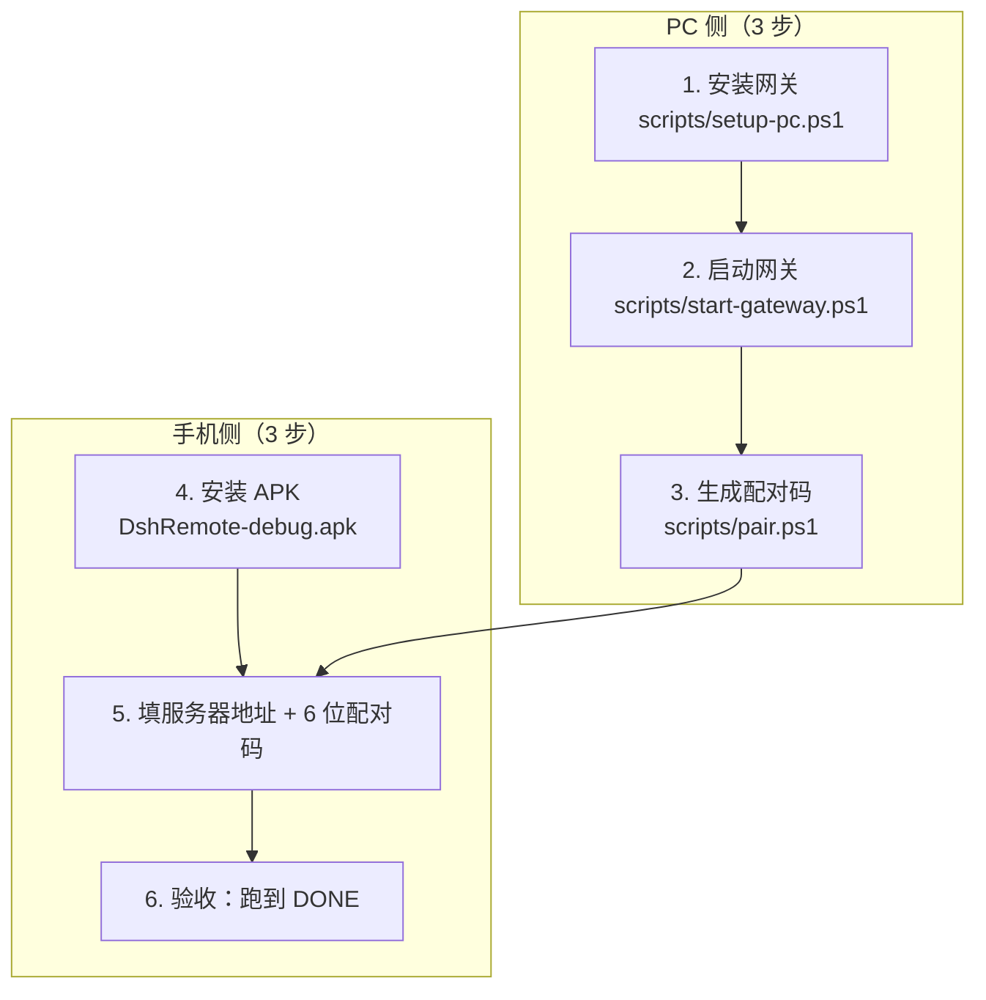

# DSH Remote 部署手册

| 项 | 值 |
|---|---|
| 文档编号 | OPS-DSHR-001 |
| 版本 | v1.0（**骨架 + 真实命令待回填**） |
| 适用对象 | PC 机主 / 运维 / 最终用户（单机自用场景） |
| 接口基线 | [API契约.md](../01-设计/API契约.md) v1（冻结） |
| 事实基线 | 桌面端 DSH `0.2.0-rc.2`；执行引擎 `dsh` CLI `0.1.0-rc.7` 的 `--profile headless`；网关默认端口 `8787` |

> **文档状态说明**：本手册给出完整的部署流程、配置项与排障表；其中标注 `> 待验证：` 的步骤命令，其**准确参数与输出**由 PC 安装脚本（`scripts/**`）与网关启动脚本（`tools/dsh-remote/**`）交付后回填核对。请勿把待验证步骤当成已实测通过的步骤使用。

> **安全前置（先读再做）**：① 配对码**只能在 PC 本机**生成；② 外网访问**必须**经 Tailscale / frp+TLS / Cloudflare Tunnel 等 TLS 隧道；③ **禁止**把 `8787` 端口以裸端口映射方式暴露到公网。

---

## 0. 部署前检查（Prerequisites）

| # | 检查项 | 合格标准 | 检查方式 |
|---|---|---|---|
| P1 | 操作系统 | Windows 11（实测）；Windows 10 21H2+ `> 待验证：未实测` | `winver` |
| P2 | DSH 桌面端 | 已装 `0.2.0-rc.2`（Electron）；Web GUI 监听 `127.0.0.1:19387` | 打开桌面端可正常使用 |
| P3 | `dsh` CLI | `0.1.0-rc.7`，支持 `--profile headless` | 见下方探测命令 |
| P4 | Node.js 运行时 | 可执行 `node --version` `> 待验证：Node 主版本下限以安装脚本探测结果为准` | `node --version` |
| P5 | API 凭据 | 有可用的 `DEEPSEEK_API_KEY` | 由用户自行获取，**不入仓库** |
| P6 | 网络 | PC 与手机可达（同局域网或隧道已通） | `ping` / Tailscale 状态页 |
| P7 | 端口 | `8787` 未被占用 | `netstat -ano \| findstr :8787` |
| P8 | 磁盘 | 运行目录可写（任务与日志会持续增长） | 目录属性 |
| P9 | 权限 | 当前用户可创建计划任务（自启需要） | 见[§4 开机自启](#4-开机自启) |

**P3/P4 探测命令（实测环境参考值，实际路径以本机为准）**

```powershell
# node 运行时（实测环境示例路径）
D:\DSH\resources\runtime\primary-runtime\dependencies\node\bin\node.exe --version

# dsh CLI（实测环境示例路径）
C:\Users\<用户名>\.dsh\profiles\node_modules\@deepseek-ai\dsh\lib\bin.js

# headless 探测：执行一条最小任务，退出码 0 表示可用
& <node.exe> <bin.js> --profile headless "回答 DONE"
```

| 期望 | 说明 |
|---|---|
| 退出码 `0` | 表示 headless 会话可用 |
| stdout 末段 | 即最终答复文本（网关据此写入 `output`） |
| 基准参考 | 实测「写文件并回答 DONE」任务 **2.6 秒**完成，文件真实落盘 |

> 待验证：上述路径为当前实测环境的具体值；正式安装请以 `scripts/setup-pc.ps1` 的探测输出为准，并支持 `-DshRoot` 覆盖。

---

## 1. 总览：PC 侧 3 步 + 手机侧 3 步



| 阶段 | 目标状态 | 验证点 |
|---|---|---|
| PC 安装完成 | 运行目录、凭据、`config.json` 就绪 | `config.json` 存在；凭据回读成功 |
| 网关运行中 | `GET /api/v1/health` 返回 `ok:true` | 浏览器/`curl` 可见 `serverName`/`gatewayVersion`/`dshVersion` |
| 取得配对码 | PC 上显示 6 位数字，5 分钟内有效 | 码为一次性 |
| 手机连上 | App 配置页显示服务器名与版本 | 保存后调 `GET /api/v1/health` 成功 |
| 端到端通过 | 手机提交任务 → PC 执行 → 结果回传 | 任务 `succeeded`，`output` 含预期文本 |

---

## 2. PC 侧安装网关

### 2.1 目录与文件布局（安装后应长这样）

| 路径 | 内容 | 是否入库 |
|---|---|---|
| `tools/dsh-remote/` | 网关源码（`gateway.mjs`、`lib/**`、`test/**`） | 是 |
| `%DSH_HOME%\.credentials.yaml` | `DEEPSEEK_API_KEY: <key>`（UTF-8 无 BOM） | **否** |
| `%DSH_HOME%\config.json` | 端口、并发、超时、工作区白名单 | **否** |
| `%DSH_HOME%\devices.json` | 设备库（只含 `sha256(token)`） | **否** |
| `%DSH_HOME%\tasks\*.json` | 每任务一份快照（原子写） | **否** |
| `%DSH_HOME%\logs\gateway-YYYYMMDD.log` | 按日滚动日志（含 `sessionId` 与耗时） | **否** |

默认运行目录：`%USERPROFILE%\.dsh-remote`（可用 `-Home` 参数覆盖）。

### 2.2 一键安装

```powershell
# 在仓库根目录执行
pwsh -File scripts/setup-pc.ps1
# 或指定参数
pwsh -File scripts/setup-pc.ps1 -DshRoot "D:\DSH\resources" -Home "$env:USERPROFILE\.dsh-remote" -ApiKey "<你的Key>"
```

| 步骤 | 脚本动作 | 期望输出 |
|---|---|---|
| 1 | 探测 DSH 安装路径、`node.exe`、`dsh` CLI | 打印探测到的路径 |
| 2 | 创建运行目录（含 `tasks/`、`logs/`） | 目录存在 |
| 3 | 交互式或按 `-ApiKey` 写入 `.credentials.yaml`（UTF-8 无 BOM）并**回读校验** | 回读一致 |
| 4 | 生成 `config.json`（端口 `8787`、并发 `2`、超时 `3600`、工作区白名单） | 文件存在且 JSON 合法 |
| 5 | 打印下一步命令 | 显示启动与配对命令 |
| 6 | 幂等保护 | 已存在文件备份为 `.bak-<时间戳>`，不破坏既有配置 |

> 待验证：脚本的实际参数名、输出文案与备份命名以 `scripts/setup-pc.ps1` 交付版为准；本节需在脚本落地后回填真实执行记录。

**执行策略提示**：若 PowerShell 拒绝执行脚本，按提示临时放行：

```powershell
Set-ExecutionPolicy -Scope Process -ExecutionPolicy Bypass
```

### 2.3 手工安装（脚本不可用时的兜底）

| 步骤 | 操作 |
|---|---|
| 1 | 创建运行目录：`New-Item -ItemType Directory -Force "$env:USERPROFILE\.dsh-remote\tasks","$env:USERPROFILE\.dsh-remote\logs"` |
| 2 | 写凭据：新建 `.credentials.yaml`，内容一行 `DEEPSEEK_API_KEY: <key>`，保存为 **UTF-8 无 BOM** |
| 3 | 复制 `tools/dsh-remote/config.example.json` 为 `config.json`，按[§3.2](#32-配置项表configjson) 修改 |
| 4 | 启动网关：见[§4.1](#41-手动启动) |

> 待验证：`config.example.json` 的字段名与取值以网关实现为准；`%DSH_HOME%` 的具体环境变量名以启动脚本为准。

---

## 3. 配置

### 3.1 配置 API Key

| 项 | 要求 |
|---|---|
| 文件 | `%DSH_HOME%\.credentials.yaml` |
| 格式 | `DEEPSEEK_API_KEY: <key>`（单行，冒号后一个空格） |
| 编码 | **UTF-8 无 BOM**（带 BOM 会导致解析失败） |
| 权限 | 仅当前用户可读（不要放共享目录） |
| 红线 | 不要把 Key 写进 `config.json`、日志、脚本、仓库任何文件 |
| 替换 | 换 Key 时直接覆盖该文件并重启网关 |

> 待验证：网关读取凭据的确切字段名与是否支持多键（如 base URL 覆盖），以 `tools/dsh-remote` 实现为准。

### 3.2 配置项表（`config.json`）

| 键（预期名） | 默认值 | 说明 | 关联需求 |
|---|---|---|---|
| `port` | `8787` | 监听端口 | 契约 §0 |
| `bind` / `host` | `0.0.0.0` | 监听地址；仅本机使用可改 `127.0.0.1` | 契约 §6.1 |
| `maxConcurrent` | `2` | 并发任务上限；超出行为见契约 §3.1（`busy` 或入队） | FR-25 |
| `defaultTimeoutSec` | `3600` | 单任务默认超时（上限 `86400`） | FR-25 |
| `workspaceAllowlist` | 示例值 `["D:\\proj"]` | 允许的工作区白名单（含子目录） | NFR-SEC-06 |
| `dshBin` | 探测值 | `bin.js` 绝对路径 | FR-05 |
| `nodeBin` | 探测值 | `node.exe` 绝对路径 | FR-05 |
| `dshHome` | `%DSH_HOME%` | 凭据与会话目录 | FR-05 |
| `logDir` / `logRetentionDays` | `logs` / 建议 14 | 日志目录与保留天数 | FR-16 |
| `pairTtlSec` | `300` | 配对码有效期（契约默认 5 分钟） | FR-02 |
| `rateLimit` | `pairClaimPerMin=10`、`authFailPerMin=30` | 限速阈值 | NFR-SEC-04 |

> 待验证：上表键名为**预期设计值**，实际键名/默认值/是否支持环境变量覆盖，以 `tools/dsh-remote/config.example.json` 与 `README.md` 为准；落地后必须回填本表，避免用户配错。

**工作区白名单示例**

```json
{
  "workspaceAllowlist": [
    { "path": "D:\\proj", "label": "proj" },
    { "path": "C:\\Users\\<用户名>\\work", "label": "work" }
  ]
}
```

| 规则 | 说明 |
|---|---|
| 含子目录 | 白名单 `D:\proj` 允许 `D:\proj\sub`（TC-23） |
| 越界拒绝 | 白名单外路径或含 `..` 穿越一律 `400 bad_request`（TC-22） |
| 路径存在性 | `GET /api/v1/workspaces` 的 `exists` 字段反映当前是否存在（契约 §5） |

### 3.3 配置后自检

```powershell
pwsh -File scripts/selftest.ps1
```

| 检查项 | 期望 |
|---|---|
| node / dsh 路径 | PASS |
| 凭据文件 | PASS（存在且可解析） |
| 网关健康接口 | PASS（`ok:true`） |
| 真实提交一条任务并等待成功 | PASS |
| 整体退出码 | `0`（任一 FAIL 则非 0） |

> 待验证：`selftest.ps1` 的 PASS/FAIL 明细文案与检查条数以交付版为准。

---

## 4. 开机自启与进程管理

### 4.1 手动启动

```powershell
pwsh -File scripts/start-gateway.ps1
# 或直接：
node tools/dsh-remote/gateway.mjs
```

| 项 | 说明 |
|---|---|
| 后台方式 | 脚本以隐藏窗口后台启动并写入 PID 文件 |
| 重复启动 | 脚本应检测 PID 文件并提示「已在运行」 |
| 停止 | `pwsh -File scripts/stop-gateway.ps1` |
| 日志查看 | `%DSH_HOME%\logs\gateway-YYYYMMDD.log` |

> 待验证：PID 文件路径、重复启动的提示文案与停止方式以脚本交付版为准。

### 4.2 安装开机自启（Windows 计划任务，登录时触发）

```powershell
pwsh -File scripts/install-autostart.ps1
# 卸载
pwsh -File scripts/uninstall-autostart.ps1
```

| 项 | 要求 |
|---|---|
| 触发方式 | 用户登录时触发（Headless 服务方式不做，避免权限与凭据错位） |
| 幂等 | 重复安装不产生重复任务；参数变化时更新既有任务 |
| 可卸载 | 卸载后计划任务被移除，且不删除任务历史与日志 |
| 验证 | 重新登录后 `GET /api/v1/health` 返回 `ok:true`（TC-51） |
| 排障 | `Get-ScheduledTask -TaskName <任务名> \| Get-ScheduledTaskInfo` 查看上次结果码 |

> 待验证：计划任务名称、运行账户与是否勾选「不管用户是否登录都要运行」，以 `install-autostart.ps1` 交付版为准。

---

## 5. 获取配对码并配对手机

### 5.1 PC 生成配对码（**必须在 PC 本机操作**）

```powershell
pwsh -File scripts/pair.ps1
# 网关自带脚本（若已交付）：
pwsh -File tools/dsh-remote/pair.ps1
```

| 项 | 说明 |
|---|---|
| 内部调用 | `POST http://127.0.0.1:8787/api/v1/pair/open` |
| 返回 | `{"code":"482913","expiresAt":1730000600000}`（6 位数字） |
| 有效期 | 默认 **5 分钟** |
| 次数 | **一次性**：用过即废；失败/过期需重新生成 |
| 二维码 | 脚本尽量打印纯文本二维码；无法生成时打印配对码与手输说明 |
| 安全 | 网关只接受 `127.0.0.1`/`::1` 的 `pair/open` 请求；不要在群里/截图外发配对码 |

### 5.2 手机配对

| 步骤 | 操作 | 期望 |
|---|---|---|
| 1 | 打开 `DshRemote` | 未配置时进入配置页 |
| 2 | 填服务器地址 | 内网：`http://<PC-IP>:8787`；外网：隧道提供的 `https://...` 地址 |
| 3 | 填 6 位配对码 + 设备名（如 `Xiaomi 14`） | 设备名会出现在 PC 设备列表 |
| 4 | 点「配对」 | 成功返回令牌并保存；失败见下表 |
| 5 | 自动校验 | 调 `GET /api/v1/health` 成功，显示 `serverName` 与 `gatewayVersion` |
| 6 | 兜底 | 支持**手动粘贴令牌**（用于已有令牌或脚本分发场景，TC-61） |

| 失败提示 | `error.code` | 处理 |
|---|---|---|
| 码错误或已过期 | `pairing_bad_code`（`401`） | 回 PC 重新生成配对码 |
| 未开启配对 | `pairing_closed`（`403`） | 先在 PC 执行 `pair.ps1` |
| 请求过于频繁 | `rate_limited`（`429`） | 等待 1 分钟后重试（`pair/claim` 上限 10 次/分钟/IP） |
| 连不上 | —（网络层） | 检查地址/端口/防火墙/隧道状态 |

### 5.3 设备管理（PC 侧）

| 操作 | 接口 | 说明 |
|---|---|---|
| 查看已配对设备 | `GET /api/v1/devices` | 返回 `tokenId`/`deviceName`/`pairedAt`/`lastSeenAt` |
| 吊销某设备 | `DELETE /api/v1/devices/{tokenId}` | `204`；该设备随即 `401`，需重新配对 |
| 重装 App 后重配 | 同一 `deviceId` 再配对 | **旧令牌立即吊销**，返回新令牌 |
| CLI 吊销（契约提及） | `dsh-remote devices revoke <tokenId>` | > 待验证：该 CLI 子命令是否随网关交付，以 `tools/dsh-remote` 实现为准 |

---

## 6. 手机侧安装 APK

### 6.1 获取安装包

| 项 | 值 |
|---|---|
| 产物路径 | `android/app/build/outputs/apk/release/app-release.apk`（或 debug 变体） |
| 签名 | **debug 签名**（自用安装包）——不可公开发布或上架 |
| 最低系统 | Android 8.0（API 26） |
| 目标系统 | Android 14（API 34）；Android 15 `> 待验证：未逐机型实测` |
| 校验 | 交付时记录文件大小与 `sha256`，安装前可用 `Get-FileHash` 核对 |

> 待验证：当前交付的 APK 具体路径、大小与 `sha256` 值需在构建完成后回填（由 `scripts/verify.ps1` 输出）。

### 6.2 安装步骤

| 步骤 | 操作 | 备注 |
|---|---|---|
| 1 | 把 APK 传到手机（数据线 / 局域网共享 / 网盘） | 单用户自用，注意传输通道可信 |
| 2 | 允许「安装未知来源应用」 | Android 8+ 会按来源应用授权 |
| 3 | 安装并打开 App | 首次进入配置页 |
| 4 | 按[§5.2](#52-手机配对) 配对 | 配对码需 PC 侧重新生成（一次性） |
| 5 | 后台保活授权 | 建议：允许自启动、关闭电池优化、锁定后台任务（厂商 ROM 尤其重要） |
| 6 | 通知权限 | 允许通知（前台服务状态栏常驻，Android 8+ 需通知渠道） |

### 6.3 网络与明文 HTTP 说明

| 项 | 说明 |
|---|---|
| 支持地址 | `http://` 与 `https://` 均可（`networkSecurityConfig` 放行明文，便于内网使用） |
| 风险 | 明文 HTTP 在**同一网络内**可被嗅探；仅限可信内网或本机回环转发使用 |
| 外网要求 | 外网**必须**用 `https://`（隧道提供），禁止明文跨公网 |
| 自签证书 | App **不支持**在应用内安装自签 CA；仅使用系统默认信任链 |

---

## 7. 内网与外网接入

### 7.1 形态 A：同一局域网直连

| 步骤 | 操作 |
|---|---|
| 1 | 确认手机与 PC 在同一 Wi-Fi/网段 |
| 2 | 查 PC 内网 IP：`ipconfig` |
| 3 | 手机配置页填 `http://<PC-IP>:8787` |
| 4 | 若不通：检查 Windows 防火墙是否放行 `8787`（仅放行「专用网络」） |

```powershell
# 仅对专用网络放行 8787（示例，按需调整）
New-NetFirewallRule -DisplayName "DSH Remote 8787" -Direction Inbound -Protocol TCP -LocalPort 8787 -Action Allow -Profile Private
```

| 风险 | 处置 |
|---|---|
| 内网明文可被同网段嗅探 | 仅在可信网络使用；公共 Wi-Fi 禁用 |
| 端口对内网所有设备可见 | 必须依赖 Bearer 令牌（NFR-SEC-01）+ 配对码本机生成（NFR-SEC-03） |

### 7.2 形态 B：Tailscale（**外网首选**）

| 步骤 | 操作 |
|---|---|
| 1 | PC 与手机各安装 Tailscale 并登录**同一账号** |
| 2 | 确认两端在 `tailnet` 内可见（`tailscale status`） |
| 3 | 用 PC 的 tailnet 名称/MagicDNS 地址访问：`https://<pc>.<tailnet>.ts.net`（经 `tailscale serve`）或 `http://<tailscale-IP>:8787` |
| 4 | 手机配置页填对应地址并配对 |

| 优点 | 注意 |
|---|---|
| 无需开放公网端口；隧道自带加密与设备身份 | 隧道内地址仍是 `http` 时，明文仅限隧道内部（仍建议上 `tailscale serve` 走 HTTPS） |
| 手机蜂窝网络下可用 | 两端需保持 Tailscale 在线 |

> 待验证：`tailscale serve` 与 `8787` 的具体映射命令与证书签发表现，需在真实 tailnet 上实测回填。

### 7.3 形态 C：frp + TLS

| 步骤 | 角色 | 操作 |
|---|---|---|
| 1 | 公网 VPS | 部署 `frps`，配置 TLS 证书（域名证书）与 `vhostHTTPSPort = 443` |
| 2 | PC | 部署 `frpc`，把本地 `127.0.0.1:8787` 反向映射到 VPS 的 HTTPS 入口 |
| 3 | 手机 | 配置页填 `https://<你的域名>` |
| 4 | 校验 | 浏览器访问域名应拿到 `GET /api/v1/health` 的 JSON |

| 关键配置点 | 建议 |
|---|---|
| 认证 | `frpc` 必须配置 `token`/`metadatas` 认证，避免隧道被他人滥用 |
| 暴露面 | 只暴露 HTTPS 入口，不要在 VPS 上再开 `8787` 明文监听 |
| 限流 | 网关自身限速生效（`pair/claim` 10/min/IP、认证失败 30/min/IP） |

> 待验证：`frps`/`frpc` 具体配置片段与证书续期方式，需在真实 VPS + 域名环境实测后回填。

### 7.4 形态 D：Cloudflare Tunnel

| 步骤 | 操作 |
|---|---|
| 1 | 域名托管在 Cloudflare |
| 2 | PC 安装 `cloudflared`，创建命名隧道并映射 `http://127.0.0.1:8787` |
| 3 | 为子域配置 DNS 路由（`cloudflared tunnel route dns`） |
| 4 | 手机填 `https://<子域>` |

| 优点 | 注意 |
|---|---|
| 不需要公网 IP、不开入站端口 | 依赖 Cloudflare 账号与域名；建议加 Cloudflare Access 或至少保留网关令牌认证 |

> 待验证：`cloudflared` 隧道命令与 DNS 路由的实际输出需实测回填。

### 7.5 明确禁止的做法

| 禁止项 | 原因 |
|---|---|
| 路由器上把 `8787` 端口转发到公网（HTTP 明文） | 令牌可被爆破/嗅探，NFR-SEC-05 明令禁止 |
| 把 `.credentials.yaml` 或 `devices.json` 放到共享目录/网盘 | 凭据泄露 |
| 在聊天工具/公开渠道发送配对码截图 | 5 分钟内可被抢用（虽要求本机生成，仍应最小暴露） |
| 把 API Key 或令牌写进脚本、README、示例配置 | 会随仓库扩散 |

---

## 8. 验证部署是否成功

| # | 验证项 | 命令/操作 | 通过标准 |
|---|---|---|---|
| V1 | 健康检查 | `curl http://127.0.0.1:8787/api/v1/health` | `ok:true`；含 `serverName`/`gatewayVersion`/`dshVersion` |
| V2 | 一键自检 | `pwsh -File scripts/selftest.ps1` | 全项 PASS，退出码 `0` |
| V3 | 配对可用 | `pwsh -File scripts/pair.ps1` 后手机配对 | 拿到令牌并显示服务器名 |
| V4 | 端到端任务 | 手机提交「写一个文件 test-dshr.txt，内容为 OK，然后回答 DONE」 | 任务 `succeeded`；PC 上文件真实存在；`output` 含 `DONE` |
| V5 | 实时回传 | 提交长任务并观察详情页 | 输出持续滚动；退出码与完整输出可见 |
| V6 | 取消 | 长任务点取消 | 状态变 `canceled`；任务管理器无残留 node 进程 |
| V7 | 断线续传 | 执行中开关飞行模式 | 自动重连并补齐输出（`fromSeq`） |
| V8 | 重启恢复 | 重启网关/电脑 | 历史任务仍在；无 `running` 悬挂任务 |
| V9 | 交付验收 | `pwsh -File scripts/verify.ps1` | 输出验收报告表且全项 PASS |

---

## 9. 故障排查表

| 现象 | 可能原因 | 定位方法 | 处理 |
|---|---|---|---|
| 手机提示连不上服务器 | 地址/端口错；PC 关机；防火墙拦截；隧道未通 | 手机浏览器直接开 `/api/v1/health`；PC 上 `netstat -ano \| findstr :8787` | 修正地址；启动网关；放行防火墙；恢复隧道 |
| `curl` 本机也不通 | 网关未启动或端口被占 | 查 `start-gateway.ps1` 输出与日志 | 换端口或结束占用进程后重启 |
| `health` 可访问但任务提交 `401 unauthorized` | 令牌无效/已吊销/未带 `Authorization` | 检查 App 是否已配对；用 `GET /api/v1/devices` 核对 `tokenId` | 重新配对；或用 `DELETE /api/v1/devices/{tokenId}` 后重配 |
| 配对报 `pairing_closed` | PC 未生成配对码 | 看 PC 是否执行了 `pair.ps1` | 先执行 `pair.ps1` |
| 配对报 `pairing_bad_code` | 码错误/已用/超 5 分钟 | 时间是否超过 5 分钟 | 重新生成 |
| 配对报 `rate_limited` | 短时间重试过多 | 1 分钟内调用次数 | 等 1 分钟（上限 10 次/分钟/IP） |
| 任务一直 `queued` | 并发已满（默认 2） | `health` 的 `activeTasks`/`queuedTasks` | 等前序任务结束或取消；调大并发配置 |
| 提交返回 `429 busy` | 并发已满且未入队 | 同上 | 稍后重试或调整并发策略 |
| 提交返回 `400 bad_request` | `prompt` 为空；`workspace` 不存在或不在白名单（含 `..` 穿越） | 看响应 `error.message` | 改工作区或加入白名单（含子目录） |
| 任务 `failed`，`error` 指向凭据 | `.credentials.yaml` 缺失/格式错/BOM/Key 失效 | 检查文件与回读校验 | 重写为 UTF-8 无 BOM，或更换 Key |
| 任务 `failed`，`error` 指向 CLI/参数 | `dshBin`/`nodeBin` 路径错；profile 不可用 | 手动跑 `node <bin.js> --profile headless "回答 DONE"` | 修正 `config.json` 路径或升级 CLI |
| 任务 `failed` 且提示超时 | 任务超过 `timeoutSec`（默认 3600 s） | 日志中含耗时与超时标记 | 增大 `timeoutSec`（上限 86400）或拆分任务 |
| 输出乱码/中文异常 | 编码不一致 | 对比 PC 日志与手机显示 | 统一 UTF-8；避免在中间层转换编码 |
| 手机端看不到实时输出 | SSE 被中间层缓冲；App 后台被清理 | 浏览器直连事件流测心跳；看 App 是否允许后台 | 关闭代理缓冲；给 App 加自启动/电池白名单 |
| 断线后输出缺一段 | 离线超过 2000 条事件窗口 | 观察缺失区间与事件量 | App 会回退拉取任务详情快照（契约 §3.3）；减少离线时长 |
| 电脑重启后任务停在运行中 | 网关被强杀 | 查看历史任务状态 | 网关重启应将中断任务置终态并说明原因（FR-27） |
| 开机不自启 | 计划任务未安装/被禁用 | `Get-ScheduledTask` 与上次结果码 | 重跑 `install-autostart.ps1`；检查执行策略与账户 |
| 日志里出现疑似敏感信息 | 日志实现缺陷 | 搜索 `dshr_`/`DEEPSEEK_API_KEY` | **按 P0 处理**：立即停止外发日志并修复（NFR-SEC-02、FR-26） |
| APK 装不上 | 未知来源未允许/系统版本低于 26/包被改 | 系统版本与安装来源 | 允许未知来源；Android 8.0+ |
| 外网地址不生效 | 隧道未启动/域名未解析 | `tailscale status` / `cloudflared tunnel info` / `frpc` 日志 | 恢复隧道；核对 DNS |

**取日志与现场信息（提 issue 用）**

```powershell
# 网关日志尾部
Get-Content "$env:USERPROFILE\.dsh-remote\logs\gateway-$(Get-Date -Format yyyyMMdd).log" -Tail 100

# 健康快照
curl.exe http://127.0.0.1:8787/api/v1/health

# 端口占用
netstat -ano | findstr :8787
```

> 提交日志前**必须**脱敏：令牌替换为 `dshr_****`、Key 替换为 `sk-****`。

---

## 10. 升级、备份与回滚

### 10.1 升级

| 步骤 | 操作 |
|---|---|
| 1 | 停止网关（`stop-gateway.ps1`） |
| 2 | 备份 `%DSH_HOME%`（至少 `config.json`、`devices.json`） |
| 3 | 更新 `tools/dsh-remote` 源码 |
| 4 | 检查契约版本：`health.apiVersion` 与 `X-Api-Version` 是否变化（[变更记录](../06-项目管理/变更记录.md)） |
| 5 | 重启网关并跑 `selftest.ps1` + 一次端到端任务 |
| 6 | 若 App 与契约不兼容，同步升级 APK |

### 10.2 备份清单

| 项 | 是否必须 | 说明 |
|---|---|---|
| `config.json` | 必须 | 白名单与端口配置 |
| `devices.json` | 建议 | 备份后无需重新配对（其中只含哈希，仍按敏感文件保管） |
| `tasks/*.json` | 可选 | 历史任务与输出 |
| `logs/**` | 可选 | 排障用 |
| `.credentials.yaml` | **不建议备份到共享位置** | 泄露风险；换机直接重填 |

### 10.3 回滚

| 步骤 | 操作 |
|---|---|
| 1 | 停止网关 |
| 2 | 还原上一版 `tools/dsh-remote` 源码 |
| 3 | 用备份覆盖 `config.json` / `devices.json` |
| 4 | 启动并验证 `health` + 一条端到端任务 |

---

## 11. 卸载

| 步骤 | 操作 | 说明 |
|---|---|---|
| 1 | 卸载自启：`pwsh -File scripts/uninstall-autostart.ps1` | 计划任务被移除 |
| 2 | 停止网关：`pwsh -File scripts/stop-gateway.ps1` | 确认端口释放 |
| 3 | 手机卸载 App | 令牌随 App 私有数据一同删除 |
| 4 | 吊销设备（可选）：`DELETE /api/v1/devices/{tokenId}` | 若手机丢失，先吊销再卸载 |
| 5 | 删除运行目录 | 含凭据与历史，按需保留或彻底删除 |
| 6 | 恢复防火墙规则 | 删除 `DSH Remote 8787` 入站规则 |

---

## 12. 附录

### 12.1 常用命令速查

| 目的 | 命令 |
|---|---|
| 一键安装 | `pwsh -File scripts/setup-pc.ps1` |
| 启动 / 停止 | `pwsh -File scripts/start-gateway.ps1` / `stop-gateway.ps1` |
| 生成配对码 | `pwsh -File scripts/pair.ps1` |
| 安装 / 卸载自启 | `pwsh -File scripts/install-autostart.ps1` / `uninstall-autostart.ps1` |
| 自检 | `pwsh -File scripts/selftest.ps1` |
| 交付验收 | `pwsh -File scripts/verify.ps1` |
| 健康检查 | `curl http://127.0.0.1:8787/api/v1/health` |
| 查设备 | `curl -H "Authorization: Bearer <token>" http://127.0.0.1:8787/api/v1/devices` |
| 网关测试 | `node --test tools/dsh-remote/test` |

### 12.2 端口与默认值速查

| 项 | 值 |
|---|---|
| 网关端口 | `8787` |
| 桌面端 Web GUI | `127.0.0.1:19387`（**不对外开放**，不参与远程链路） |
| 并发上限 | `2` |
| 任务默认超时 | `3600` s（上限 `86400`） |
| 配对码有效期 | `300` s（5 分钟，一次性） |
| SSE 心跳 | `15` s |
| 事件保留 | 最近 `2000` 条 |
| 重连退避 | `1s → 30s` 上限 |
| `pair/claim` 限速 | `10` 次/分钟/IP |
| 认证失败限速 | `30` 次/分钟/IP |
