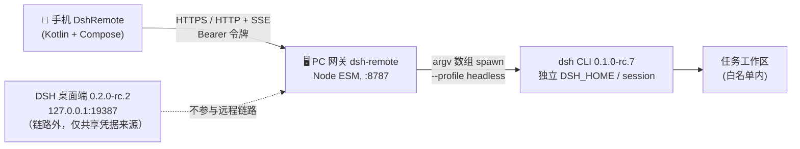

# DSH Remote 文档中心

> **一句话简介**：DSH Remote 让你在**不在家**时用手机把任务下发给家里或公司那台 **Windows PC 上的 DSH（DeepSeek Harness）**，PC 自动执行 headless 会话，并把过程与结果**实时回传**到手机。

| 项 | 值 |
|---|---|
| 仓库根 | `D:\Workspace\dsh_android`（示例路径，按实际部署替换） |
| 组成 | PC 网关 `dsh-remote`（零第三方依赖 Node ESM，默认 `0.0.0.0:8787`）+ Android 客户端 `DshRemote`（Kotlin + Jetpack Compose） |
| 执行引擎 | 官方 `dsh` CLI `0.1.0-rc.7` 的 **headless profile**：`node <bin.js> --profile headless "<任务文本>"` |
| 桌面端（不在链路内） | DSH 桌面端 `0.2.0-rc.2`（Electron，Web GUI `127.0.0.1:19387`，账号平台设备授权） |
| 接口唯一事实来源 | [API契约.md](01-设计/API契约.md) —— 已冻结，任何一方改动须同步递增 `X-Api-Version` |
| 文档状态 | v1.0 初始化留档；标注 `> 待验证：` 的条目尚未实测 |

---

## 1. 文档索引

| 编号 | 文档 | 内容 | 主要读者 |
|---|---|---|---|
| — | [docs/README.md](README.md) | 本文：索引与阅读路径 | 全部 |
| 00 | [需求规格说明书](00-需求/需求规格说明书.md) | 干系人、用户故事 US-xx、功能需求 FR-xx、非功能需求 NFR-xx、范围外、验收标准矩阵 | 产品 / 测试 / 开发 |
| 01 | [API契约.md](01-设计/API契约.md) | **冻结**的 HTTP + SSE 接口、字段、状态机、错误码、安全要求 | 开发（两端） |
| 01 | [概要设计](01-设计/概要设计.md) | 上下文图、部署拓扑、组件职责、时序图、数据模型、错误与降级、技术选型对比、威胁模型 | 开发 / 架构评审 |
| 02 | [开发规范](02-开发/开发规范.md) | 分支与提交、代码风格、目录结构、命名、注释、依赖、版本号、评审清单、安全红线 | 开发 |
| 03 | [测试计划](03-测试/测试计划.md) | 测试分层、环境矩阵、用例表 TC-xx、缺陷等级、准出标准 | 测试 / 开发 |
| 05 | [部署手册](05-运维/部署手册.md) | PC 侧安装与自启、API Key、配对、手机装 APK、内外网接入、排障表 | 运维 / 最终用户 |
| 06 | [变更记录](06-项目管理/变更记录.md) | 版本 / 日期 / 变更人 / 内容 / 影响面 | 全部 |

> 目录编号 04（接口文档）留空：接口文档即 `01-设计/API契约.md`，不另建重复源，避免两处不一致。

---

## 2. 阅读路径

### 2.1 我是使用者（只想把手机连上自己的电脑）

| 步骤 | 读什么 | 目标 |
|---|---|---|
| 1 | [部署手册 · 2 PC 侧安装](05-运维/部署手册.md) | 装好网关、填好 API Key、开启开机自启 |
| 2 | [部署手册 · 4 配对](05-运维/部署手册.md) | 在 PC 上取得 6 位配对码 |
| 3 | [部署手册 · 5 手机侧](05-运维/部署手册.md) | 装 APK、填地址、输配对码 |
| 4 | [部署手册 · 6 外网接入](05-运维/部署手册.md) | 不在家也能连（Tailscale / frp+TLS / Cloudflare Tunnel） |
| 5 | [部署手册 · 8 故障排查](05-运维/部署手册.md) | 连不上、任务失败时先查这里 |

只记三条安全底线：**配对码只能在 PC 本机生成**、**外网必须走 TLS 隧道**、**绝不把 `8787` 端口直接映射到公网**。

### 2.2 我是开发者（要改代码）

| 顺序 | 读什么 | 为什么先读 |
|---|---|---|
| 1 | [API契约.md](01-设计/API契约.md) | 端点 / 字段 / 状态机 / 错误码的唯一事实来源，改接口先改它 |
| 2 | [概要设计](01-设计/概要设计.md) | 组件边界、时序、数据落盘位置、为什么不用桌面端私有 RPC |
| 3 | [需求规格说明书](00-需求/需求规格说明书.md) | FR-xx 决定「该做什么」，NFR-xx 决定「做到什么程度」 |
| 4 | [开发规范](02-开发/开发规范.md) | 提交格式、命名、评审清单、安全红线 |
| 5 | [测试计划](03-测试/测试计划.md) | 你的改动对应哪些 TC-xx，准出标准是什么 |

### 2.3 我是运维 / 交付验收

| 顺序 | 读什么 | 输出物 |
|---|---|---|
| 1 | [部署手册](05-运维/部署手册.md) | 可复现的安装步骤 |
| 2 | [测试计划 · 准出标准](03-测试/测试计划.md) | 验收口径 |
| 3 | [需求规格说明书 · 验收标准矩阵](00-需求/需求规格说明书.md) | FR/NFR ↔ TC 的可追溯对照 |
| 4 | [变更记录](06-项目管理/变更记录.md) | 本次交付相对上一版改了什么 |

---

## 3. 项目边界速查

| 会做 | 不会做 |
|---|---|
| 手机 → PC 下发文本任务，PC 上 headless DSH 独立会话执行 | 复用 / 逆向桌面端 Web GUI 的私有 WebSocket RPC 协议 |
| SSE 实时回传增量输出、状态机、退出码、完整结果 | 手机端远程桌面、屏幕镜像、GUI 自动化点击 |
| 本机回环生成配对码 + 设备令牌（服务端只存 `sha256`） | 云端中转服务器、第三方账号体系、多租户 |
| 工作区白名单约束、任务取消、历史留档 | 文件上传/下载、附件管理 |
| 外网经 Tailscale / frp+TLS / Cloudflare Tunnel 接入 | 裸端口映射到公网；自签证书信任链的 App 内安装 |

---

## 4. 文档维护约定

| 约定 | 说明 |
|---|---|
| 语言 | 简体中文；Markdown；表格优先；图用 Mermaid |
| 编号 | 需求 `FR-xx` / `NFR-xx`；用例 `TC-xx`；用户故事 `US-xx`；每条需求必须能在[验收标准矩阵](00-需求/需求规格说明书.md)中找到对应验收方法 |
| 接口一致性 | 文档中出现的路径、字段名、状态值、错误码必须与[API契约.md](01-设计/API契约.md)逐字一致；不一致时以契约为准并立即修文档 |
| 未验证标注 | 未实测的行为一律写 `> 待验证：<具体待验证内容>`，禁止写成已完成 |
| 变更流程 | 接口变更 → 先改契约并递增 `X-Api-Version` → 同步 FR/设计/用例 → 登记[变更记录](06-项目管理/变更记录.md) |
| 密钥 | 任何文档、示例、截图都不得出现真实 `DEEPSEEK_API_KEY` 或设备令牌明文，示例统一用 `sk-****`、`dshr_****` |
