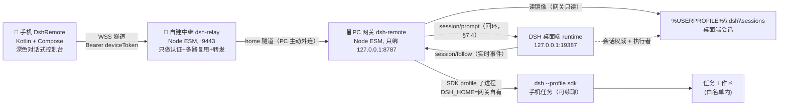

# DSH Remote 文档中心

当前交付：[v2.12.0 下载、校验与升级说明](../deliverables/交付说明.md)。首次使用请先看 [README](../README.md)。下文保留各阶段的设计与验证记录，当前能力以版本记录及协议契约为准。

> **一句话简介**：DSH Remote 让你在**任意网络**（4G/5G/公司网/家里）下用手机查看并驱动家里那台 **Windows PC 上的 DSH（DeepSeek Harness）**：看电脑端会话、浏览工作区、新建「手机任务」并真实续聊，过程与结果实时回传。
> **v2 架构要点**：手机 **不直连 PC**，PC **不开任何入站端口** —— 两边都主动连你自建的**中继**（`tools/dsh-relay`）。v1 的「同局域网直连」形态**仍然兼容**（同一套 v1 端点全部保留）。
>
> **v2.4.0 起（2026-10-13 实测）**：电脑端会话**可以**从手机续聊 —— 轮次交给**电脑端自己的 runtime** 执行（回环 `session/prompt` + `session/follow`，契约 §7.4/§7.5），手机与电脑看到同一条时间线；原先「镜像会话一律只读 / `/turns` 一律 409 `session_busy`」的裁定**只对 headless/SDK 路线成立**。网关侧适配层已落地（`tools/dsh-remote/lib/desktop-api.mjs`，开关 `desktop.enabled`）；当时登记的两处实现不一致（`driver` 取值、`source:"phone"` 的 `driver` 下发）**已于 2026-10-14 修复**（契约 §7.5）。
>
> **v2.5.0 起（2026-10-14 实测，网关组件 `2.1.0`）**：手机**新建**的任务默认直接落在**电脑端 DSH**（`POST /api/v2/tasks` 的可选字段 `host`，契约 §7.6）—— 会话原生登记进电脑端工作区，在电脑上打开就是同一个会话，**不是接力、也不是复制一份历史**。代价如实写在契约 §7.6.4：电脑端会话的**权限档手机端无法指定**（跟随电脑端 DSH 自己的 `DSH_PERMISSION_MODE`），需要人工审批时**手机端无法代答**。

| 项 | 值 |
|---|---|
| 仓库根 | `D:\Workspace\dsh_android`（示例路径，按实际部署替换） |
| 组成 | 中继 `dsh-relay`（零依赖 Node ESM，默认 `0.0.0.0:9443`）+ PC 网关 `dsh-remote`（零依赖 Node ESM，**只绑 `127.0.0.1:8787`**）+ Android 客户端 `DshRemote`（Kotlin + Jetpack Compose，深色对话式控制台） |
| 执行引擎 | 网关自有 `DSH_HOME` 下的 `dsh --profile sdk`（stdio JSON-RPC，长驻进程服务多轮）；电脑端会话**读**自 `%USERPROFILE%\.dsh`，**写**经电脑端自己的 runtime（回环通道，契约 §7.4） |
| 桌面端（会话权威 + 执行者） | DSH 桌面端（Electron，Web GUI `127.0.0.1:19387`）；网关**只读**它的会话目录，续聊只经回环 `session/prompt` 提交（适配层 `tools/dsh-remote/lib/desktop-api.mjs`），**绝不直接写它的文件** |
| 接口唯一事实来源 | [协议契约-v2.md](01-设计/协议契约-v2.md)（`X-Api-Version: 2`，含 §6 验收口径 / §7 续聊裁定 / §8 环境约束）；[API契约.md](01-设计/API契约.md) 是**冻结的 v1**，其端点全部保留，网关 `supportedApiVersions:[1,2]` |
| 文档状态 | v2.0（中继 + 会话镜像 + 手机任务）；**公网形态已于 2026-10-13 在真实 VPS 实测通过**（Let's Encrypt IP 地址证书 + `wss://<IP>:9443`，手机侧经公网配对、真实任务往返、探针 12/12，中继 22:14 起从 80 迁到 9443），见 [中继部署手册](05-运维/中继部署手册.md) §9.2/§9.3/§9.4 与 [验收报告](04-验收/验收报告.md) §10；**网关看门狗与免管理员自启**已于同日实测（杀进程 ≤20 秒自愈、`-StartupFolder` 免管理员登录自启、`verify.ps1` PASS=4/FAIL=0），见中继部署手册 §7.1、验收报告 §11；**域名形态**（有域名 + 正式 DNS 证书）仍未实测 |

---

## 1. 文档索引

| 编号 | 文档 | 内容 | 主要读者 |
|---|---|---|---|
| — | [docs/README.md](README.md) | 本文：索引与阅读路径 | 全部 |
| — | [DSH桌面端功能文档](01-设计/DSH桌面端功能文档.md) | **桌面端功能全景**（15 节：外壳/会话列表/对话视图/右栏/输入区/权限审批/模型预设/多智能体/设置/技术底座）+ **§12 手机端对标清单** + §13 实现批次 | 产品 / 开发 |
| — | [原型/README.md](01-设计/原型/README.md) | **手机端 UI 实现基线**：6 张 1080×2340 高保真原型 + 设计令牌 + Pillow 复现脚本 | 设计 / 开发 |
| 00 | [需求规格说明书](00-需求/需求规格说明书.md) | 干系人、用户故事 US-xx、功能需求 FR-xx（含 §11 v2 的 FR-V2/NFR-V2）、范围外、验收标准矩阵 | 产品 / 测试 / 开发 |
| 01 | [协议契约-v2.md](01-设计/协议契约-v2.md) | **v2 唯一事实源**：中继 HTTP/WS、网关 v2 API、安全红线、§6 验收口径、§7 续聊裁定、§8 环境约束 | 开发（三方） |
| 01 | [API契约.md](01-设计/API契约.md) | **冻结的 v1**（任务型接口 + 裁定 A1~A7）；v2 全部保留，供兼容对照 | 开发（两端） |
| 01 | [概要设计](01-设计/概要设计.md) | 上下文图、部署拓扑、组件职责、时序图（含 §12 v2 三方圆图与时序）、数据模型、错误与降级、威胁模型 | 开发 / 架构评审 |
| 02 | [开发规范](02-开发/开发规范.md) | 分支与提交、代码风格、目录结构、命名、注释、依赖、版本号、评审清单、安全红线 | 开发 |
| 03 | [测试计划](03-测试/测试计划.md) | 测试分层、环境矩阵、用例表 TC-xx（含 §9 TC-V2-01~23 与跨网络判据 A~E）、缺陷等级、准出标准 | 测试 / 开发 |
| 05 | [部署手册](05-运维/部署手册.md) | PC 侧安装与自启、API Key、配对、手机装 APK、内外网接入、排障表（含 §13 v2：`dsh.launcher`、两类会话、已知限制） | 运维 / 最终用户 |
| 05 | [中继部署手册](05-运维/中继部署手册.md) | **v2 新增**：中继三种部署形态、`publicUrl` 地址表、TLS、防火墙、开机自启、`profiles/sdk` 物化、排障表、安全红线 | 运维 / 最终用户 |
| 06 | [变更记录](06-项目管理/变更记录.md) | 版本 / 日期 / 变更人 / 内容 / 影响面（含 v2.0） | 全部 |

> 目录编号 04（接口文档）留空：接口文档即 `01-设计/API契约.md`，不另建重复源，避免两处不一致。

---

## 2. 阅读路径

### 2.1 我是使用者（只想把手机连上自己的电脑）

| 步骤 | 读什么 | 目标 |
|---|---|---|
| 1 | [部署手册 · 2 PC 侧安装](05-运维/部署手册.md) | 装好网关、填好 API Key、开启开机自启 |
| 2 | [中继部署手册 · 3 本机/内网验证](05-运维/中继部署手册.md) | 起一个中继（手机与 PC 都连它；公网则先看 §4 VPS 部署） |
| 3 | [中继部署手册 · 2 三方地址表](05-运维/中继部署手册.md) | 弄清 `publicUrl`（手机连的地址）与网关连的地址的区别 |
| 4 | [部署手册 · 5 配对](05-运维/部署手册.md) | 在 PC 上取得 6 位配对码（v2 会同时在中继上打开配对窗口） |
| 5 | [部署手册 · 6 手机侧](05-运维/部署手册.md) | 装 APK、填中继地址、输配对码 |
| 6 | [中继部署手册 · 10 排障表](05-运维/中继部署手册.md) | 连不上、手机显示电脑离线时先查这里 |

只记四条底线：**网关只绑 `127.0.0.1`**、**绝不把 8787 映射到公网**、**公网必须 `wss://` + TLS**、**手机连的是中继，不是 PC**。

> v1 兼容：如果你只想在**同一局域网**内使用，也可以继续用旧形态（手机填 `http://<PC内网IP>:8787` 直连），
> v1 端点与流程完全保留；但**任意网络**场景请用 v2 中继形态。

### 2.2 我是开发者（要改代码）

| 顺序 | 读什么 | 为什么先读 |
|---|---|---|
| 1 | [API契约.md](01-设计/API契约.md) | 端点 / 字段 / 状态机 / 错误码的唯一事实来源，改接口先改它 |
| 2 | [概要设计](01-设计/概要设计.md) | 组件边界、时序、数据落盘位置、为什么不用桌面端私有 RPC |
| 3 | [需求规格说明书](00-需求/需求规格说明书.md) | FR-xx 决定「该做什么」，NFR-xx 决定「做到什么程度」 |
| 4 | [开发规范](02-开发/开发规范.md) | 提交格式、命名、评审清单、安全红线 |
| 5 | [测试计划](03-测试/测试计划.md) | 你的改动对应哪些 TC-xx，准出标准是什么 |

### 2.3 我是运维 / 交付验收

| 顺序 | 读什么 | 输出物 |
|---|---|---|
| 1 | [部署手册](05-运维/部署手册.md) | 可复现的安装步骤 |
| 2 | [中继部署手册](05-运维/中继部署手册.md) | 中继部署（本机 / 内网 / VPS systemd）、地址表、排障表 |
| 3 | [测试计划 · §9 v2 用例与判据](03-测试/测试计划.md) | TC-V2-01~23 与跨网络判据 A~E 的口径 |
| 4 | [需求规格说明书 · §11 v2 需求](00-需求/需求规格说明书.md) | FR-V2/NFR-V2 ↔ 验收方法对照 |
| 5 | [验收报告 · §8 v2 章节](04-验收/验收报告.md) | 判据 A~E 状态、缺陷登记、已知限制 |
| 6 | [变更记录](06-项目管理/变更记录.md) | 本次交付相对上一版改了什么 |

一键复跑（隔离拓扑，不动 v1 的 8787 现场）：

```powershell
powershell -File scripts/tests/check-scripts.ps1                                   # 18 个 .ps1 静态校验
powershell -File scripts/e2e-crossnetwork.ps1 -Port 18787 -RelayPort 19443         # 判据 A~E
powershell -File scripts/selftest.ps1                                              # 网关自检（含中继/v2 检查）
node scripts/tests/relay-rfc-check.mjs                                             # RFC 6455 官方向量
node scripts/tests/check-real-dsh-readonly.mjs --snapshot .runtime\acceptance\real-dsh-baseline.json
```

---

## 3. 项目边界速查

| 会做 | 不会做 |
|---|---|
| 手机在**任意网络**经自建中继查看/驱动 PC 上的 DSH（会话镜像 + 手机任务 + 续聊） | 手机直连 PC；PC 开任何入站端口（**架构上禁止**） |
| **续聊电脑端会话**（列表 / 对话记录 / 工具调用 / 交付物 + 由电脑端 runtime 真实执行轮次，契约 §7.4/§7.5） | 网关**直接写**桌面端会话文件（写入一律由电脑端 runtime 落盘）；桌面端没在运行时续聊（自动回退为只读） |
| 工作区文件树、文件内容、 git 改动与 unified diff（realpath 白名单校验） | 把桌面端私有 RPC 面**暴露到非回环**：`desktop-api.mjs` 只连 `127.0.0.1`，凭据不出本机 |
| 新建「手机任务」并在同一会话内真实续聊（SDK profile，`--session-id` 语义） | 网关重启后接管旧的手机会话（SDK 限制：`runtime_gone`）；`abort` 后同样不可续 |
| 本机回环生成配对码 + 设备令牌（中继与网关都只存 `sha256`） | 云端多租户/账号体系；中继落盘消息正文 |
| 外网经**自建中继**（`wss://` + TLS）；v1 的 Tailscale / frp / Cloudflare 形态仍可用 | 裸端口映射到公网；自签证书信任链的 App 内安装 |



---

## 4. 文档维护约定

| 约定 | 说明 |
|---|---|
| 语言 | 简体中文；Markdown；表格优先；图用 Mermaid |
| 编号 | 需求 `FR-xx` / `NFR-xx`（v2 新增族 `FR-V2-*` / `NFR-V2-*`）；用例 `TC-xx` / `TC-V2-xx`；用户故事 `US-xx` |
| 接口一致性 | 文档中出现的路径、字段名、状态值、错误码必须与 [协议契约-v2.md](01-设计/协议契约-v2.md) 逐字一致；v1 相关表述以 [API契约.md](01-设计/API契约.md)（含裁定 A1~A7）为准。不一致时以契约（v2 优先）为准并立即修文档 |
| 未验证标注 | 未实测的行为一律写 `> 待验证：<具体待验证内容>`（公网部署统一写 `> 待验证（需公网 VPS）`），禁止写成已完成 |
| 变更流程 | 接口变更 → 先改契约并递增 `X-Api-Version` → 同步 FR/设计/用例 → 登记[变更记录](06-项目管理/变更记录.md) |
| 密钥 | 任何文档、示例、截图都不得出现真实 `DEEPSEEK_API_KEY`、`homeToken`、`deviceToken` 明文，示例统一用 `sk-****`、`dshr_****` |
